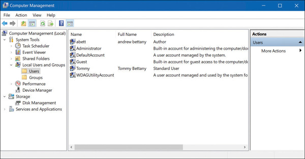
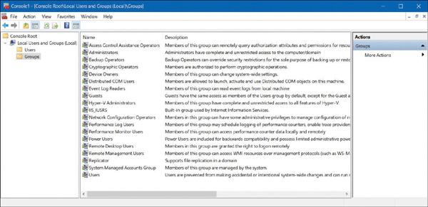
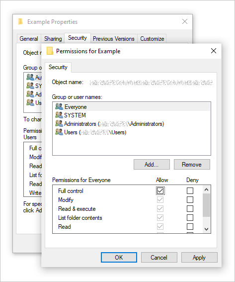

<!-- Сценарий для отложенной рецензии. К4/К5 не пройдены.
     Полный новый показ: 25–35 минут первых объяснений и 55 минут практики.
     При 60 минутах всего: 30 минут объяснений и четыре задачи на 30 минут:
     session-requests (5), dac-matrix (7), mac-operations (7),
     role-transfer (8), вопросы (3).
     Нынешним группам полный повтор семинара 4 не назначается.
     Фрагменты создаются из единственного чернового банка; вручную их не менять.
     Парный sol использует штатную видимость Core/Presentation. Сначала прогноз,
     затем обсуждение; закрытое решение не открывать отдельной ссылкой. -->

## Как система разрешает действие

Одна учётная запись может читать документ и не иметь права изменить его.

При разборе обращения нужны два результата:

- установить, от чьего имени действует запрос;
- применить правило к выбранному объекту и операции.

Успешный вход даёт начало работе с полномочиями записи.

::: {.notes}
Это содержательное начало после титула, без перечня будущих тем.
Для нынешних групп можно использовать его как короткое возвращение,
затем перейти к одной выбранной задаче повторения.
:::

## Три процедуры

| Процедура | Вопрос системы | Пример электронной библиотеки |
|---|---|---|
| **Идентификация** | Какая запись указана? | Найти читателя по логину |
| **Аутентификация** | Пройдено ли предусмотренное подтверждение? | Проверить предъявленный секрет |
| **Авторизация** | Разрешена ли эта операция? | Разрешить чтение выданной книги |

Знание логина помогает указать запись. Подтверждение входа позволяет
пользоваться ею. Разрешение относится к конкретному действию.

[Определения трёх процедур](../theory/access-control.md#sec-draft-access-procedures).

## Сеанс после входа

```text
Подтверждение входа → сеанс записи → последующие запросы
```

Сервис связывает запросы с записью через действующий сеанс.
Условия повторной проверки задаёт сам сервис.

Управление записью, средство входа и уже созданный сеанс — разные
части ситуации. Чтобы оценить действие постороннего, нужно указать,
какой из них ему доступен.

## Материалы курса {.smaller .scrollable}

::: {style="font-size: 0.85em;"}



:::

::: {.notes}
Полный маршрут: 7 минут; сокращённый: 5.
Сначала студенты записывают решения по всем трём запросам.
Затем обсуждаются основания и два браузера.
Канонический разбор — sol-access-control-session-requests в этом включении.
Его не показывать до собственного прогноза аудитории.
:::

## Где должен действовать запрет

```text
Процесс или запрос     Проверка политики       Защищаемый объект
с полномочиями     →   разрешить / отказать →  выполнить операцию
```

**Монитор обращений** применяет политику на защищённом пути к объекту.
Его нельзя обойти или произвольно изменить со стороны обычного субъекта.

Если изменение выполняет сервер, сервер должен проверить полномочие
перед этим изменением. Видимость кнопки в браузере сама по себе
не определяет права серверной операции.

[Монитор обращений](../theory/access-control.md#sec-draft-access-monitor).

## Подтверждение входа

| Вид фактора | Основание проверки |
|---|---|
| Знание | Секрет, который нужно знать |
| Владение | Возможность использовать зарегистрированное средство |
| Биометрический признак | Предусмотренное сопоставление признака пользователя |

Число экранов входа и число разных видов факторов считают отдельно.
Нужно установить все обязательные проверки конкретной процедуры.

[Факторы](../theory/access-control.md#sec-draft-access-factors).

## Код приложения TOTP

При регистрации средство и сервер связывают учётную запись
с общим секретом $K$.

$$ \mathrm{код}=\operatorname{TOTP}(K,t). $$

$K$ — зарегистрированный общий секрет, $t$ — текущее время,
из которого алгоритм получает номер временного интервала.
Средство вычисляет короткий код, сервер проверяет его с учётом
допустимого временного окна.

Для классификации факторов отдельно учитывают,
требует ли само средство обязательный PIN или биометрию.

[RFC 6238, §§ 3–4](https://www.rfc-editor.org/rfc/rfc6238.html#section-3).

## Замена второго шага входа {.smaller .scrollable}



::: {.notes}
Только полный маршрут, 5 минут. В сокращённом пропустить.
До обсуждения собрать шесть ответов о входе; затем классифицировать факторы.
Резерв old-authenticator заменяет эту задачу, а не добавляется к ней.
Канонический разбор — sol-access-control-login-change.
:::

## Пользователь в Windows {.smaller}

{#fig-draft-slide-windows-users fig-alt="В Computer Management выбран раздел Users, справа перечислены учётные записи" width="70%"}

Видно существование записи. Её полномочия на выбранный файл
на этом экране ещё не показаны.

Источник: Andrew Bettany, Andrew Warren, *Exam Ref MD-100 Windows 10*,
2-е изд., [Microsoft Press, 2021](https://www.microsoftpressstore.com/articles/article.aspx?p=3128863),
исходная иллюстрация 2-1. Точная сборка не указана.

## Группа в Windows {.smaller}

{#fig-draft-slide-windows-groups fig-alt="Оснастка MMC показывает имена локальных групп и их описания" width="70%"}

Группа объединяет участников для назначения разрешений.
Список групп ещё не показывает членство отдельного пользователя.

Источник: тот же [фрагмент Microsoft Press](https://www.microsoftpressstore.com/articles/article.aspx?p=3128863),
исходная иллюстрация 2-5; Windows 10, сборка не указана.

## Разрешения объекта в Windows {.smaller}

::: {.columns}
::: {.column width="46%"}

{#fig-draft-slide-windows-permissions fig-alt="В официальной иллюстрации окна разрешений выбран Everyone; ниже видны виды разрешений и столбцы Allow и Deny" height="580"}

:::
::: {.column width="54%"}

Верхний список выбирает пользователя или группу.
Нижняя часть показывает разрешения выбранной записи.

Для фактического решения нужны все применимые выдачи,
членство в группах и дополнительные ограничения.

Источник: [Microsoft Learn](https://learn.microsoft.com/en-us/troubleshoot/windows-client/networking/cannot-access-shared-folder-file-explorer#you-do-not-have-permission-to-access-ipaddress-or-hostname).
Версия самого снимка не названа.

В8 частичен: для цельного показа нужны членство и проверка доступа
на одной версии Windows. [Сценарий захвата](../visuals/windows-demo.md).

:::
:::

## Запрос процесса в Windows {.smaller}

```text
Пользователь и группы → маркер доступа процесса
Объект                → список разрешений DACL
Запрошенная операция  → требуемые права
                       ↓
                  проверка доступа
```

При открытии объекта система может выдать дескриптор с определёнными
правами. Последующие операции используют этот дескриптор.

Поэтому момент изменения ACL и момент получения прав на открытый объект
нужно различать. Модель портала с проверкой текущих назначений
на каждом запросе будет явно задана в его условии.

[Microsoft: маркеры доступа](https://learn.microsoft.com/en-us/windows/win32/secauthz/access-tokens),
[проверка DACL](https://learn.microsoft.com/en-us/windows/win32/secauthz/how-dacls-control-access-to-an-object).

## Дискреционное управление

**DAC:** владелец или другой уполномоченный участник распоряжается
доступом к объекту в установленных пределах.

| Представление назначений | Что выбираем |
|---|---|
| Матрица доступа | Строка — субъект, столбец — объект, клетка — операции |
| ACL объекта | Один объект и перечень субъектов с их разрешениями |
| Строка субъекта | Один субъект и его разрешения на разные объекты |

Запись в содержимое и изменение назначений доступа — разные полномочия.
Обозначения `r` и `w` задают чтение и запись в учебной модели.

::: {.notes}
Не заполнять матрицу следующей задачи заранее.
Матрица и ACL — способы представления; сами по себе они не доказывают DAC.
:::

## Общая папка занятия {.smaller .scrollable}



::: {.notes}
Полный: 8 минут; сокращённый: 7.
Сначала исходная матрица, затем решения трёх шагов, затем итоговая.
Обсудить каждую изменившуюся клетку и основания неизменившихся.
Канонический разбор — sol-access-control-dac-matrix.
:::

## Обязательная политика

**MAC:** обязательные ограничения политики действуют независимо
от обычного усмотрения владельца.

В учебной модели конфиденциальности уровни упорядочены снизу вверх.
Проверка зависит от направления движения информации:

| Действие | Поток | Правило учебной модели |
|---|---|---|
| Чтение | Файл → процесс | Не читать выше уровня процесса |
| Запись без чтения | Процесс → файл | Не писать ниже уровня процесса |
| Редактирование | Прочитать и записать | Пройти обе проверки |

Берётся текущий уровень процесса. Максимальный допуск пользователя
и текущий уровень его процесса — разные величины.

## Каталоги с разными уровнями {.smaller .scrollable}



::: {.notes}
Полный: 10 минут; сокращённый: 7.
Перед ответом студенты заполняют девять клеток и рисуют два направления потока.
Затем обсуждается действие приглашения владельца.
Канонический разбор — sol-access-control-mac-operations.
:::

## Ролевое управление

**RBAC:** разрешения объединяют в роли по обязанностям,
а пользователям назначают эти роли.

```text
пользователь → назначенная роль → разрешение на операцию
```

Смена обязанностей может менять назначения пользователя,
сохраняя разрешения общих ролей для остальных.

Если ролей несколько или есть личные выдачи, нужно знать правило
их совместного применения. Оно задаётся политикой системы.

## Завершение проверки работ {.smaller .scrollable}



::: {.notes}
Полный: 10 минут; сокращённый: 8.
Сначала предложить роли и проверить исходную таблицу.
Затем менять назначения Лены и проверять четыре конечные операции.
Принимать разные точные разложения; число ролей не минимизируется.
Канонический разбор — sol-access-control-role-transfer.
:::

## Закрыть временный доступ {.smaller .scrollable}



::: {.notes}
Только полный маршрут: 8 минут. Сокращённый маршрут завершён после role-transfer.
Требовать прогноз всех пяти строк до общего разбора.
Затем применить изменения Д и новое правило другого проекта.
Канонический разбор — sol-access-control-revoke-paths.
:::

## Проверка рассуждения

Развёрнутый ответ на запрос содержит:

- от чьего имени действует субъект;
- объект и операцию;
- применимые выдачи и ограничения;
- решение и факт, который его определяет.

При изменении доступа отдельно проверяем,
какое назначение поменялось и какой путь разрешения ещё действует.

::: {.notes}
Полный маршрут оставляет 7 минут на проверку матриц и вопросов;
сокращённый — 3 минуты. Времена — оценки для К5.
Для нынешних групп выбрать затруднения; все задачи целиком повторно не назначать.
:::

## Резерв: старый телефон {.smaller .scrollable data-visibility="hidden"}



::: {.notes}
7 минут вместо login-change. Общий запас уменьшается на 2 минуты.
Только после объяснения общего секрета TOTP и действия нового входа.
Канонический разбор — sol-access-control-old-authenticator.
:::

## Резерв: приглашение к чтению {.smaller .scrollable data-visibility="hidden"}



::: {.notes}
7 минут вместо revoke-paths. Это альтернативный акцент внутри бюджета.
Канонический разбор — sol-access-control-delegated-reading.
:::

## Дополнение: пути ролей {.smaller .scrollable data-visibility="hidden"}



::: {.notes}
15–20 минут отдельной работы после основного занятия.
Перед самостоятельной работой объяснить: ребро означает получение прав
роли справа ролью слева; проверяется существование всех путей.
Работа с Casbin или новым ПО не требуется.
Канонический разбор — sol-access-control-role-path-repair.
:::

## Материал преподавателю: маршрут {.smaller data-visibility="hidden"}

| Вариант | Объяснения | Практика |
|---|---:|---|
| Полный первый показ | 25–35 минут | Шесть основных задач и запас, всего 55 минут |
| Всё занятие 60 минут | 30 минут | `session-requests`, `dac-matrix`, `mac-operations`, `role-transfer`, вопросы — 30 минут |
| Нынешние группы после 4 | Короткое возвращение по затруднению | Выбранные задачи повторения к зачёту |

Резерв заменяет указанный основной элемент. Дополнения выполняются
отдельно. Проверка темпа и окончательный выбор показа — предмет К5.

Т1 и определения моделей, показанные здесь, предъявляются на К4.
Подлинные снимки и предел их полноты описаны в
[сценарии Windows](../visuals/windows-demo.md).
