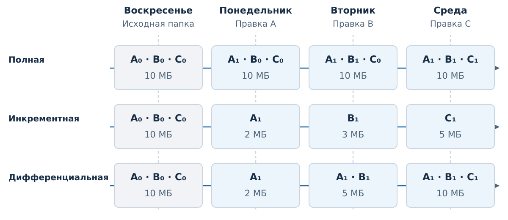
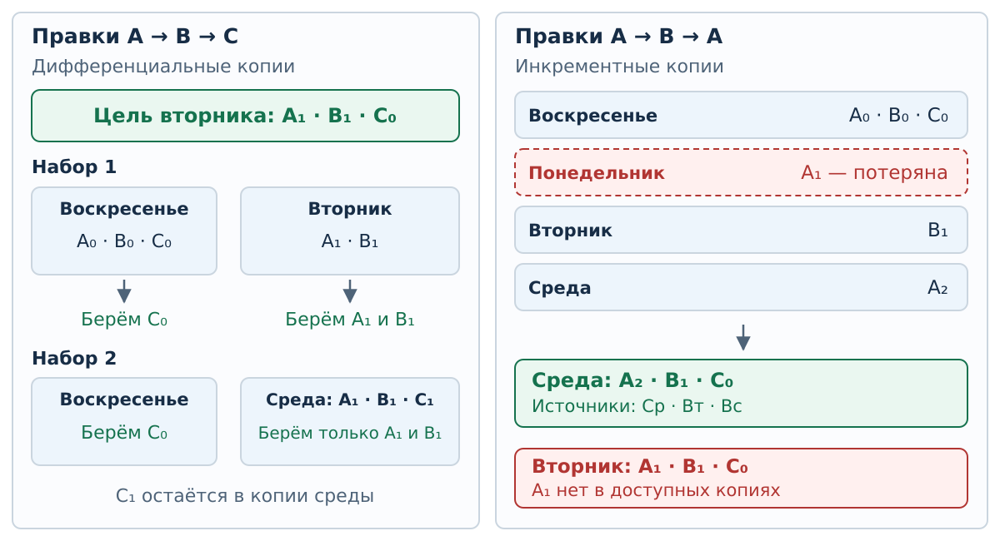
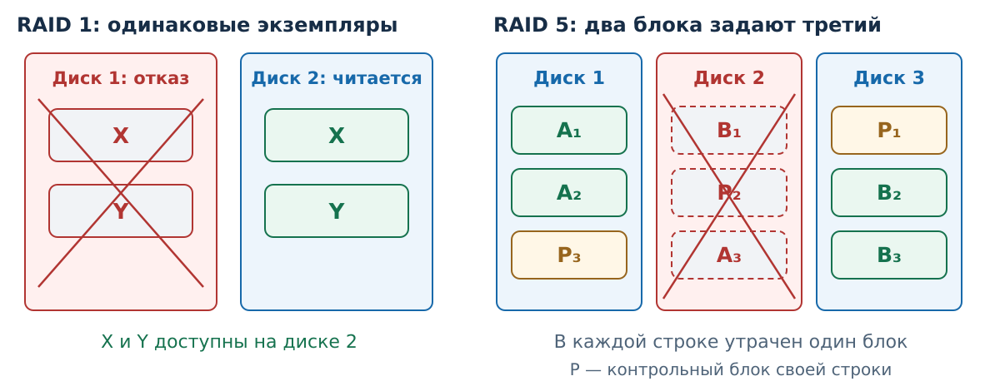
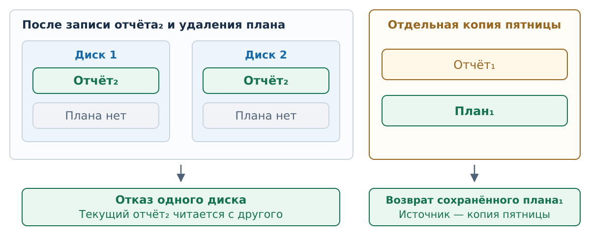
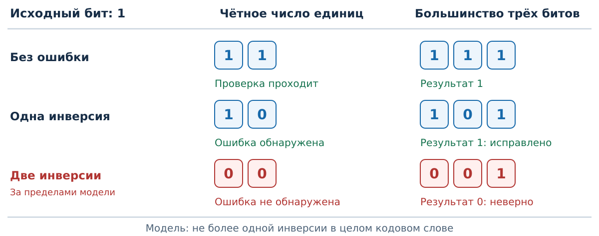

## Возможность вернуться

После отказа носителя нужен уцелевший экземпляр данных.
После нежелательной правки нужна подходящая **прошлая версия**.

Резервная копия сохраняет данные для такого восстановления.
Её полезность проверяют по конкретной цели: какие версии файлов
можно получить из доступных источников?

::: {.notes}
Это черновик С7. Первые объяснения и общие рисунки требуют К4;
полный показ — К5. Слайды не включены в действующее оглавление.
Начальный экран не предполагает предварительного знакомства с утилитой.
Сведения о маршруте и зависимых задачах вынесены в последний скрытый раздел.
:::

## Что означает копия в наших задачах

Индекс — версия файла: **A₀, A₁, A₂** — разные состояния одного A.

Копии создаются после дневных изменений. Каждая сохраняет целые файлы;
из доступной копии можно извлечь **отдельный файл** без других копий.

Размеры файлов в истории постоянны. Сжатия, общих блоков,
удалений и переименований в этой модели нет.

Три схемы сравниваем независимо: у каждой свой набор копий
с воскресной полной в начале. Источники разных схем не смешиваем.

Подробная [модель целых файлов](../theory/backups.md#sec-draft-backups).

## Точка сравнения

| Схема | Что попадает в очередную копию |
|---|---|
| [Полная](../theory/backups.md#def-draft-full-backup) | Все файлы в текущих версиях |
| [Инкрементная](../theory/backups.md#def-draft-incremental-backup) | Текущие версии файлов, изменённых после предыдущей копии |
| [Дифференциальная](../theory/backups.md#def-draft-differential-backup) | Текущие версии файлов, изменённых после последней полной |

Изменился файл — сохраняем его целиком.
Если файл редактировался несколько раз, в новую копию входит
его версия **на момент этой копии**.

## Состав очередной копии {.smaller .scrollable}



## Объём всего набора {.smaller data-visibility="hidden" .scrollable}



::: {.notes}
Резерв на 6 минут вместо missing-copy. Условие расположено перед
следующим разбором. Не включать одновременно со всем основным набором.
:::

## Повторная правка {.smaller data-visibility="hidden" .scrollable}



::: {.notes}
Резерв на 6 минут, если смешивают A₁ и A₂. Использовать перед
recovery-after-reedit, которую в таком маршруте перенести
в самостоятельную практику. Слайд стоит до разбора этой истории.
:::

## Одна история — три состава

{#fig-draft-slide-backup-timeline width=1120 fig-alt="Для полной, инкрементной и дифференциальной схем показаны состав и объём каждой копии от воскресенья до среды на одних правках A, B, C."}

В понедельник неполные копии совпадают. Во вторник точки сравнения
уже дают разный состав. К среде после воскресенья изменились все файлы.

## Сначала задаём результат

[Целевое состояние](../theory/backups.md#def-draft-recovery-target)
указывает **состав папки и версии**.
Например, X₂ и Y₀ — конкретные версии; X₁ и Y₁ им не равны.

Для каждого нужного файла ищем копии с точной версией.
Затем выбираем набор источников, покрывающий всю цель.

Если нужен минимум числа копий, считаем используемые копии.
Файлы и мегабайты — другие величины.

Более поздняя дата источника допустима, если в нём сохранена нужная версия.

## Вернуть вторник {.smaller .scrollable}



## Два способа получить одну папку

Для цели **A₁, B₁, C₀** в дифференциальной схеме подходят:

| Источники | Что берём |
|---|---|
| Воскресенье и вторник | C₀ из воскресенья; A₁ и B₁ из вторника |
| Воскресенье и среда | C₀ из воскресенья; A₁ и B₁ из среды; C₁ не извлекаем |

C не менялся до вторника, но **C₀ всё равно нужен источник**.
Поэтому одной из этих дифференциальных копий недостаточно.

Индивидуальное извлечение позволяет оставить ненужную C₁ в копии.

## Недоступная копия {.smaller .scrollable}



## Назвать недостающую версию

В инкрементной схеме потерянная B₁ не заменяется доступной B₀.
Папка **A₁, B₀, C₁** собрана, но отличается от цели среды.

В дифференциальной схеме **A₁, B₁, C₁** уже есть в среде.
По правилам нашей модели для этой цели достаточно одной копии среды.

Потеря источника мешает точному восстановлению, если нужной версии
больше нет ни в одной доступной копии.

## Более поздняя версия того же файла {.smaller .scrollable}



## Зависимости следуют из версий

{#fig-draft-slide-backup-recovery width=1080 fig-alt="Две дифференциальные альтернативы для вторника истории A, B, C. В истории A, B, A понедельник с A₁ потерян: среда достижима из A₂, B₁, C₀, а вторник недостижим без A₁."}

A₂ хранится целиком. Для цели среды A₁ не нужна;
для цели вторника A₂ не возвращает утраченную A₁.

## Что даёт избыточность дисков

[RAID](../theory/error-control-raid.md#def-draft-raid)
организует несколько дисков в один массив.
Избыточные данные могут позволить пережить отказ диска.

| Схема | Механизм |
|---|---|
| RAID 0 | Разные блоки на разных дисках; избыточности нет |
| RAID 1 | Одинаковые текущие блоки на двух дисках |
| RAID 5 | Данные и контрольные блоки, распределённые по дискам |

Рассматриваем один известный отказ. Остальные диски и сведения
о размещении исправны, записи завершены до отказа.

## Готовый экземпляр или восстановление блока

{#fig-draft-slide-raid-layout width=1150 fig-alt="RAID 1 оставляет готовые X и Y на исправном диске. В RAID 5 в каждой строке после отказа диска 2 остаются два из трёх блоков; контрольный блок относится к своей строке."}

В зеркале читаем другой экземпляр. В RAID 5 получаем утраченный
блок из двух уцелевших блоков **той же строки**.
Текущее состояние и сохранённая история решают разные задачи.

## Собрать папку проекта {.smaller .scrollable}

::: {style="font-size: 0.78em;"}



:::

## Где искать прошлую версию

{#fig-draft-slide-raid-history width=1120 fig-alt="Текущие отчёт₂ и отсутствие плана одинаковы на двух дисках зеркала. Отдельная копия пятницы содержит отчёт₁ и план₁. После отказа одного диска актуальный отчёт читается с другого, сохранённый план возвращается из отдельной копии."}

Запись и удаление меняют текущее состояние зеркала.
Чтобы вернуть прошлую версию, она должна где-то сохраниться.

## Формат реального архива

В задачах читаем целые версии независимо. Реальная утилита
может сохранять изменённые блоки, ссылки и служебные сведения.
Её требования к другим частям архива проверяют отдельно.

[SQL Server](https://learn.microsoft.com/en-us/sql/relational-databases/backup-restore/differential-backups-sql-server?view=sql-server-ver17)
требует базу перед её дифференциальной копией.
[MySQL Enterprise Backup](https://dev.mysql.com/doc/mysql-enterprise-backup/26.7/en/mysqlbackup.incremental.html)
описывает последовательное применение инкрементов к полной копии.

Эти правила относятся к форматам программ. Таблица независимо
извлекаемых файлов сама по себе их не задаёт.

## Восстановить блоки заменённого диска {.smaller data-visibility="hidden" .scrollable}



::: {.notes}
Дополнительные 10–15 минут после RAID, вне основного бюджета.
Условие уже задаёт XOR и все четыре бита каждого доступного блока.
В основной маршрут не добавлять по умолчанию. Лабораторная отложена.
:::

## Кандидаты К4: модель ошибки {data-visibility="hidden"}

Для общего принципа предлагаются **бит чётности и тройное повторение**.
Окончательный выбор ещё не сделан.

При передаче инвертируется не более **одного бита во всём кодовом слове**.
Позиция неизвестна; вставок, удалений и перестановок битов нет.
Получатель видит только принятое слово.

Обнаружить — заметить нарушение правила кода.
Исправить — однозначно получить исходное сообщение в заданной модели.

Подробное [объяснение кандидатов](../theory/error-control-raid.md#def-draft-error-code).

## Кандидаты К4: правила чтения {data-visibility="hidden"}

[Чётность](../theory/error-control-raid.md#def-draft-parity-bit):
добавляем бит, чтобы общее число единиц стало чётным.
Одна инверсия нарушает правило, но не указывает место ошибки.

[Тройное повторение](../theory/error-control-raid.md#def-draft-triple-repetition):
0 → `000`, 1 → `111`. Выбираем большинство.
Одна ошибка оставляет два правильных бита.

За пределами модели вывод меняется: две инверсии могут пройти
проверку чётности или изменить большинство.

Это модели ошибок хранения и передачи; автора сообщения они не подтверждают.

## Предварительный В7 {data-visibility="hidden"}

{#fig-draft-slide-error-control width=1150 fig-alt="Для исходного бита 1 чётность даёт 11, повторение даёт 111. При одной инверсии чётность обнаруживает 10, большинство исправляет 101. Две инверсии, вне модели: 00 проходит чётность, 001 даёт ошибочное большинство 0."}

**Не более одной ошибки** — условие обещанного результата.
Две ошибки показаны для проверки границы этого обещания.
Ручной Хэмминг и CRC не входят в предложение.

## Для преподавателя {data-visibility="hidden"}

### Статус показа

Т5, Т6, В1–В4 требуют К4. Чётность, тройное повторение и В7 —
предварительные кандидаты; три соответствующих экрана скрыты в обычном
показе. С7 требует просмотра К5 после К4. Условия включаются из
подготовленных фрагментов единого банка; ответы остаются в штатных
`sol-*` и обрабатываются Course Presentation.

### Карта зависимых задач

| Опора | Зависимые задачи |
|---|---|
| Т5: целые версии, точка сравнения, объём одной копии | `daily-copies`, `storage-limit`, `repeated-edit` |
| Т5: цель, индивидуальное извлечение, недоступный источник | `restore-tuesday`, `missing-copy`, `recovery-after-reedit` |
| Т6: текущее зеркало и отдельно сохранённая версия | `project-recovery` |
| Т6: контрольный блок своей строки, один известный отказ | Дополнительная `parity-recovery` |
| Кандидаты Т6 и В7 | Отдельная задача не назначена; выбор содержания на К4 |

### Порядок занятия

Основная практика: `daily-copies` (10), `restore-tuesday` (8),
`missing-copy` (8), `recovery-after-reedit` (10), `project-recovery` (8),
вопросы и проверка источников (11) — ориентир 55 минут с обсуждением.
Первые объяснения копий и краткого RAID — ещё 15–20 минут.
Кандидаты кодов в этот бюджет не включены.

При 60 минутах на всё занятие: первые объяснения — 20;
`daily-copies` (10), `restore-tuesday` (8),
`recovery-after-reedit` (9), `project-recovery` (7), вопросы (6).
`missing-copy` переносится в самостоятельную практику.

Скрытые `storage-limit` и `repeated-edit` — замены согласно
[маршруту](../routes.md), а не добавления к основной практике.
Для выбранной замены преподаватель открывает соответствующий экран
и пропускает заменённый. `parity-recovery` — отдельные 10–15 минут;
лабораторная остаётся отложенной отдельной работой.

В1 следует после `daily-copies`; В2 — после трёх задач восстановления.
В4 идёт после `project-recovery`. Разобранная история не предшествует
задаче с теми же данными. Карта зависимостей относится к преподавателю
и не заменяет видимые объяснения на основных слайдах.

### Проверяемые опоры

Источники технических утверждений и границы моделей приведены в
[Т5](../theory/backups.md) и [Т6](../theory/error-control-raid.md).
Для RAID — [документация Intel](https://www.intel.com/content/www/us/en/support/articles/000005867/technologies.html);
для чётности — [MIT 6.02, слайд 12](https://web.mit.edu/6.02/www/currentsemester/handouts/L03_slides.pdf#page=12);
для повторения — [MIT 16.36, слайд 3](https://ocw.mit.edu/courses/16-36-communication-systems-engineering-spring-2009/a49d9e2954b440def3794fe73e79756c_MIT16_36s09_lec13_14.pdf#page=4).
Проверено 8 ноября 2026 года.
