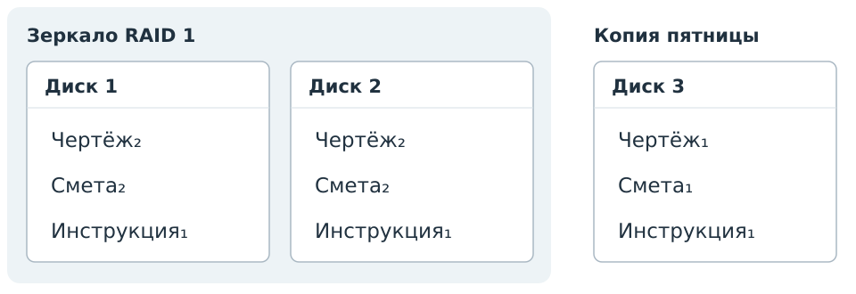
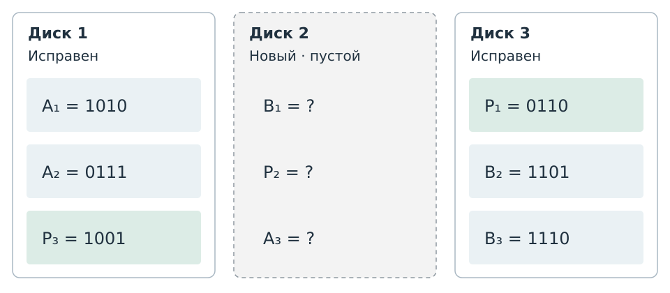

# Резервные копии: порция З7.1

Черновик для содержательного просмотра К1, 8 ноября 2026 года.
Три условия и парные разборы. В опубликованный курс пока не включён.

:::: {#exr-data-preservation-daily-copies difficulty="introductory"}
### Что окажется в копии

В воскресенье сохранена полная копия папки. В следующие три дня
копии создаются после изменений. Копируются целые файлы.

| День | A — 2 МБ | B — 3 МБ | C — 5 МБ |
|---|---|---|---|
| Воскресенье | A₀ | B₀ | C₀ |
| Понедельник | **A₁** | B₀ | C₀ |
| Вторник | A₁ | **B₁** | C₀ |
| Среда | A₁ | B₁ | **C₁** |

Индексы обозначают версии файлов. Жирным выделены обновлённые файлы.

Для понедельника, вторника и среды определите, какие версии файлов
попадут в копию и каков будет её объём при каждой из трёх схем:
полной, инкрементной и дифференциальной.
Когда инкрементная и дифференциальная копии впервые будут различаться по составу?
::::

::: {#sol-data-preservation-daily-copies}
В полную копию входят все файлы папки. В инкрементную — файлы,
изменённые после предыдущей копии. В дифференциальную — файлы,
изменённые после последней полной, то есть после воскресенья.

| День | Полная: файлы и объём | Инкрементная: файлы и объём | Дифференциальная: файлы и объём |
|---|---|---|---|
| Понедельник | A₁, B₀, C₀ — 10 МБ | A₁ — 2 МБ | A₁ — 2 МБ |
| Вторник | A₁, B₁, C₀ — 10 МБ | B₁ — 3 МБ | A₁, B₁ — 5 МБ |
| Среда | A₁, B₁, C₁ — 10 МБ | C₁ — 5 МБ | A₁, B₁, C₁ — 10 МБ |

В понедельник инкрементная и дифференциальная копии совпадают:
после полной копии изменён только A. Во вторник после предыдущей копии
изменён только B, а после полной — уже A и B. Поэтому во вторник
состав этих двух копий впервые различается.

К среде изменены все три файла. Дифференциальная копия этого дня
совпадает с полной по составу и объёму. По одной такой копии
без истории нельзя определить, какая из двух схем применялась.

В таблице указан объём каждой копии отдельно.
:::

:::: {#exr-data-preservation-storage-limit difficulty="intermediate"}
### Хватит ли места до среды

Для резервных копий выделено **24 МБ**. Нужно сохранить все четыре копии:
воскресную полную и по одной за понедельник, вторник и среду.
Копируются целые файлы после изменений.

| День | A — 2 МБ | B — 3 МБ | C — 5 МБ |
|---|---|---|---|
| Воскресенье | A₀ | B₀ | C₀ |
| Понедельник | **A₁** | B₀ | C₀ |
| Вторник | A₁ | **B₁** | C₀ |
| Среда | A₁ | B₁ | **C₁** |

Индексы обозначают версии файлов. Жирным выделены обновлённые файлы.

Рассчитайте суммарный объём четырёх копий для каждой схемы:
ежедневной полной, инкрементной и дифференциальной.
Какие варианты поместятся в 24 МБ?
::::

::: {#sol-data-preservation-storage-limit}
Воскресная полная копия занимает $2+3+5=10$ МБ.
Она сохраняется вместе с тремя последующими копиями.

| Схема | Объёмы копий: Вс, Пн, Вт, Ср | Всего | Помещается в 24 МБ |
|---|---|---:|---|
| Ежедневные полные | 10, 10, 10, 10 МБ | 40 МБ | Нет |
| Инкрементные после полной | 10, 2, 3, 5 МБ | 20 МБ | Да |
| Дифференциальные после полной | 10, 2, 5, 10 МБ | 27 МБ | Нет |

Поместится только инкрементная схема; останется 4 МБ.
Для дифференциальной не хватит 3 МБ, для ежедневной полной — 16 МБ.

Размер папки — 10 МБ. Столько занимает одна полная копия,
но хранить нужно четыре копии. Каждый сохранённый экземпляр файла
занимает место: например, файл A входит во все четыре копии
дифференциальной схемы.
:::

:::: {#exr-data-preservation-repeated-edit difficulty="intermediate"}
### Повторная правка файла

В воскресенье сохранена полная копия. Затем копии создаются ежедневно
после изменений. Копируются целые файлы.

| День | A — 2 МБ | B — 3 МБ | C — 5 МБ |
|---|---|---|---|
| Воскресенье | A₀ | B₀ | C₀ |
| Понедельник | **A₁** | B₀ | C₀ |
| Вторник | A₁ | **B₁** | C₀ |
| Среда | **A₂** | B₁ | C₀ |

Индексы обозначают версии файлов. Жирным выделены обновлённые файлы.

1. Какие версии файлов попадут в копию среды при инкрементной
   и при дифференциальной схеме? Рассчитайте объём каждой копии.
2. Сравните дифференциальные копии вторника и среды.
   Изменился ли их объём? Можно ли считать их содержимое одинаковым?
::::

::: {#sol-data-preservation-repeated-edit}
| Копия | Файлы | Объём |
|---|---|---|
| Инкрементная среды | A₂ | 2 МБ |
| Дифференциальная вторника | A₁, B₁ | 5 МБ |
| Дифференциальная среды | A₂, B₁ | 5 МБ |

После вторничной копии изменён только A. Поэтому в инкрементную копию
среды входит A₂ — 2 МБ.

После воскресной полной менялись A и B. В дифференциальную копию среды
входят их текущие версии A₂ и B₁ — всего 5 МБ. Версия A₁ в неё
не попадает: к среде этот файл уже заменён на A₂.

Дифференциальные копии вторника и среды занимают по 5 МБ,
но содержат разные версии A. Повторная правка изменила данные,
не изменив объём копии. По одинаковому объёму нельзя установить,
что содержимое копий совпадает.
:::

## Для просмотра К1

| Условие | Самостоятельное действие студента | Место в переработке |
|---|---|---|
| `exr-data-preservation-daily-copies` | Применить три разных точки отсчёта, построить состав копий и найти первый день различия | История A → B → C из `exr-data-integrity-backup-chain` использована для новой задачи о создании копий; само восстановление остаётся З7.2 |
| `exr-data-preservation-storage-limit` | Выбрать схемы по ограничению места, различив одну копию и суммарное хранение | Новое условие З7.1 на тех же данных |
| `exr-data-preservation-repeated-edit` | Определить состав копии после повторной правки; различить объём и содержимое копий | Переработка `exr-data-integrity-backup-volume`; повторная правка вводится после простой истории |

Перед задачами нужно объяснить три схемы копирования. Конкретный текст
и общий рисунок относятся к Т5 и В1 и рассматриваются отдельно на К4.
В этой порции проверяются состав и объём копий. Утверждения об обязательности
всех инкрементов, полной копии или порядка восстановления сюда не перенесены.

На К1 проверяется, достаточно ли различаются три учебных действия
и помогает ли одна исходная история перейти от состава к ограничению
места, а затем к повторной правке. Эти шесть задач К1 по двум темам
не образуют обязательного сценария одного занятия.

# Восстановление файлов: порция З7.2

Три задачи о выборе источников. В каждой заданы содержимое копий,
нужные версии файлов и разрешённый способ их извлечения.

:::: {#exr-data-preservation-restore-tuesday difficulty="introductory"}
### Вернуть состояние вторника

Копии содержат целые файлы. Из любой копии можно извлечь отдельный файл.
Индексы обозначают версии.

| День копии | Инкрементная схема | Дифференциальная схема |
|---|---|---|
| Воскресенье, полная | A₀, B₀, C₀ | A₀, B₀, C₀ |
| Понедельник | A₁ | A₁ |
| Вторник | B₁ | A₁, B₁ |
| Среда | C₁ | A₁, B₁, C₁ |

Нужно собрать папку **A₁, B₁, C₀** — состояние вторника.
Для каждой схемы выберите минимальное число копий и укажите,
из какой копии взять каждую версию. Используйте только столбец выбранной схемы.
::::

::: {#sol-data-preservation-restore-tuesday}
| Схема | Минимальный набор | Источники нужных версий |
|---|---|---|
| Инкрементная | Воскресенье, понедельник, вторник — 3 копии | A₁ из понедельника, B₁ из вторника, C₀ из воскресенья |
| Дифференциальная | Воскресенье и вторник — 2 копии | A₁ и B₁ из вторника, C₀ из воскресенья |

В инкрементном столбце каждая нужная версия находится только в одной копии;
все три источника необходимы.

В дифференциальной схеме также подходит **воскресенье и среда**:
из среды можно извлечь A₁ и B₁, оставив ненужную C₁ в копии.
По условию разрешено извлекать отдельные файлы.
Оба набора из двух копий принимаются.

Одной дифференциальной копии недостаточно: C₀ есть только в воскресной,
а в ней нет A₁ и B₁.
:::

:::: {#exr-data-preservation-missing-copy difficulty="intermediate"}
### Копия вторника недоступна

Из каждой доступной копии можно извлекать отдельные целые файлы.
Копии вторника недоступны в обеих схемах.

| День копии | Инкрементная схема | Дифференциальная схема |
|---|---|---|
| Воскресенье, полная | A₀, B₀, C₀ | A₀, B₀, C₀ |
| Понедельник | A₁ | A₁ |
| Вторник | Недоступна | Недоступна |
| Среда | C₁ | A₁, B₁, C₁ |

Нужно состояние среды: **A₁, B₁, C₁**.
Для каждой схемы запишите самые новые доступные версии A, B и C.
Если нужную папку можно собрать, выберите минимальное число копий.
Если нельзя — укажите недостающую версию.
Используйте только столбец выбранной схемы.
::::

::: {#sol-data-preservation-missing-copy}
| Схема | Самые новые доступные версии | Достижимо состояние среды | Основание |
|---|---|---|---|
| Инкрементная | A₁, B₀, C₁ | Нет | B₁ нет ни в одной доступной копии |
| Дифференциальная | A₁, B₁, C₁ | Да | Все три версии есть в копии среды; достаточно одной копии |

Для инкрементной схемы A₁ берётся из понедельника, B₀ — из воскресенья,
C₁ — из среды. Получится папка с устаревшим B₀.
Это доступный результат, но он не совпадает с требуемым состоянием.

В дифференциальной копии среды сохранены все изменённые после воскресенья файлы.
В этом примере это вся нужная папка, поэтому полная копия для её сборки
не требуется. Недоступность вторника не мешает получить B₁ из среды.
:::

:::: {#exr-data-preservation-recovery-after-reedit difficulty="intermediate"}
### Более поздняя версия того же файла

Сохранялись инкрементные копии с целыми файлами.
Из доступной копии можно извлечь любой сохранённый в ней файл.
Копия понедельника потеряна.

| Копия | Сохранённые версии | Доступность |
|---|---|---|
| Воскресенье, полная | A₀, B₀, C₀ | Доступна |
| Понедельник | A₁ | Потеряна |
| Вторник | B₁ | Доступна |
| Среда | A₂ | Доступна |

Нужно проверить два состояния папки:

- вторник: **A₁, B₁, C₀**;
- среда: **A₂, B₁, C₀**.

Какие из них можно собрать из доступных копий?
Для каждого достижимого состояния выберите минимальное число копий
и укажите источники файлов. Для недостижимого укажите недостающую версию.
::::

::: {#sol-data-preservation-recovery-after-reedit}
**Вторник восстановить нельзя:** A₁ находилась только в потерянной копии.
A₀ и A₂ — другие версии; наличие более позднего файла не возвращает A₁.

**Среду восстановить можно из трёх копий:**

| Нужная версия | Источник |
|---|---|
| A₂ | Среда |
| B₁ | Вторник |
| C₀ | Воскресенье |

Каждая нужная версия есть только в указанном источнике,
поэтому использовать меньше трёх копий не получится.
Потерянная A₁ для состояния среды не нужна: требуемая A₂ сохранена целиком.

Потеря одного инкремента в этой модели мешает получить определённую версию,
но не обязательно каждое более позднее состояние.
Решение определяется доступностью нужных версий файлов.
:::

## Для просмотра порции З7.2

| Условие | Проверяемый результат |
|---|---|
| `exr-data-preservation-restore-tuesday` | Минимальный набор источников для заданных версий; два допустимых набора в дифференциальной схеме |
| `exr-data-preservation-missing-copy` | Отличить точное состояние от папки с устаревшим файлом; найти конкретную недостающую версию |
| `exr-data-preservation-recovery-after-reedit` | Сравнить достижимость двух дат после потери одной копии и повторной правки файла |

Это переработка `exr-data-integrity-backup-chain` с разделением учебных действий.
Модель каждой задачи — доступные для отдельного извлечения полные версии файлов.
Оптимизируется число используемых копий, а не объём или порядок работы утилиты.
Так цель восстановления и критерий минимума заданы в самом условии.

В З7.1 сохраняются прежние три пары о составе и объёме копий.
Порции З7.2 и З7.3 приняты пользователем.
Дополнительная практика З7.4 подготовлена ниже;
лабораторная и совместный просмотр наборов 6 и 7 на К2 ещё предстоят.
Первое объяснение копирования Т5 и общий рисунок рассматриваются отдельно на К4.

# Зеркало: порция З7.3

Задача «Собрать папку проекта» со схемой принята пользователем.

:::: {#exr-data-preservation-project-recovery difficulty="intermediate"}
### Собрать папку проекта

Папка проекта хранится на зеркале RAID 1. Есть отдельная копия пятницы.
Индексы обозначают версии файлов.

{#fig-project-storage-before fig-alt="На дисках 1 и 2 зеркала: чертёж₂, смета₂, инструкция₁. В отдельной копии пятницы: чертёж₁, смета₁, инструкция₁."}

Затем произошли три события:

1. В рабочей папке сохранили новую версию чертежа — **чертёж₃**.
2. Из рабочей папки случайно удалили смету.
3. **Диск 1 вышел из строя.**

Нужно собрать папку для продолжения работы. Для каждого файла выберите
самую новую доступную версию и укажите, откуда её взять.
Удастся ли вернуть последнюю сохранённую смету?
::::

::: {#sol-data-preservation-project-recovery}
| Файл | Самая новая доступная версия | Источник |
|---|---|---|
| Чертёж | Чертёж₃ | Диск 2 |
| Смета | Смета₁ | Отдельная копия пятницы |
| Инструкция | Инструкция₁ | Диск 2 или отдельная копия пятницы |

Новый чертёж записан на оба диска зеркала до отказа. Поэтому чертёж₃
доступен на диске 2, а возвращаться к чертежу₁ из копии не требуется.

Удаление сметы также выполнилось на обоих дисках. Последняя сохранённая
смета₂ утрачена; отдельно осталась только смета₁. Папку собрать можно,
но смета в ней будет устаревшей.

Инструкция не менялась. Оба указанных источника содержат одну и ту же
нужную версию; принимается любой из них.
:::

## Состояние порции З7.3

`exr-data-preservation-project-recovery` и парный разбор заменяют
отклонённые условия `mirror-disk-failure` и `mirror-deletion`.
Задача объединяет смысл исходных `exr-data-integrity-mirror-copy`
и `exr-data-integrity-mirror-history`: отказ диска оставляет текущий чертёж,
а распространённое удаление требует прошлой сметы из отдельной копии.

Проверяемый результат — конкретный состав папки и источник каждого файла.
Схема показывает исходные данные; результат трёх событий студент выводит сам.
Она относится только к этой задаче. Первое объяснение RAID и общие рисунки
В3–В4 по-прежнему требуют отдельного просмотра К4.

Шесть принятых пар З7.1–З7.2 сохранены. З7.3 завершена одной принятой
комплексной задачей: она объединяет выбор актуальной версии после отказа
с возвратом прошлой версии после удаления. Дополнительные повторы не нужны.

# Дополнительная практика: порция З7.4.1

Задача о простой сумме снята из самостоятельной практики как слишком
элементарная. Условие о восстановлении диска переработано: заданы
операционная цель, размер блоков, правило для каждой строки и все
доступные значения. Пользователь подтвердил последнюю редакцию для
сохранения текущего результата в PR; лабораторная остаётся отдельной работой.

:::: {#exr-data-preservation-parity-recovery course-role="independent-study" difficulty="intermediate"}
### Восстановить новый диск

В хранилище отказал **диск 2**. Его заменили пустым диском.
Нужно заново записать на него утраченные блоки, используя исправные диски 1 и 3.

В учебной модели каждый блок состоит из **четырёх битов**.
Каждая горизонтальная строка содержит два блока данных $A_i$, $B_i$
и один контрольный блок $P_i$. Индекс $i$ — номер строки.
Для каждой строки выполняется правило

$$
P_i = A_i \oplus B_i,
$$

где $\oplus$ — побитовый XOR. В каждой позиции результат равен 1,
если биты различаются, и 0, если совпадают.
Все доступные значения показаны на схеме. Знаки вопроса обозначают места
блоков, которые нужно записать на новый диск.

{#fig-parity-storage fig-alt="Диск 2 новый и пустой; диски 1 и 3 исправны. Строка 1: A₁ = 1010, B₁ нужно восстановить, P₁ = 0110. Строка 2: A₂ = 0111, P₂ нужно восстановить, B₂ = 1101. Строка 3: P₃ = 1001, A₃ нужно восстановить, B₃ = 1110."}

1. Какие три блока нужно записать на диск 2? Выпишите их сверху вниз,
   указав обозначение, четыре бита и расчёт для каждой строки.
2. В другой строке такой же модели из-за двух отказов сохранился только
   $P = \mathtt{0110}$. Можно ли однозначно восстановить оба блока данных?
   Обоснуйте ответ; если нет — приведите две разные пары четырёхбитных
   $A$ и $B$, совместимые с этим $P$.
::::

::: {#sol-data-preservation-parity-recovery}
В первой строке утрачен блок данных B₁, во второй — контрольный блок P₂,
в третьей — блок данных A₃. Данные из разных строк не смешиваются.

| Строка | Блок для диска 2 | Расчёт | Что записать |
|---|---|---|---|
| 1 | B₁ | A₁ ⊕ P₁ = 1010 ⊕ 0110 | 1100 |
| 2 | P₂ | A₂ ⊕ B₂ = 0111 ⊕ 1101 | 1010 |
| 3 | A₃ | P₃ ⊕ B₃ = 1001 ⊕ 1110 | 0111 |

На новый диск сверху вниз записываются **1100, 1010, 0111**.
Для каждой строки два уцелевших блока однозначно определяют третий:
$A_i \oplus B_i \oplus P_i = \mathtt{0000}$.

Во втором пункте известен только один блок другой строки — $P$.
Две совместимые с ним пары:

| A | B | A ⊕ B |
|---|---|---|
| 0011 | 0101 | 0110 |
| 1111 | 1001 | 0110 |

Обе пары дают сохранённый P, поэтому единственного восстановления нет.
Принимаются любые две разные четырёхбитные пары с XOR, равным 0110.
Всего таких пар 16: каждому A соответствует B = A ⊕ 0110.
:::

## Состояние порции З7.4

| Исходный материал | Решение |
|---|---|
| `exr-data-integrity-sum` | Не переносить в самостоятельные задачи; предложенный вариант `sum-check` снят как элементарный |
| `exr-data-integrity-xor` | Переработан в `exr-data-preservation-parity-recovery`: восстановить содержимое заменённого диска по явно заданной модели |
| `exr-data-integrity-raid-capacity` | Вопрос об объёме убран из задачи восстановления; серию расчётов уровней RAID не переносить |
| `exr-data-integrity-backup` | Лабораторная остаётся отдельной порцией З7.4.2; её результаты и проверочный разбор ещё не подготовлены |

Последняя редакция дополнительной пары подтверждена пользователем
для сохранения в PR. З7.4 остаётся частично выполненной до лабораторной.
Семь принятых основных задач З7.1–З7.3 и их рисунок сохранены.
Выбор простых кодов для объяснения Т6 остаётся отдельным вопросом.
После лабораторной предстоит рассмотреть наборы 6 и 7 вместе на К2.
