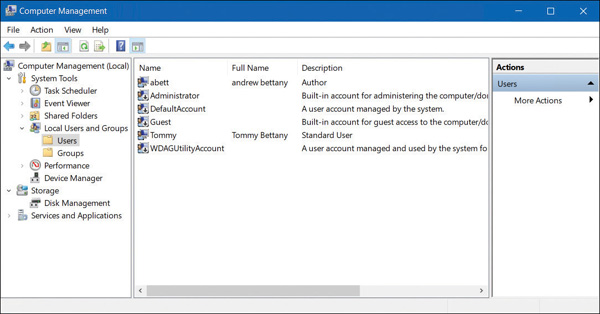
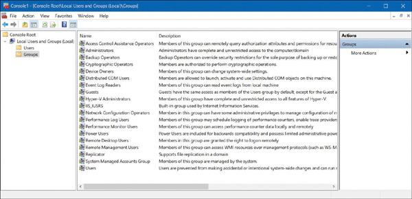
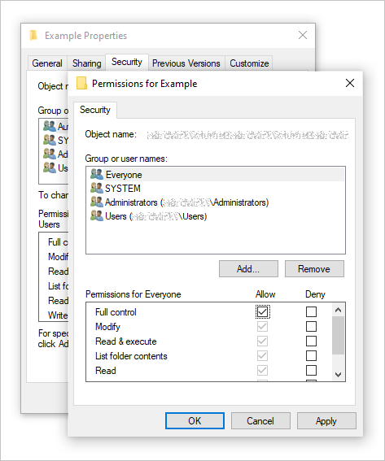

::: {.callout-note}
Содержательный черновик Т1 для К4. Объяснение и иллюстрации ещё не приняты
для действующей теории. Сценарий показа подготовлен отдельно для К5.
:::

# Начало доступа {#sec-draft-access-entry}

Управление доступом связывает действие с тем, кто его выполняет,
и применяет установленное правило. Для этого системе нужно различать
три вопроса: какая учётная запись указана, чем подтверждено право
пользоваться ею и какие операции ей разрешены.

::: {#def-draft-access-account name="Учётная запись"}
**Учётная запись** — запись системы об участнике, с которой связывают
идентификаторы, средства подтверждения входа и полномочия.
:::

Человек может иметь несколько записей, а отдельная запись может
принадлежать службе. Поэтому найденное имя ещё не устанавливает,
кто сейчас действует за компьютером.

## Три процедуры {#sec-draft-access-procedures}

::: {#def-draft-access-identification name="Идентификация"}
**Идентификация** — указание и распознавание идентификатора участника
или его учётной записи.
:::

Например, при входе в электронную библиотеку читатель указывает логин.
Система находит соответствующую запись. Логин помогает выбрать запись
для дальнейшей проверки; его знание само по себе не подтверждает вход.

::: {#def-draft-access-authentication name="Аутентификация"}
**Аутентификация** — проверка предъявленного подтверждения того,
что обращающийся вправе пользоваться указанной учётной записью.
:::

Подтверждением может служить знание пароля или возможность использовать
зарегистрированное средство. Результат проверки относится к заданной
процедуре. Например, парольная проверка устанавливает знание подходящего
секрета, а не физическую личность человека у экрана.

::: {#def-draft-access-authorization name="Авторизация"}
**Авторизация** — определение того, разрешено ли субъекту выполнить
конкретную операцию над конкретным объектом при действующих условиях.
:::

После входа читатель может открыть выданную ему электронную книгу,
но не может изменять каталог библиотеки. Оба запроса относятся к одной
успешно проверенной записи; решение различается из-за операции и объекта.
Успешная аутентификация не заменяет проверку полномочий.

| Процедура | Что поступает на проверку | Что устанавливается |
|---|---|---|
| Идентификация | Идентификатор, например логин | Какая запись указана |
| Аутентификация | Подтверждение, предусмотренное процедурой | Пройдено ли подтверждение входа для записи |
| Авторизация | Субъект, объект, операция и условия | Разрешено ли это действие |

Эти процедуры различаются назначением, а не обязательно числом экранов.
Сервис может определить запись по уже предъявленному средству, а после
входа — использовать сеанс, связывающий последующие запросы с записью.
Сохранённый сеанс позволяет продолжать работу без нового ввода пароля
при каждом действии. Кто получил возможность пользоваться этим сеансом,
может действовать с его полномочиями до предусмотренного прекращения
или ограничения сеанса.

## Подтверждение входа {#sec-draft-access-factors}

::: {#def-draft-access-factor name="Фактор аутентификации"}
**Фактор аутентификации** — вид основания проверки: знание секрета,
владение средством либо биометрический признак пользователя.
:::

Два последовательно введённых секрета проверяют знание. Для сочетания
разных факторов нужны проверки разных видов оснований. При разборе
конкретного средства важно установить, какие проверки обязательны:
например, требуется ли локальный PIN для использования ключа.
Это различие следует из классификации факторов в
[NIST SP 800-63B-4](https://pages.nist.gov/800-63-4/sp800-63b.html#authentication-factor).

TOTP-приложение и сервер располагают общим секретом, а код зависит
также от текущего интервала времени. Поэтому проверяется возможность
предъявить код зарегистрированного средства. Сам код не сообщает
серверу серийный номер физического телефона. Базовое устройство описано
в [RFC 6238, §§ 3–4](https://www.rfc-editor.org/rfc/rfc6238.html#section-3).
Копирование, потеря и замена средства требуют анализа того, какой секрет
сохранился и что именно сервер продолжает принимать.

## Место проверки прав {#sec-draft-access-monitor}

::: {#def-draft-access-request name="Запрос доступа"}
**Запрос доступа** задаёт субъект, защищаемый объект и требуемую операцию.
Субъектом обычно выступает выполняющийся процесс или запрос сервиса,
действующий с определёнными полномочиями; объектом — файл, запись
или другой защищаемый ресурс.
:::

Политика может разрешать процессу просмотр документа и запрещать его
изменение. Теперь нужен механизм, который применит это правило на пути
к документу.

::: {#def-draft-access-monitor name="Монитор обращений"}
**Монитор обращений** — механизм, который посредничает при обращении
субъекта к защищаемому объекту, проверяет запрос по политике
и препятствует запрещённой операции.
:::

Защищённый путь выглядит так:

> процесс с установленными полномочиями → запрос операции →
> проверка политики → разрешённая операция над объектом либо отказ.

Проверка должна охватывать защищаемые пути, быть защищена от изменения
и допускать проверку правильности своей работы. Скрытая кнопка в интерфейсе
не обеспечивает этот контроль: запрос можно отправить другим способом.
Если данные изменяет сервер, решение должно применяться там, где сервер
выполняет защищаемую операцию. Требования полноты посредничества,
защиты и проверяемости сформулированы в
[определении reference monitor у NIST](https://csrc.nist.gov/glossary/term/reference_monitor).

В операционной системе проверка может происходить при получении
дескриптора объекта. В Windows маркер доступа процесса содержит сведения
о пользователе и группах; при проверке запрошенные права сопоставляются
с разрешениями объекта. Полученный дескриптор несёт предоставленные права.
Поэтому нельзя без отдельного условия переносить модель «портал проверяет
текущие назначения на каждом запросе» на каждую последующую запись
через уже открытый дескриптор. См.
[маркеры доступа](https://learn.microsoft.com/en-us/windows/win32/secauthz/access-tokens)
и [проверку DACL](https://learn.microsoft.com/en-us/windows/win32/secauthz/how-dacls-control-access-to-an-object).

## Знакомый интерфейс Windows {#sec-draft-access-windows}

Каталог пользователей показывает, какие записи существуют; каталог групп —
какие группы заведены. Список сам по себе не показывает весь путь получения
конкретного разрешения. Чтобы связать пользователя с правом файла,
нужно увидеть членство в группе и запись разрешения на нужном объекте.
Назначение прав пользователям и группам описано в
[обзоре управления доступом Windows](https://learn.microsoft.com/en-us/windows/security/identity-protection/access-control/access-control).

{#fig-draft-access-windows-users fig-alt="Подлинный экран Computer Management: в Local Users and Groups выбран Users, справа видны имена учётных записей" width="85%"}

{#fig-draft-access-windows-groups fig-alt="Подлинный экран оснастки Local Users and Groups: выбран Groups, справа перечислены группы и их описания" width="85%"}

Оба снимка взяты без изменения из открытого фрагмента книги Andrew Bettany
и Andrew Warren, *Exam Ref MD-100 Windows 10*, 2-е издание:
[Manage devices and data](https://www.microsoftpressstore.com/articles/article.aspx?p=3128863),
исходные иллюстрации 2-1 и 2-5. Точная сборка Windows в источнике не указана.
Эти снимки показывают каталоги; состав выбранной группы на них не открыт.

{#fig-draft-access-windows-permissions fig-alt="Официальная иллюстрация Security: выбран Everyone, ниже показаны флажки разрешений выбранной записи" width="60%"}

В @fig-draft-access-windows-permissions сверху выбран субъект `Everyone`,
снизу показаны его разрешения для объекта. Это состояние из диагностического
[материала Microsoft Learn](https://learn.microsoft.com/en-us/troubleshoot/windows-client/networking/cannot-access-shared-folder-file-explorer#you-do-not-have-permission-to-access-ipaddress-or-hostname);
версия Windows для самого снимка не названа. Иллюстрация позволяет найти
запись субъекта и вид операции. Чтобы установить фактический доступ
конкретного процесса, дополнительно учитывают другие применимые записи,
членство в группах и действующие ограничения.

Полноценный показ на одной версии Windows ещё требует снимка членства
в группе и проверки обращения. Поэтому В8 подготовлен частично;
точные параметры будущего захвата находятся в
[сценарии Windows](../visuals/windows-demo.md).

## Материал преподавателю: зависимые задачи

Этот раздел служит карте согласования К4 и не входит в основное изложение.

| Понятие или показ | Зависимые идентификаторы |
|---|---|
| Три процедуры, сеанс, место проверки | `exr-access-control-session-requests` |
| Виды факторов и TOTP | `exr-access-control-login-change`, `exr-access-control-old-authenticator` |
| Субъект, объект, операция; различие содержания и назначения прав | `exr-access-control-dac-matrix`, `exr-access-control-delegated-reading` |
| Применение нескольких условий авторизации | `exr-access-control-mac-operations`, `exr-access-control-role-transfer`, `exr-access-control-revoke-paths` |

Для последних пяти условий дополнительно требуются определения DAC, MAC,
RBAC и правила их учебных моделей. Их краткое первое объяснение включено
в черновой сценарий С4; оно также выносится на К4. Детальный разбор
проверки Windows и устройства дескрипторов не становится новой
самостоятельной обязательной задачей.
