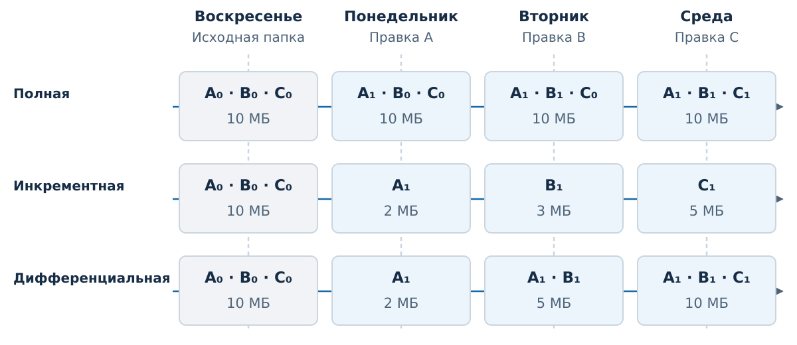
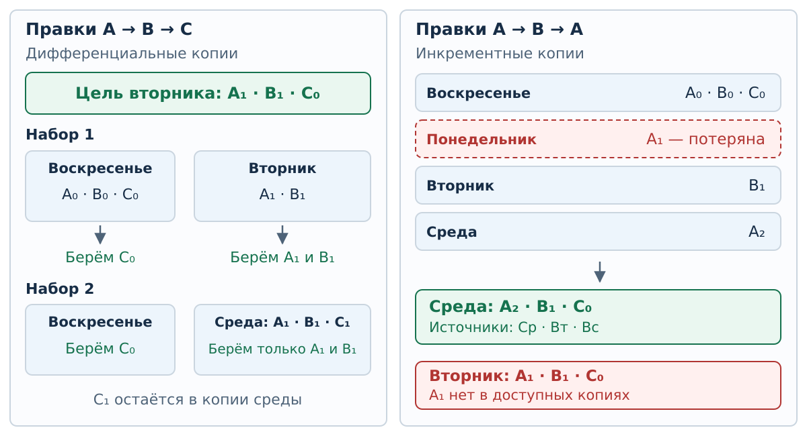

# Резервные копии {#sec-draft-backups}

::: {.callout-note}
Черновик Т5 для отдельного просмотра К4. Текст и общие рисунки ещё
не согласованы для применения в курсе. Ниже описана учебная модель
целых файлов, а не формат архива конкретной программы.
:::

## Возможность вернуться к сохранённым данным

После отказа носителя нужна уцелевшая копия данных. После ошибочной
правки или удаления нужна подходящая **прошлая версия**. Одна актуальная
рабочая папка не обеспечивает оба результата: успешная запись новой
версии ещё ничего не говорит о сохранности прежней.

::: {#def-draft-backup name="Резервная копия"}
Резервная копия — сохранённый экземпляр данных, предназначенный
для их восстановления после утраты или нежелательного изменения.
:::

Важно установить, что сохраняется, за какой момент времени и откуда
это удастся прочитать после рассматриваемого события. Само название
«копия» не гарантирует независимости: отказ общего носителя может
сделать недоступными и рабочую папку, и её копию. Назначение копирования
и восстановления соответствует [объяснению Microsoft](https://support.microsoft.com/en-us/windows/experience/backup-recovery/backup-restore-and-recovery-in-windows).
Различие между сохранённой версией и текущим зеркалом рассмотрено
в [разделе о RAID](error-control-raid.md#sec-draft-raid-history).

## Что именно хранит учебная копия

Во всех примерах этого подраздела действуют одни правила.

- Папка содержит файлы A, B и C. Индекс обозначает версию: A₀, A₁,
  A₂ — разные сохранённые состояния одного файла A.
- После дневных изменений создаётся копия. В ней лежат **целые файлы**
  в их состоянии к этому моменту, а не команды правки или разности байтов.
- Из любой доступной копии можно извлечь отдельный файл. Извлечение
  A₁ не требует брать из той же копии B или C.
- Содержимое доступных копий известно. Выбранные файлы не требуют
  других копий для чтения; это отдельное предположение модели.
- Размеры A, B и C постоянны: 2, 3 и 5 МБ. Служебный объём, сжатие
  и совместное хранение одинаковых частей не учитываются.
- В этой истории файлы только редактируются. Удаление и переименование
  потребовали бы отдельно задать, как запоминается состав папки.

Три схемы ниже сравниваются **независимо на одной истории**. В каждой
воскресенье начинает свой набор полной копией. Инкрементная схема затем
сравнивает состояние с предыдущим днём, дифференциальная — с воскресеньем.
Копии разных схем при восстановлении не смешиваются.

## Правила создания копии

::: {#def-draft-full-backup name="Полная копия"}
Полная копия содержит все выбранные для копирования данные в их текущем
состоянии. В нашей модели — все файлы папки с текущими версиями.
:::

::: {#def-draft-incremental-backup name="Инкрементная копия"}
Инкрементная копия сохраняет изменения после предыдущей копии.
В нашей модели в неё целиком входят файлы, изменённые с прошлого дня,
каждый в своей текущей версии.
:::

::: {#def-draft-differential-backup name="Дифференциальная копия"}
Дифференциальная копия сохраняет изменения после последней полной копии.
В нашей модели в неё целиком входят файлы, которые редактировались
после воскресенья, каждый в своей текущей версии.
:::

Различается точка сравнения. Если A изменён в понедельник и не менялся
во вторник, во вторничную инкрементную копию он не входит, а
в дифференциальную входит снова. Если A отредактирован второй раз,
в очередной копии сохраняется текущая A₂, а не две версии A₁ и A₂.
Общие названия методов и зависимость реальных форматов от источника
и места хранения описаны в [документации Acronis](https://www.acronis.com/en/support/documentation/AcronisCyberProtect_16/backup-schemes.html).

## История A → B → C

Стрелка здесь означает **очерёдность правок файлов**, а не превращение
содержимого A в B. В понедельник изменяется A, во вторник B, в среду C.

| Состояние после изменений | A, 2 МБ | B, 3 МБ | C, 5 МБ |
|---|---|---|---|
| Воскресенье | A₀ | B₀ | C₀ |
| Понедельник | A₁ | B₀ | C₀ |
| Вторник | A₁ | B₁ | C₀ |
| Среда | A₁ | B₁ | C₁ |

Применим каждое правило к этой истории.

| День копии | Полная | Инкрементная | Дифференциальная |
|---|---|---|---|
| Воскресенье | A₀, B₀, C₀; 10 МБ | A₀, B₀, C₀; 10 МБ | A₀, B₀, C₀; 10 МБ |
| Понедельник | A₁, B₀, C₀; 10 МБ | A₁; 2 МБ | A₁; 2 МБ |
| Вторник | A₁, B₁, C₀; 10 МБ | B₁; 3 МБ | A₁, B₁; 5 МБ |
| Среда | A₁, B₁, C₁; 10 МБ | C₁; 5 МБ | A₁, B₁, C₁; 10 МБ |

{#fig-draft-backup-timeline fig-alt="Три параллельные шкалы от воскресенья до среды. Полные копии содержат по три текущих файла. Инкременты после воскресенья: A₁, B₁, C₁. Дифференциальные: A₁; A₁ и B₁; A₁, B₁ и C₁. У каждой копии указан её объём."}

В понедельник оба неполных метода дают A₁. Во вторник инкремент содержит
только новую B₁, а дифференциальная копия ещё раз сохраняет A₁.
К среде дифференциальная копия содержит всю папку: с воскресенья
изменился каждый файл. Это вывод из конкретной истории, а не свойство
каждой дифференциальной копии.

Объём одной копии и объём всех хранимых копий — разные величины.
Например, инкремент среды занимает 5 МБ, но вместе с воскресной полной
и двумя предыдущими инкрементами сохранено 10 + 2 + 3 + 5 = 20 МБ.
Аналогично четыре полные копии занимают 40 МБ, четыре копии
дифференциальной схемы — 27 МБ. В этой модели каждый повторно
сохранённый экземпляр файла занимает место целиком.

## Целевая версия определяет источники

::: {#def-draft-recovery-target name="Целевое состояние восстановления"}
Целевое состояние восстановления — требуемый состав данных с указанными
версиями. Для папки A₁, B₁, C₀ недостаточно получить любые три файла
с именами A, B и C: каждая версия должна совпасть с требуемой.
:::

Восстановление начинаем с целевого состояния, затем для каждого файла
ищем доступные копии **именно нужной версии**. После этого выбираем
набор копий, покрывающий все требуемые файлы. Если задан минимум числа
копий, считаем используемые копии, а не файлы или мегабайты.

На истории A → B → C состояние среды A₁, B₁, C₁ собирается из трёх
инкрементов: A₁ из понедельника, B₁ из вторника, C₁ из среды.
Каждая нужная версия здесь встречается в одном инкременте, поэтому
все три необходимы. Воскресная копия не нужна: в цели нет её версий.
Для дифференциальной схемы достаточно одной среды, содержащей все три
требуемые версии. Так видно, почему правило «полная плюс все последующие»
нельзя подставлять вместо проверки данных нашей модели.

### Восстановить вторник

Цель — A₁, B₁, C₀. Файл C не менялся до этой даты, но его C₀ всё равно
нужно откуда-то прочитать.

| Схема | Минимальный набор | Что извлекаем |
|---|---|---|
| Инкрементная | Воскресенье, понедельник, вторник | C₀ из воскресенья; A₁ из понедельника; B₁ из вторника |
| Дифференциальная | Воскресенье и вторник | C₀ из воскресенья; A₁ и B₁ из вторника |
| Дифференциальная, другой минимум | Воскресенье и среда | C₀ из воскресенья; A₁ и B₁ из среды; C₁ не извлекаем |

Более поздняя копия пригодна, если в ней сохранилась нужная версия.
Дата самой копии не обязана совпадать с датой цели. Среда подходит
для A₁ и B₁, но её C₁ не подходит вместо C₀.

Минимум в инкрементной схеме равен трём: каждая версия есть только
в своём источнике. В дифференциальной — двум: C₀ есть только
в воскресенье, а A₁ и B₁ в воскресенье отсутствуют. Оба указанных
набора из двух копий достигают цели.

### Потерять источник

Пусть вторничная копия недоступна, а цель — состояние среды
A₁, B₁, C₁. В инкрементной схеме A₁ можно взять из понедельника,
C₁ из среды, но B₁ больше негде взять. Доступная B₀ из воскресенья
не равна требуемой B₁. Папка A₁, B₀, C₁ пригодна лишь как результат
с потерей последней версии B; точным восстановлением среды она не является.

В дифференциальной схеме все нужные версии есть в среде.
Недоступный вторник не мешает восстановлению. В этой истории достаточно
одной копии среды: ни воскресенье, ни понедельник для цели не нужны.

## Повторная правка: A → B → A

Теперь в среду снова правят A, получая **новую A₂**. Это не возврат к A₀.
C всё время остаётся C₀. Инкрементные копии содержат:

| Копия | Сохранённые целые версии |
|---|---|
| Воскресенье, полная | A₀, B₀, C₀ |
| Понедельник | A₁ |
| Вторник | B₁ |
| Среда | A₂ |

Цель вторника A₁, B₁, C₀ требует воскресенья, понедельника и вторника.
Цель среды A₂, B₁, C₀ требует воскресенья, вторника и среды.
Понедельник для среды не нужен: A₂ хранится целиком, её не надо строить
из A₁. Неизменный C₀ в обеих целях требует воскресенья.

Если понедельник потерян, вторник восстановить нельзя: A₁ нет
в доступных копиях. Среду восстановить можно из трёх оставшихся копий.
Наличие A₂ не возвращает A₁, зато потеря A₁ не мешает прочитать A₂.

{#fig-draft-backup-recovery fig-alt="Слева два набора дифференциальной схемы для цели вторника A₁, B₁, C₀: воскресенье и вторник либо воскресенье и среда с отдельным извлечением. Справа инкременты истории A, B, A с потерянным понедельником: среда A₂, B₁, C₀ достижима, вторнику недостаёт A₁."}

Зависимость определяется доступностью требуемых версий. Чтобы утверждать,
что потеря копии препятствует восстановлению, нужно назвать потерянную
версию и проверить, есть ли она в другом доступном источнике.

## Где заканчивается учебная модель

Реальная программа может хранить изменённые блоки, ссылки на общие
данные и служебные сведения. Тогда даже извлечение одного файла
может требовать других частей архива. Например, [MySQL Enterprise Backup](https://dev.mysql.com/doc/mysql-enterprise-backup/26.7/en/mysqlbackup.incremental.html)
описывает подготовку полной копии и последовательное применение
инкрементов; [SQL Server](https://learn.microsoft.com/en-us/sql/relational-databases/backup-restore/differential-backups-sql-server?view=sql-server-ver17)
требует восстановить базу перед её дифференциальной копией.
Это правила соответствующих реализаций. Они не следуют из наших
таблиц целых независимо извлекаемых файлов и не отменяются ими.

Практический вывод проверяют восстановлением выбранных данных
в отдельное место: наличие архива ещё не доказывает достижимость цели.
[Microsoft](https://learn.microsoft.com/en-us/sql/relational-databases/backup-restore/back-up-and-restore-of-sql-server-databases?view=sql-server-ver17)
отдельно указывает пробное восстановление при проверке копий БД.
Способ чтения архива и допустимые комбинации копий задаёт документация
выбранной утилиты.

## Опоры для просмотра К4

Технические источники проверены 8 ноября 2026 года. Определения методов
сопоставлены с документацией разработчиков; составы и минимальные наборы
выше выведены из отдельно заданной учебной модели. Для К4 остаются
объём первого объяснения, читаемость двух рисунков и достаточность
явного различения модели файлов и форматов программ.
