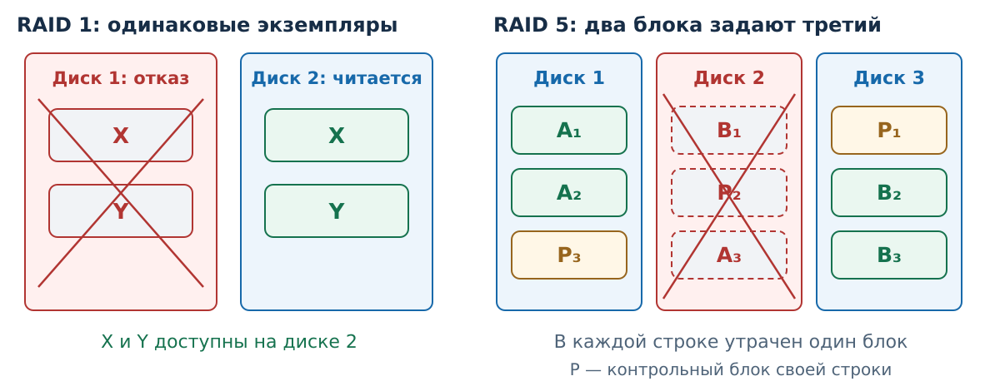
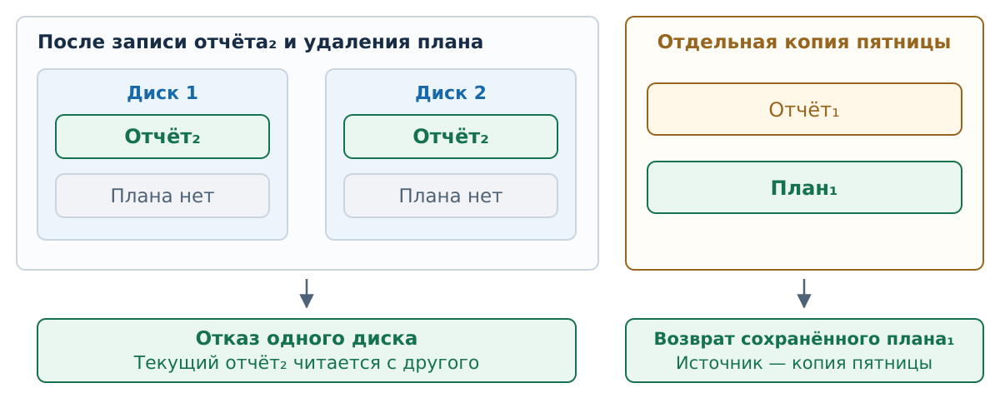
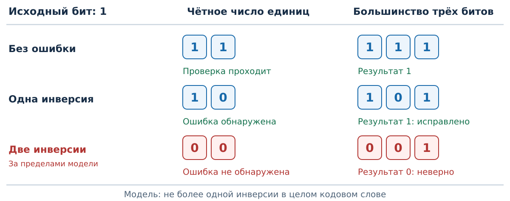

# Избыточность хранения {#sec-draft-storage-redundancy}

::: {.callout-note}
Черновик Т6 для К4. Краткий RAID предложен для основного объяснения.
Бит чётности и тройное повторение — **кандидаты**, окончательный
набор простых кодов не выбран. В7 — предварительный рисунок этих
кандидатов; его применение также требует К4.
:::

## Данные после отказа диска

Если единственный экземпляр блока находился на отказавшем диске,
прочитать его с этого диска нельзя. Избыточность заранее сохраняет
дополнительные сведения: ещё один экземпляр блока либо данные,
из которых утраченный блок можно восстановить.

::: {#def-draft-raid name="RAID"}
RAID — способ организации нескольких дисков в общий массив с выбранным
правилом размещения данных. Некоторые уровни хранят избыточные сведения,
позволяющие продолжить работу при определённых отказах дисков.
:::

В нашем обзоре отказавший диск известен, остальные диски и сведения
о размещении блоков исправны, записи завершены до отказа. Это модель
потери известного источника, а не незаметного искажения неизвестного бита.

| Размещение | Что хранится | Результат одного отказа в показанной модели |
|---|---|---|
| RAID 0 | Разные блоки на разных дисках, без избыточности | Часть данных теряется; полного набора больше нет |
| RAID 1, два диска | Два одинаковых экземпляра текущих данных | Данные читаются с исправного диска |
| RAID 5, три диска | Блоки данных и распределённые контрольные блоки | Утраченные блоки восстанавливаются по уцелевшим |

Размещение и возможность выдержать один отказ для RAID 1 и RAID 5
соответствуют [описанию Intel](https://www.intel.com/content/www/us/en/support/articles/000005867/technologies.html).
Механизмы восстановления избыточности после потери диска также отражены
в [документации Linux MD](https://docs.kernel.org/admin-guide/md.html).
Здесь не сравниваются скорости и ёмкости всех уровней.

{#fig-draft-raid-layout fig-alt="Слева два диска RAID 1 содержат одинаковые блоки X и Y; диск 1 отказал, диск 2 читается. Справа RAID 5: в каждой строке два блока данных и один контрольный, положение контрольного блока меняется. Диск 2 недоступен, в каждой строке уцелели два блока для восстановления третьего."}

В зеркале RAID 1 после отказа не требуется выводить содержимое блока:
его готовый экземпляр есть на другом диске. В показанном RAID 5
контрольный блок относится к своей строке. Два доступных блока
позволяют получить третий; брать блок из соседней строки нельзя.
Контрольные блоки распределены по дискам, отдельного постоянного
«диска чётности» в этой схеме нет.

Для дополнительного разбора можно ввести одно правило:
$P = A \oplus B$. Здесь A и B — два блока одной строки, P — её
контрольный блок; все блоки равной длины, XOR выполняется отдельно
в каждой битовой позиции. Зная любые два блока, можно восстановить
третий. Если в строке остался только P, единственного ответа уже нет:
разные пары A и B могут давать один P. Ручное применение этого
правила не является обязательной основой занятия.

## История версий вне зеркала {#sec-draft-raid-history}

Зеркало хранит одно текущее логическое состояние в двух экземплярах.
Если программа успешно записала новую версию файла, она становится
текущей на обоих дисках. Если файловая система успешно удалила файл,
его нет в доступной рабочей папке на обоих дисках. Отказ одного диска
после этих операций сохраняет возможность прочитать **текущее**
состояние с другого; сам по себе он не возвращает удалённое.

Для возврата к прошлой версии её нужно сохранить отдельно — например,
в [резервной копии](backups.md#def-draft-backup). Это другая задача:
выбрать требуемый момент и найти соответствующие версии, как в
[модели восстановления](backups.md#def-draft-recovery-target).

{#fig-draft-raid-history fig-alt="Рабочая папка после записи отчёта₂ и удаления плана одинаково представлена на двух дисках зеркала. Отдельная копия пятницы сохраняет отчёт₁ и план₁. Исправный диск даёт текущий отчёт₂, отдельная копия даёт сохранённый план₁."}

В примере рисунка рабочий отчёт₂ новее отчёта₁ в отдельной копии.
Поэтому для продолжения работы его берут с исправного диска.
Удалённый план₁ можно прочитать из копии пятницы. Если после пятницы
существовал другой план, но его версия нигде не сохранена, рисунок
не даёт оснований обещать её возврат.

Такой разбор относится к обычному зеркалу без отдельно заданной
истории версий. Снимки, журнал версий и специальные средства восстановления
нельзя молча приписывать RAID: их наличие и правила нужно оговорить.

## Кандидаты К4: обнаружить ошибку или исправить её

У следующей модели другая неисправность: при хранении или передаче
**неизвестная позиция меняет 0 на 1 либо 1 на 0**. В основном примере
допускается не более одной такой ошибки во всём переданном кодовом слове.
Вставок и потерь битов нет, порядок и длина известны. Проверяющий
видит только полученное слово, а не исходное сообщение.

::: {#def-draft-error-code name="Код с избыточностью"}
Код с избыточностью сопоставляет сообщению более длинное кодовое слово.
Дополнительные биты позволяют обнаружить или исправить определённые
ошибки при явно заданных ограничениях на их число и вид.
:::

**Обнаружить** — установить, что полученное слово нарушает правило кода.
**Исправить** — однозначно получить исходное сообщение в принятой модели.
Второе требует больше сведений, чем первое.

### Кандидат 1: бит чётности

::: {#def-draft-parity-bit name="Бит чётности"}
При контроле чётного числа единиц к сообщению добавляют один бит,
чтобы во всём кодовом слове число единиц было чётным. Проверяющий
пересчитывает единицы и отвергает слово с нечётным результатом.
:::

Для сообщения `1011` добавляется 1: слово `10111` содержит четыре
единицы. Без изменений проверка проходит. Если ровно один бит
инвертирован, число единиц становится нечётным — ошибка обнаружена,
включая случай ошибки самого проверочного бита.

Но её место неизвестно. Полученное `10011` могло появиться из `10111`
после изменения третьего бита или из `10010` после изменения последнего.
Оба исходных слова имеют чётное число единиц и кодируют разные сообщения.
Единственный правильный вариант по полученному слову не выбрать.

Граница предположения видна на двух ошибках: `10111` → `01111`.
Число единиц осталось чётным, хотя сообщение изменилось. Прохождение
проверки означает отсутствие обнаруженного нарушения; без ограничения
на ошибки оно не гарантирует неизменность. Этот принцип приведён
в [лекции MIT 6.02, слайд 12](https://web.mit.edu/6.02/www/currentsemester/handouts/L03_slides.pdf#page=12).

### Кандидат 2: тройное повторение

::: {#def-draft-triple-repetition name="Тройное повторение"}
Каждый исходный бит заменяется тремя одинаковыми битами: 0 → `000`,
1 → `111`. При чтении выбирают значение, которое встречается
в тройке хотя бы два раза.
:::

Если в тройке нет ошибки, большинство равно исходному биту.
Если испорчен один бит, два других сохраняют исходное значение.
Например, 1 → `111` → `101` → 1. Для сообщения из нескольких битов
правило применяется к каждой тройке; обещание исправления требует
не более одной ошибки в каждой тройке. Наше более строгое исходное
условие «не более одной во всём слове» это обеспечивает.

Две ошибки в одной тройке уже могут дать неверное большинство:
1 → `111` → `001` → 0. По `001` проверяющий не знает, было ли
это две ошибки от `111` или одна от `000`. Смысл повторения и выбор
большинства описаны в [лекции MIT 16.36, слайд 3](https://ocw.mit.edu/courses/16-36-communication-systems-engineering-spring-2009/a49d9e2954b440def3794fe73e79756c_MIT16_36s09_lec13_14.pdf#page=4).

{#fig-draft-error-control fig-alt="Один исходный бит 1. Чётность кодирует его словом 11: без ошибки 11 проходит, одна ошибка даёт 10 и обнаруживается, две дают 00 и не обнаруживаются. Тройное повторение кодирует 111: без ошибки большинство 1, при одной ошибке 101 большинство 1, при двух 001 большинство 0 и ошибочно. Последняя строка выходит за модель одной ошибки."}

Это простые модели случайных ошибок. Они не подтверждают автора,
не обеспечивают защиту от сознательной подмены и не заменяют
криптографические проверки. Для основной практики копирования
расчёт таких кодов не требуется; ручной Хэмминг и CRC не предлагаются.

## Опоры для просмотра К4

Источники разработчиков и учебные материалы MIT проверены 8 ноября
2026 года. Примеры битовых слов посчитаны отдельно. Решения для К4:
достаточны ли две обзорные схемы RAID; включать ли оба кандидата,
один из них или только общий принцип; достаточно ли короткого показа
без отдельной вычислительной задачи. До этого выбора В7 остаётся
предварительным, а коды не считаются принятой частью занятия.
