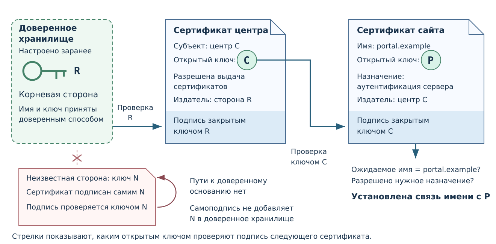
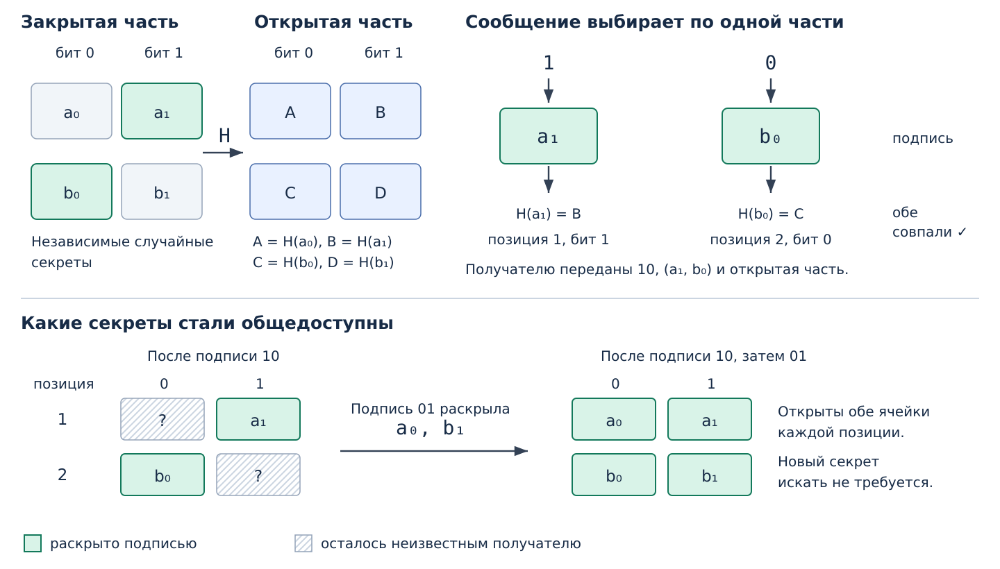

# Цифровая подпись {#sec-draft-signature}

> **ЧЕРНОВИК Т4 для К4.** Лэмпорт и сертификаты впервые объясняются
> в новом блоке доверия. Текст и рисунки не приняты и не перенесены
> в действующий курс.

## Открытая проверка {#sec-draft-signature-check}

Подпись нужна, когда данные следует связать с определённым ключом,
а проверку должны выполнять участники, которым нельзя передавать
секрет подписывающего. Для неё используется
[пара асимметричных ключей](integrity-keys.md#def-draft-public-key-pair).

::: {#def-draft-digital-signature name="Цифровая подпись"}
Цифровая подпись — результат криптографической операции над данными
с закрытым ключом, который можно проверить по этим данным и соответствующему
открытому ключу. Стойкая схема должна препятствовать созданию допустимой
подписи новых данных без закрытого ключа.
:::

Автор передаёт данные $m$ и подпись $s$; проверяющий использует открытый
ключ $K$. Правило $\operatorname{Verify}(K,m,s)$ возвращает результат
«проверка прошла» или «отказ». Все три входа существенны: результат
для другого файла либо другого ключа проверяется заново.

Это проверка соответствия конкретных байтов и ключа. Для вывода о человеке
или организации дополнительно устанавливают принадлежность ключа,
а для решения о приёме документа — применимые правила системы.
Подпись не определяет правильность содержания. Её не следует объяснять
как «шифрование документа закрытым ключом»: это отдельная операция,
а результат подписи не предназначен для сокрытия документа.

## Одноразовая схема Лэмпорта {#sec-draft-lamport}

Устройство подписи можно показать через знакомое хеширование. В учебной
модели $H$ — условная односторонняя функция: вычислить $H(x)$ легко,
а найти подходящий секрет по открытому результату практически трудно.
Буквы обозначают значения, а не операцию над алфавитом.

Сначала рассмотрим **первый бит**. Независимо и случайно выбирают два
секрета $a_0$ и $a_1$. Для бита 0 раскрывают $a_0$ и проверяют
$H(a_0)=A$; для бита 1 раскрывают $a_1$ и проверяют $H(a_1)=B$.
Буквы $A$ и $B$ — опубликованные результаты хеширования этих секретов.

Для второй позиции выбирают свою независимую пару $b_0$, $b_1$;
открытые результаты — $H(b_0)=C$ и $H(b_1)=D$. Закрытый ключ
содержит четыре секрета, открытый — четыре значения $A$, $B$, $C$, $D$.
В подпись двухбитового сообщения входят два секрета, выбранных
по его битам. Проверка сообщения проходит, только если совпали оба хеша
с ячейками своих позиций и битов.

::: {#def-draft-lamport-one-time name="Одноразовый ключ Лэмпорта"}
Ключ схемы Лэмпорта предназначен для подписи одного сообщения.
Для нового сообщения создают новую пару ключей. Проверять уже созданную
подпись можно многократно.
:::

Подпись раскрывает часть секретов. При подписании другого сообщения
тем же ключом могут раскрыться дополнительные значения, которые становятся
доступны всем получателям. Ограничение относится к этой схеме; другие схемы
подписи могут допускать многократное подписание. Здесь сообщение имеет
заданное небольшое число битов целиком. Подпись произвольного файла через
его хеш требует отдельной конструкции и в ручной пример не входит.

Побитовая модель сверена с [учебником Berkeley, §§ 5.3–5.4](https://securitybook.eecs.berkeley.edu/chapters/lec05.html#one-time-secure-signatures-lamport-signatures).
Первоначальная работа [Лэмпорта, 1979](https://www.microsoft.com/en-us/research/publication/constructing-digital-signatures-one-way-function/)
описывает более общую конструкцию; её не следует выдавать за буквальный
источник нашей двухбитовой записи.

## Сертификат открытого ключа {#sec-draft-certificates}

Участник может получить ключ из файла, каталога или сетевого сообщения.
Криптографическая проверка подписи ещё не устанавливает, кому принадлежит
этот ключ. Для связи ключа с ожидаемым именем используют, в частности,
сертификаты.

::: {#def-draft-public-key-certificate name="Сертификат открытого ключа"}
Сертификат открытого ключа — подписанный удостоверяющей стороной документ,
связывающий сведения о субъекте с его открытым ключом и условиями применения
этой связи. Проверка подписи сертификата использует ключ выдавшей стороны.
:::

В сертификате различают **субъекта**, чей ключ указан, и **издателя**,
который подписал это утверждение. Имя сайта может находиться в расширении
`Subject Alternative Name`; поле `Subject Public Key Info` содержит
открытый ключ субъекта. Приложение проверяет связь с ожидаемым именем
и допустимость назначения ключа.

## Цепочка проверки {#sec-draft-certificate-chain}

::: {#def-draft-trust-anchor name="Доверенное основание"}
Доверенное основание — заранее принятые проверяющей системой сведения
об удостоверяющей стороне и её открытом ключе, от которых начинается
проверка цепочки сертификатов. Основание принимается доверенным способом,
а не получается из одной только подписи внутри полученного комплекта.
:::

Рассмотрим условный сайт `portal.example`. В системе заранее доверяют
корневому ключу $R$. Им проверяют сертификат промежуточного центра
с ключом $C$; полученным $C$ проверяют сертификат сайта с ключом $P$.
Промежуточному центру должно быть разрешено выдавать сертификаты;
конечный сертификат связывает $P$ с ожидаемым именем сайта.
Стрелки в @fig-draft-certificate-chain показывают использование ключа
для проверки следующей подписи.

{#fig-draft-certificate-chain fig-alt="Из локального доверенного хранилища берётся ключ R. Он проверяет сертификат центра с ключом C, которому разрешена выдача сертификатов. Ключ C проверяет сертификат portal.example с ключом P. Приложение сравнивает имя и назначение. Отдельная неизвестная самоподписанная пара не связана с хранилищем."}

Совпадения названий издателя и субъекта помогают построить путь,
но не заменяют проверки подписей и ограничений. Самоподпись корневого
сертификата не создаёт доверие к нему: решение о доверенном основании
внешнее по отношению к цепочке. В полной проверке есть дополнительные
условия. Возможен **отзыв** сертификата; его статус учитывается по правилам
системы. Подробный разбор отзыва здесь не требуется.

Эта учебная схема выделяет связь имени и ключа. Она не моделирует весь TLS:
для установления соединения сервер также должен подтвердить владение
соответствующим закрытым ключом. Сертификат сайта не удостоверяет истинность
каждого утверждения на странице и не назначает владельцу административных
полномочий в другом приложении.

Формат и проверки сверены с [RFC 5280, §§ 4.1–4.2, 6.1](https://www.rfc-editor.org/rfc/rfc5280.html#section-6.1).
Переход от имени к ключу и границы доверия разобраны также в
[Berkeley, § 7.4](https://securitybook.eecs.berkeley.edu/chapters/lec07.html#certificates).

## Для преподавателя: рисунок после самостоятельного вывода

В5 предназначен для итогового разбора создания, проверки и повторного
использования. Его полное изображение показывают **после** самостоятельной
работы с раскрытыми частями. Рисунок сохраняет двухбитовую модель
и обозначения заданий. Для итогового разбора выбран пример `10`,
затем `01`; он не заменяет условие.

{#fig-draft-lamport fig-alt="Для сообщения 10 выбираются a1 и b0. Проверки H(a1)=B и H(b0)=C используют открытый ключ A, B, C, D. После дополнительной подписи 01 раскрыты a0 и b1, поэтому известны все четыре секрета."}

| Опора | Зависимые условия |
|---|---|
| Назначение подписи, точные входы проверки | `exr-data-trust-edited-notice` |
| Побитовый выбор и проверка | `exr-data-trust-lamport-demo`, `exr-data-trust-lamport-check` |
| Накопление раскрытых частей | `exr-data-trust-lamport-reuse` |
| Различие проверки и принадлежности ключа | `exr-data-trust-key-in-package` |
| Доверенное основание, подписи центров | `exr-data-trust-certificate-chain` |
| Правила применения поверх подписи | `exr-data-trust-schedule-acceptance` |

На К4 нужно согласовать глубину первой модели подписи, место итогового
рисунка и достаточность простой цепочки. В6 включает
[сценарий браузерного показа](../visuals/certificate-demo.md), пока без
проверенного реального скриншота. На К5 предстоит оценить темп связного
показа; подготовка этих опор не означает, что теория уже рассмотрена.
