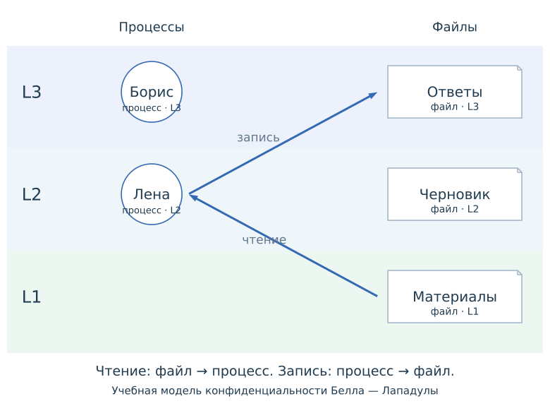

# Обвязка OJS: устройство, авторский код и варианты размещения

Статус: обзор и принятые решения, 31 октября 2026 года. Реализация расширения не начата.
Выбраны OJS и декларативные схемы Graphviz. Общая обвязка сначала размещается
в shared, после пилота её устойчивая часть выделяется в расширение Quarto.

## Авторское содержание и оформление рисунка

Зафиксированное правило: название, номер и оформление подписи принадлежат Quarto.
В SVG, DOT и HTML/JS виджета не дублируется видимый общий заголовок рисунка.
Содержательные подписи узлов, стрелок, уровней и частей схемы остаются внутри неё.
Правило внесено в AGENTS.md и относится к теории и слайдам.

Для статического изображения достаточно обычного Markdown:

~~~markdown
{#fig-mac-overview}

См. @fig-mac-overview.
~~~

Для интерактивного результата используются штатные параметры OJS-ячейки:

~~~js
//| echo: false
//| label: fig-mac-decision
//| fig-cap: "Применение мандатной политики к выбранному запросу"
mac.diagram(stage)
~~~

Ячейки импорта, выбора запроса и этапа располагаются отдельно от этой ячейки
вывода. Пример показывает форму подключения, а не готовый API курса.
Для составного рисунка допустим внешний блок `#fig-*` с одной подписью;
не применять одновременно два способа подписи к одному выводу.
Quarto документирует [подписи OJS-ячеек](https://quarto.org/docs/interactive/ojs/ojs-cells.html#cell-figures)
и [подпись составного блока](https://quarto.org/docs/authoring/cross-references-divs.html).
В экспортируемом SVG остаётся сама схема; номер включения в документ задаёт Quarto.

Автор готов редактировать JavaScript. Поэтому цель — отделить содержание от
технического отображения, а не заменить JS большим YAML или новым языком уроков:

| Что редактируется | Где находится |
| --- | --- |
| Обычное объяснение и внешняя подпись | Markdown и параметры Quarto в QMD |
| Пояснение конкретного этапа | Небольшой OJS/JS-фрагмент с именем этапа |
| Подписи элементов, связи и композиция схемы | DOT, без повторного описания графа в рендере |
| Решение доступа или вычисление алгоритма | Обычная JS-функция |
| Оформление, управление и подсветка | Общие технические функции и ограниченные контейнером стили |

Небольшие фрагменты можно оставлять в одном QMD. Самостоятельный или повторно
используемый код выносится в отдельный файл по необходимости. Пояснение связано
с именем этапа, но не определяет его существование: удаление текста не меняет
проверку политики. Один выбранный этап общей трассы обновляет обе диаграммы и текст.

Референсы подхода: [стили TikZ](https://tikz.dev/tikz-scopes#sec-12.4),
[пошаговый показ Beamer](https://github.com/josephwright/beamer/blob/main/doc/beamerug-overlays.tex),
[устройство интерактивного урока Red Blob Games](https://www.redblobgames.com/making-of/circle-drawing/),
[разделение текста и вычислений Tangle](https://worrydream.com/Tangle/guide.html).
Перенос этих приёмов в OJS — предлагаемое устройство курса; подключение TikZ,
Beamer, Vue или Tangle к сайту не требуется.

## Граница между Core и интерактивной частью

Обзорная схема оформляется рисунком Quarto. Условие банковской задачи,
демонстрационный вариант и связанное решение используют штатные элементы
Core: `#exr-*`, `course-role="demonstration"` для публичного разбора и `#sol-*`
с тем же суффиксом. Presentation отвечает за оформление и раскрытие доступного
решения, OJS — за взаимодействие внутри учебного элемента.

Большой разбор остаётся обычным Markdown внутри решения; его не требуется
переписывать в JS-строки. Объяснения шагов публичного виджета могут быть OJS/JS,
но закрытый ключ не передаётся в общедоступные скрипты. Вложенная `.solution`
является альтернативой именованному решению; `for` банковскому `#sol-*` не добавляется.
Педагогические блоки `reading`, `misconception` и `limitation` используются по смыслу.
Наличие материалов для решения ещё не означает наличия самого решения.

Контракт и проверенные примеры приведены в
[обзоре аудиторных вопросов](2026-10-31-classroom-questions-research.md#оформление-отобранных-задач-средствами-core).

## Уточнение: модели доступа рассматриваются независимо

DAC, MAC и RBAC — три самостоятельных раздела и три самостоятельные демонстрации.
Переключатель между ними в iteration-2 нужен был для сравнения вариантов галереи.
Он не является предлагаемой организацией курса. Выбор модели из массива или
передача её номера не входят в авторский интерфейс урока.

В каждом разделе последовательно находятся:

1. Его статическая обзорная картинка, включённая обычным Markdown.
2. Его самостоятельный OJS-пример применения политики с собственным запросом и этапами.

Статическая картинка не является блоком OJS. Она представляет собой готовый SVG.
В интерактивном примере OJS управляет выбранным запросом и этапом, а общие функции
помогают отобразить SVG, подсветить элементы и сохранить изображение.
Номер этапа внутри примера не является номером модели доступа.

Предметные данные, правила и композиция остаются раздельными:

~~~text
shared/visualizations/access-control/
  mac/                    только уровни, метки и правила MAC
  dac/                    только владельцы и назначения DAC
  rbac/                   только пользователи, роли и разрешения RBAC
  common/                 кнопки, работа с SVG, подсветка и сохранение
~~~

Для каждой модели нужны собственные исходники схем и учебного примера.
Общий код не выбирает модель вместо автора и не объединяет их правила.
Теория и слайды повторно используют тот же пример MAC; DAC и RBAC подключаются
отдельно в своих местах.

## Три разных уровня

1. **Предметная модель** вычисляет результат: разрешение доступа, следующий элемент последовательности, результат XOR.
2. **OJS и отображение** связывают ввод, текущий этап, пояснение и подсветку SVG.
3. **Подключение к Quarto** доставляет нужные модули, CSS и изображения в теорию и слайды.

Расширение относится прежде всего к третьему уровню. Оно само по себе не заменяет
OJS, не упрощает математическую модель и не делает описание графа декларативным.
Именно DOT описывает узлы и связи; именно OJS связывает значения и обновляет результат.

## Зафиксированные исходники

Ссылки ниже ведут в доступные локальные рабочие деревья. Для воспроизведения
без этих каталогов используйте Git-объекты того же репозитория:

| Ревизия | Корень нужных исходников |
| --- | --- |
| dfdbfb5c3dfae556f127157ec9df215f17fea62e | filters/access-examples.lua, shared/access-control/, CI/build-access-examples.mjs |
| 33c1df507a484b733bb88fb3724cef95211acd84 | experiments/visualizations-4-5/iteration-2/ |

Например, git show 33c1df5:experiments/visualizations-4-5/iteration-2/declarative.qmd
показывает использованную версию независимо от текущего checkout. Эти локальные
коммиты доступны; их публикация на GitHub этим обзором не утверждается.

## Как работают имеющиеся исходники

### Ветка структуры: короткий Div и обычный JavaScript

Авторский фрагмент уже выглядит компактно:

~~~markdown
::: {.acx-widget data-access-model="mac"}
Измените параметры, чтобы проследить решение.
:::
~~~

Дальше происходит следующее:

~~~text
QMD → Lua-фильтр → подключение widget.js и CSS
                         ↓
              JavaScript создаёт кнопки и SVG
~~~

Здесь нет OJS. Фильтр
[access-examples.lua](/home/tolya/.codex/worktrees/course-materials-structure/Cybersecurity/filters/access-examples.lua:19)
добавляет зависимости, а браузерный скрипт сам создаёт интерфейс.
Статические изображения этот же фильтр переносит через Pandoc media bag.

Авторские подписи находятся в YAML; данные, геометрия и поведение распределены по
example.mjs, diagram.mjs и widget.mjs. Генератор склеивает JS и создаёт SVG собственной
функцией рисования. Это прежняя реализация, которую предстоит заменить выбранной.

### Новый эксперимент: настоящие OJS-ячейки и готовые SVG Graphviz

Следующий фрагмент описывает существующую сравнительную галерею, а не
окончательный интерфейс трёх независимых разделов курса. Переменная accessMode
в курсе не нужна: раздел MAC непосредственно подключает свой пример MAC.

В [declarative.qmd](/home/tolya/.codex/worktrees/course-visualization-comparison/Cybersecurity/experiments/visualizations-4-5/iteration-2/declarative.qmd:38)
находится реальный код:

~~~js
accessTrace = A.trace(accessMode, accessQuery)
viewof accessPhase = {
  accessTrace;
  return C.stepper(accessTrace.length - 1);
}
accessStage = accessTrace[accessPhase]
V.explanation(accessStage)
accessPair = V.accessPair(accessMode, accessStage, accessTrace, accessPhase)
~~~

Переменная accessTrace зависит от модели и запроса. При смене запроса OJS пересоздаёт
переключатель этапов. Выбор этапа обновляет пояснение и обе картинки.
Кнопка перехода не должна одновременно выбирать другой запрос.

~~~text
Подготовка: DOT → Graphviz → сохранённые SVG

Браузер: ввод → трасса → выбранный этап → пояснение
                                    ├→ модель с подсветкой
                                    └→ алгоритм с подсветкой
~~~

Рисунок описывается отдельно. Например, сокращение настоящего DOT:

~~~dot
"person-lena" [id="person-lena", label="Лена", shape=circle];
"role-student" [id="role-student", label="Студент", shape=box];
"person-lena" -> "role-student" [id="assignment-lena-student"];
~~~

Graphviz создаёт геометрию и SVG. Загрузчик сохраняет семантические идентификаторы
как data-key, а текущий этап перечисляет, какие элементы подсветить.
Изменение связи требует правки DOT, а не длинной SVG-разметки.

Сам эксперимент пока использует обычные скрипты с window.AccessLesson и
window.LessonRuntime. Их подключает
[header-declarative.html](/home/tolya/.codex/worktrees/course-visualization-comparison/Cybersecurity/experiments/visualizations-4-5/iteration-2/shared/header-declarative.html:1).
Это настоящие OJS-ячейки, но подключённые функции пока не оформлены как ES-модули.
Прямой SVG и Graphviz различаются отображением; реактивная последовательность общая.

## Вариант А: модули в общем каталоге курса

Предлагаемое размещение:

~~~text
shared/visualizations/
  common/
    controls.js
    runtime.js
    style.css
  access-control/
    mac/
      model.js
      lesson.ojs
      graphs/*.dot
      static/*.svg
    dac/
      ...
    rbac/
      ...
  crypto/
    model.js
    lesson.ojs
    graphs/*.dot
    static/*.svg
  data-integrity/
    ...
~~~

Структура — пример для крупного повторно используемого урока, а не обязательное
число файлов каждой схемы и не уже существующий API. Названия экспортов
закрепляются на небольшом пилоте в рамках обсуждённой авторской формы.

Автор может оставлять явные OJS-ячейки конкретной модели, отдельно управляя
запросом и этапом. Другой способ — вынести реактивное построение примера MAC
в его собственный модуль и импортировать готовое представление:

~~~js
import { macExample } from "../../shared/visualizations/access-control/mac/lesson.ojs"
macExample
~~~

Это пример возможной организации файлов, а не реализованный экспорт.
В lesson.ojs находятся именно запросы, этапы и построение самостоятельного примера
MAC. Готовое представление включает его элементы управления. Аналогично каждый
раздел подключает собственный пример DAC или RBAC. Универсальный селектор моделей
для этого не требуется.

Общий модуль common предоставляет технические функции, а не готовые правила
трёх моделей. Перед сокращением авторского кода нужно проверить независимость
экземпляров и решить, какие реактивные ячейки автору важно видеть в самой странице.

[Quarto поддерживает импорт JS-модулей и повторное использование реактивных
значений](https://quarto.org/docs/interactive/ojs/code-reuse.html).

Преимущества:

- Содержательные данные и схемы находятся рядом с курсом.
- Можно менять модель, текст и граф без выпуска отдельного пакета.
- Для теории и слайдов используются одинаковые модули.
- Не требуется придумывать новый язык описания урока.

Цена:

- Нужно аккуратно настроить пути и копирование ресурсов вложенных проектов.
- Малый код подключения может повторяться.
- При использовании в нескольких курсах версию общей обвязки придётся учитывать отдельно.

## Вариант Б: тонкое расширение Quarto и те же OJS-модули

Предлагаемое разделение:

~~~text
Расширение:
  _extension.yml
  filter.lua
  browser/controls.js
  browser/runtime.js
  browser/style.css

Курс:
  shared/visualizations/access-control/mac/...
  shared/visualizations/access-control/dac/...
  shared/visualizations/access-control/rbac/...
~~~

Расширение подключает общую среду, оформляет зависимости и помогает доставить SVG.
Оно не содержит участников Moodle, учебные ключи, параметры LCG или тексты уроков.
Авторский OJS-код может оставаться таким же, как в варианте А.

Механизм подключения уже знаком по имеющемуся Lua-фильтру:

~~~lua
quarto.doc.add_html_dependency({
  name = "course-access-examples",
  version = "1.0.0",
  scripts = {{path = assets .. "/widget.js", afterBody = true}},
  stylesheets = {assets .. "/widget.css"}
})
~~~

Это настоящий фрагмент прежнего фильтра, а не готовый код нового расширения.
Ресурсный адаптер нового расширения потребуется спроектировать под OJS и несколько
типов виджетов.

Преимущества:

- Есть отдельная версия общего механизма и штатная установка в другие курсы.
- Техническое подключение не приходится повторять в каждой книге.
- Можно одинаково поддерживать HTML, Reveal и статическое изображение для печати.

Цена:

- Появляется выпуск и сопровождение пакета.
- Нужно определить совместимость пакета с предметными модулями курса.
- Наличие _extension.yml само по себе не исправляет пути вычисляемых fetch-запросов.
- Расширение не уменьшает автоматически размер среды OJS.

А и Б совместимы по авторской модели. Пользователь выбрал последовательность:
сначала общие модули в shared, после пилота — упаковка устойчивой технической
части в тонкое расширение. Содержательная часть примеров остаётся в курсе.

## Вариант В: собственная команда, которая порождает OJS

Внешне это могло бы выглядеть так:

~~~markdown

~~~

Такой команды сейчас нет. Это уже собственный интерфейс, которому потребуются
параметры, обработка ошибок, правила нескольких экземпляров и отдельная документация.

В установленном Quarto 1.11.6 OJS компилируется до запуска Pandoc/Lua:
[ojsExecuteResult](/opt/quarto/bin/quarto.js:131873),
[ojsCompile](/opt/quarto/bin/quarto.js:128397), затем
[передача Pandoc](/opt/quarto/bin/quarto.js:131902).
Поэтому Lua-фильтр, который просто возвращает блок класса ojs, ещё не создаёт
эквивалент исходной OJS-ячейки. Потребуется более раннее преобразование либо другая
проверенная интеграция. Старый Div работает именно потому, что запускает обычный JS.

Сейчас этот вариант добавляет больше самостоятельной инфраструктуры, чем А или Б.

## Что нужно исправить независимо от упаковки

1. Не копировать оформление body, h1, button из экспериментальной страницы в книгу:
   ограничить стили контейнером виджета.
2. Проверить два экземпляра на одной странице: независимые состояния и уникальные
   DOM/SVG id при сохранении смысловых data-key.
3. Явно публиковать динамически загружаемые SVG. Вычисляемый путь внутри fetch не
   означает, что Quarto автоматически найдёт все ресурсы.
4. Проверить .js/.ojs-модули отдельно. Статический OJS-import существующих .mjs
   в установленной версии нельзя считать поддержанным без адаптации.
5. Выделить готовые обзорные SVG: базовый файл эксперимента может содержать скрытые
   элементы, которые раскрывает JS, и не всегда годится для печати без обработки.
6. Согласовать предметные данные. Старый YAML-пример и новый Moodle-граф имеют
   разных участников, владельцев и роли; их нельзя заменить друг другом без правки объяснений.
7. Разделить внешнюю подпись Quarto, содержательные подписи в DOT и пояснения
   именованных этапов. У каждого текста должно быть одно место редактирования.
   Режим --regenerate может перезаписать ручные изменения; это должно быть явно видно автору.
8. Развести настройки компиляции графа и браузерную подсветку. Сначала сравнить
   автоматическую раскладку, порты и маршруты на небольшом числе схем.
9. Измерять загружаемые ресурсы страницы. Существующие результаты относятся к
   HTTP-телам без сжатия, а не к потреблению оперативной памяти.

## Принятый порядок и следующий шаг

Выбрана последовательность: общий каталог курса сейчас, тонкое устанавливаемое
расширение Quarto после пилота и проверки интерфейса.
В обоих вариантах модели, тексты и схемы остаются в курсе; самостоятельный язык
команд и большой YAML не вводятся.

Показать редактирование содержательной подписи и удаление пояснения без изменения
алгоритма, а также оформление внешней подписи средствами Quarto. Конкретное
размещение ячеек и граница ручной/автоматической раскладки проверяются на пилоте,
без отдельного согласования каждой технической функции.

Перед массовым переносом нужен один небольшой проверочный пример в теории и один в Reveal.
Только затем имеет смысл переводить на механизм все отобранные материалы.
