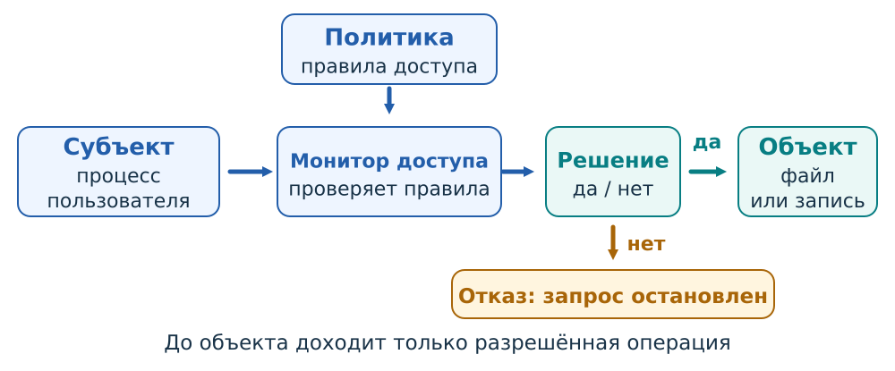
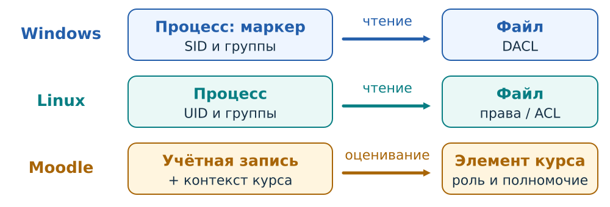
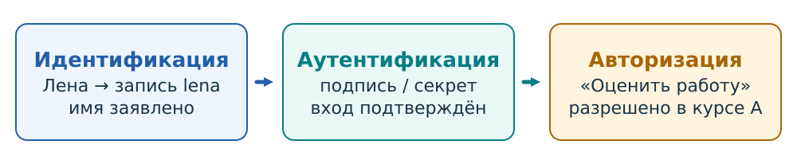
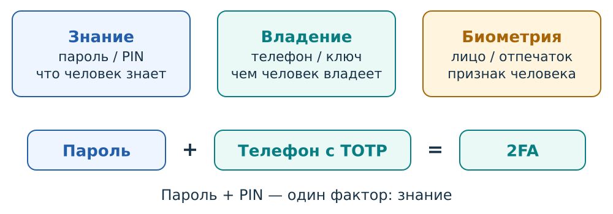
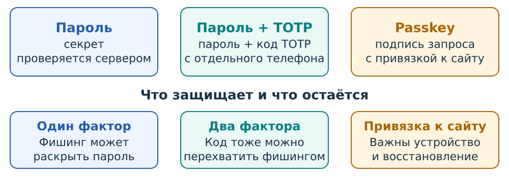
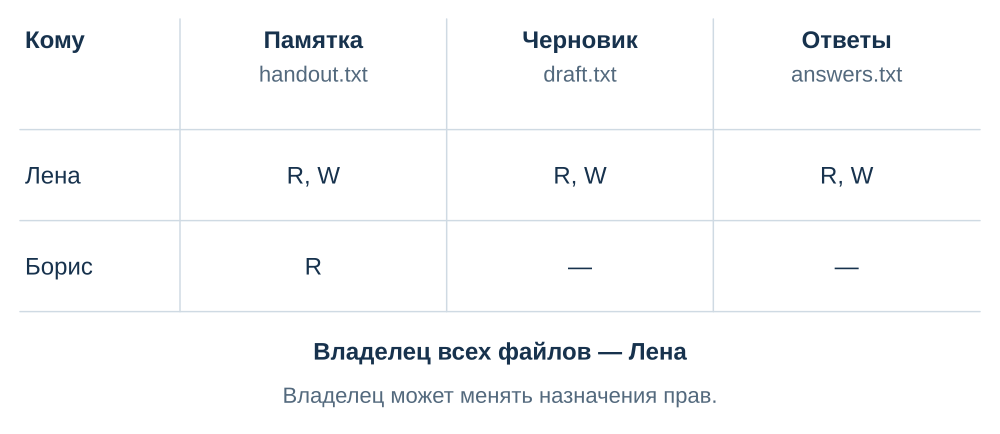
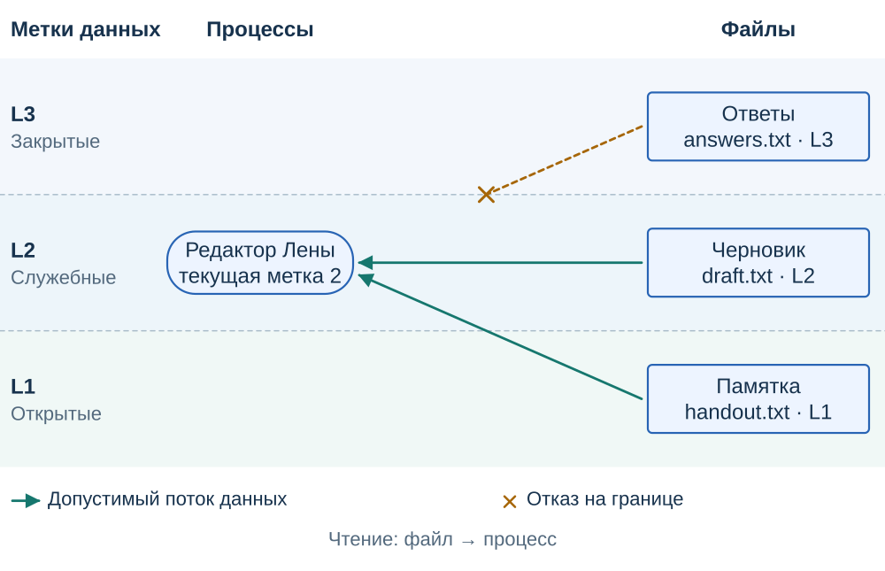
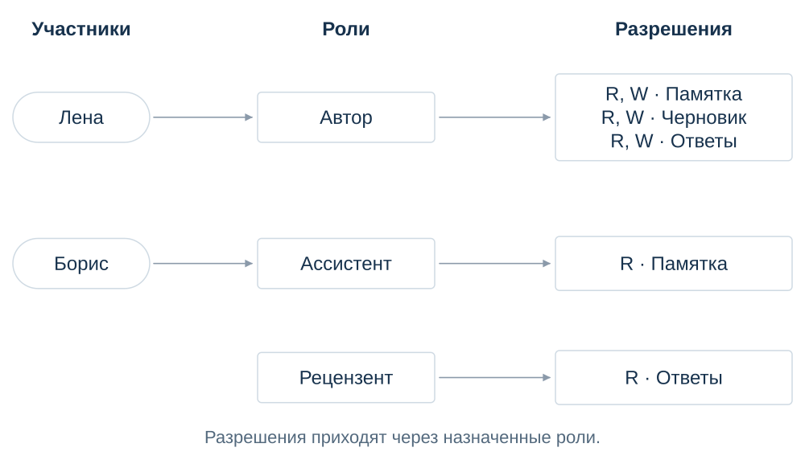
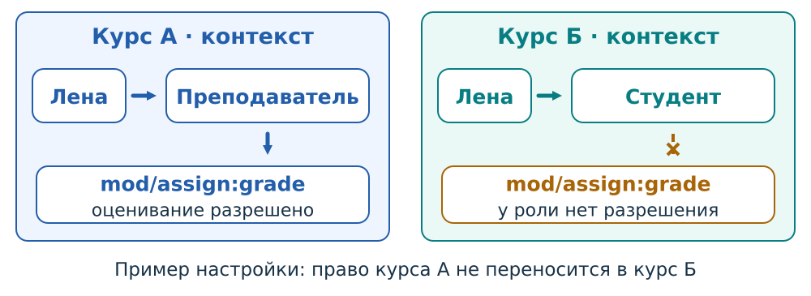

## [Семинар 4 — Управление доступом]{.r-fit-text} {#sec-seminar-4}


Как система решает, кто может выполнить действие над конкретным объектом.

Windows · Linux · Moodle

::: {.notes}
Начать с обычного действия: открыть файл или поставить оценку. Основной маршрут: общая модель, три процедуры, способы входа, DAC/MAC/RBAC. На практический разбор выбрать две или три задачи из существующего банка с учётом времени и затруднений группы.
:::

### Кто — к чему — какое действие

{.access-diagram}

Открыть файл и изменить файл — два разных запроса.

::: {.notes}
Попросить назвать субъект, объект и действие. Затем заменить только действие: чтение на изменение. Политика задаёт правило, механизм принимает решение и останавливает запрещённую операцию. Скрытая кнопка не перекрывает прямой запрос к серверу.
:::

### Одна модель в трёх системах

{.access-diagram}

Субъектом обращения может быть процесс, действующий от имени пользователя.

::: {.notes}
В Windows обратить внимание на маркер доступа процесса или потока, в Linux — на идентификаторы и группы, в Moodle — на запись и контекст. Уточнить: пользователь формулирует намерение, а операцию над ресурсом выполняет программа.
:::

### Три разных вопроса

{.access-diagram}

Успешный вход ещё не разрешает любую операцию.

::: {.notes}
Идентификация выбирает запись, аутентификация проверяет подтверждение, авторизация решает вопрос о действии. Попросить объяснить отказ изменить чужой курс после успешного входа. Процедуры могут не выглядеть как три отдельных экрана.
:::

### Идентификация: какая запись?

| Представление | Для чего нужно |
|---|---|
| Логин `lena` | Найти запись при входе |
| SID в Windows, UID в Linux | Обозначить субъект в соответствующей системе |
| Имя «Лена» на странице | Показать человеку понятное название |

Знание идентификатора не подтверждает право использовать запись.

::: {.notes}
Попросить назвать логин одногруппника: известность логина сама по себе не даёт доступа. Развести отображаемое имя, локальный идентификатор и человека. Уникальность всегда относится к определённой области.
:::

### Аутентификация: чем подтверждаем?

{.access-diagram}

2FA требует двух разных типов факторов. Два пароля остаются одним типом.

::: {.notes}
Обсудить пароль и код приложения на отдельном зарегистрированном устройстве как сочетание знания и владения. Затем сравнить с паролем и секретным словом. Количество экранов и названия средств не определяют число факторов.
:::

### От секрета к криптографическому ответу

{.access-diagram}

Сравниваем механизм проверки и угрозу, которую он ограничивает.

::: {.notes}
Пароль можно повторно предъявить; принятый OTP нельзя использовать повторно; WebAuthn связывает криптографический ответ с определённым сервисом (RP) и адресом сайта. Это развитие механизмов, а итоговая защита зависит также от восстановления и конечного устройства.
:::

### Одноразовый код: кто предъявил первым?

1. Лена вводит действующий код на поддельной странице.
2. Страница сразу передаёт его настоящему серверу.
3. Первое предъявление может пройти; повторное — получить отказ.

Одноразовость ограничивает повтор уже принятого кода.

@tasks:exr-access-control-otp

::: {.notes}
При наличии времени открыть задачу. Для TOTP генератор и проверяющая сторона используют общий секрет и время. Не описывать краткий срок как защиту от немедленной пересылки: код ещё не был использован.
:::

### Passkey: что получает сайт?

- Открытый ключ зарегистрирован для записи.
- Средство создаёт ответ на свежий запрос сайта.
- PIN или биометрия могут проверяться локально.

Касание ключа и проверка пользователя — разные режимы.

::: {.notes}
Указать привязку WebAuthn к определённому сервису (RP) и адресу сайта. Закрытый ключ не передаётся сайту, но passkey может синхронизироваться между устройствами. Не объявлять любой WebAuthn двухфакторным. В Moodle возможности зависят от версии и настройки; дополнительный фактор WebAuthn не равен автоматически входу без пароля.
:::

### Авторизация: какой курс?

Лена успешно вошла. Роль проверяющей назначена в курсе А.

| Запрос | Есть основание в условии? |
|---|---|
| Проверить работу курса А | Да |
| Проверить работу курса Б | Нет |

@tasks:exr-access-control-request

::: {.notes}
Предложить указать единственное изменённое условие: объект принадлежит другому курсу. Повторный ввод пароля не создаёт полномочия в курсе Б. Полное условие задачи открывать отдельно.
:::

### DAC: права на конкретный объект

{.access-diagram}

Лена владеет тремя файлами; Борис исходно читает только памятку.

::: {.notes}
Общий пример: handout.txt — памятка, draft.txt — черновик заданий, answers.txt — ответы. Лена читает и записывает все три файла и отдельно уполномочена менять назначения. R означает чтение, W — запись; обычное редактирование требует обоих прав. Матрица собирает права по субъектам и объектам, ACL — записи одного объекта.
:::

### DAC: выдача права

::: {.acx-widget data-access-model="dac"}
Измените параметры, чтобы проследить решение.
:::

::: {.notes}
Сравните чтение Борисом `answers.txt` до и после выдачи `R`. Показать, что изменяется назначение на конкретный файл. Чтение памятки сохраняется. Возможность Лены менять назначения задана отдельно: право записи содержимого не означает право управлять ACL.
:::

### Windows: запись файла и изменение прав

| Полномочие | Что позволяет |
|---|---|
| Запись содержимого | Изменить текст файла |
| `WRITE_DAC` | Изменить DACL объекта |

Разрешение редактировать документ ещё не означает возможность поделиться им.

::: {.notes}
Применимые ACE проверяются с учётом SID и запрошенных прав; порядок записей имеет значение. Не сводить все DACL к формуле о безусловном приоритете любого запрета. Попросить привести рабочую ситуацию, когда редактору не нужно право назначать новых читателей.
:::

### Linux: читаем режим `640`

```text
-rw-r-----  lena  teachers  report.txt
```

| Владелец | Группа | Остальные |
|---|---|---|
| Читать и писать | Читать | Прав нет |

Борис входит в `teachers`: чтение разрешено, изменение — нет.

::: {.notes}
Это упрощённый пример: родительские каталоги доступны, расширенного ACL и других ограничений нет. Попросить объяснить результат по трём группам битов. Отдельные правила SELinux могут дополнительно ограничить доступ.
:::

### MAC: три уровня данных

{.access-diagram}

Процесс Лены на L2 читает памятку и черновик; чтение ответов L3 запрещено.

::: {.notes}
Три горизонтальные зоны: открытые L1, служебные L2, закрытые L3. Процесс находится отдельно от файлов; стрелки чтения направлены от файла к процессу. На этом статическом рисунке показано чтение. Текущий уровень L2 не заменяется максимальным допуском Лены до L3.
:::

### MAC: операции с файлами

::: {.acx-widget data-access-model="mac"}
Измените параметры, чтобы проследить решение.
:::

::: {.notes}
Запись без чтения назначения и обычное редактирование требуют разных проверок. Для процесса Лены L2 сравнить чтение памятки L1, редактирование черновика L2 и размещение в L3 без чтения ответов. Затем отдельно рассмотреть процесс Лены L3, который читает ответы, но не может перенести их в памятку L1. Это независимые опыты, а не переключение вниз процесса, сохранившего закрытые данные. Равные уровни разрешают чтение и запись.
:::

### Обязательные правила бывают разными

| Механизм | Что существенно |
|---|---|
| Windows MIC | По умолчанию запрещает запись с низкого уровня целостности на высокий |
| Linux SELinux | Ограничивает действия по доменам, типам и политике |
| Учебная Белла — Лападула | Ограничивает потоки ради конфиденциальности |

Приглашение владельца не отменяет обязательный запрет.

::: {.notes}
Не переносить направления запретов BLP на MIC: MIC защищает целостность. Типы SELinux не являются единой лестницей секретности. Коротко связать с Linux-примером: обычных прав файла может быть достаточно для DAC, но недостаточно для окончательного разрешения.
:::

### RBAC: права по обязанностям

{.access-diagram}

Лена — «Автор»; Борис — «Ассистент». Чтение ответов даёт роль «Рецензент».

::: {.notes}
У Автора есть чтение и запись трёх файлов, у Ассистента — чтение памятки. Между этими ролями наследование не задано. Роль связывает обязанности с правами; назначение связывает пользователя с ролью.
:::

### RBAC: назначение роли

::: {.acx-widget data-access-model="rbac"}
Измените параметры, чтобы проследить решение.
:::

::: {.notes}
Сравните чтение ответов до и после назначения Борису «Рецензента». Назначение делает уполномоченный по правилам управления ролями. Роль Автора сама по себе не даёт такого полномочия. Меняем назначение конкретному человеку; общие разрешения Ассистента для других пользователей сохраняются.
:::

### Moodle: роль в контексте

{.access-diagram}

`mod/assign:grade` — полномочие оценивать задания в применимом контексте.

::: {.notes}
Показать различие курса А и курса Б. Контексты вложены; это не означает наследования между ролями. Для обычных ролей Prohibit нельзя снять нижележащим Allow. Название роли без области действия не определяет итог.
:::

### Почему одного отзыва может не хватить?

Право может сохраняться через другое назначение или группу.

Сначала найдите все основания. Затем выберите изменения, сохраняющие нужную работу.

@tasks:exr-access-control-rbac

::: {.notes}
Открыть существующую задачу о смене обязанностей Лены. До выбора исправления попросить нарисовать все пути к изменению оценок. В задаче явно определены наследование и активные назначения; не приписывать эти правила любой системе RBAC.
:::

### Минимальные привилегии

Проверяющему курса А нужны права в курсе А.

Для чтения отчёта не требуется изменение отчёта.

Для изменения файла не всегда требуется изменение его прав.

::: {.notes}
Попросить сузить каждое полномочие по объекту и действию, сохранив рабочую задачу. Ограничение должно сохранять необходимые возможности пользователя. Связать примеры с Moodle, ACL и отдельным WRITE_DAC.
:::

### Разделение обязанностей

Лена предлагает исправление оценки → другой сотрудник утверждает.

Проверяются роль, состояние заявки и отличие утверждающего от автора.

@tasks:exr-access-control-grade

::: {.notes}
Другой браузер или повторный вход не меняют человека. Если у одного сотрудника несколько записей, правило о разных сотрудниках требует учитывать эту связь. Открыть задачу при наличии времени; не смешивать её условную процедуру со штатной функцией Moodle.
:::

### Практический разбор

- @tasks:exr-access-control-dac
- @tasks:exr-access-control-mac
- @tasks:exr-access-control-combined

Для каждого решения назовите объект, действие и правило.

::: {.notes}
Выбрать задачи по темам, требующим закрепления. Для DAC проследить источник выдачи, для MAC — направление переноса данных, для сочетания оснований — заданный порядок разрешений и ограничений. Не требовать выполнения всего банка за одно занятие.
:::

### Семинарская работа

@tasks:sec-work-access-control

@theory:sec-theory-access-control

Объясните один разрешённый и один запрещённый запрос, различающиеся одним условием.

::: {.notes}
Подвести итог через конкретный пример студента. Причиной должны быть назначение, объект, действие, контекст или обязательное правило. Полные условия задач и основная теория доступны по ссылкам.
:::
