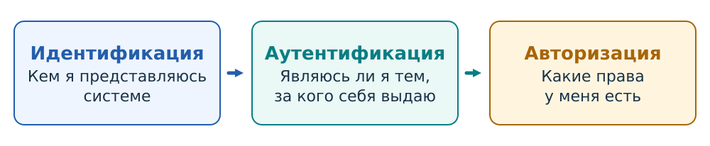
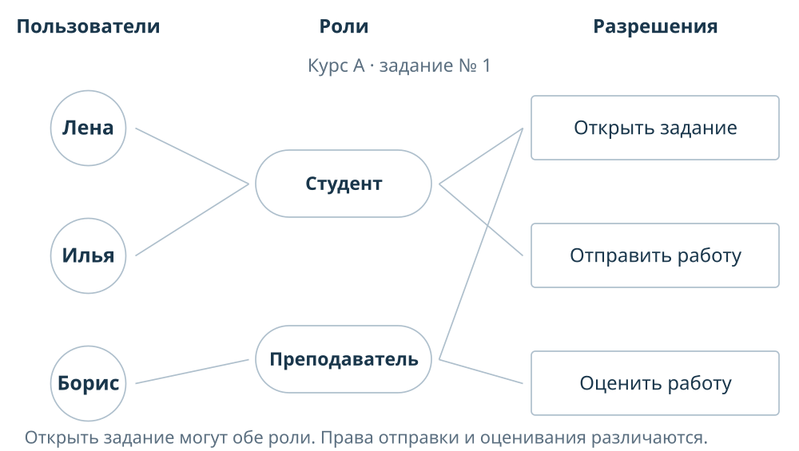

## Семинар 4 — Управление доступом {#sec-seminar-4}

Общая модель распределения доступа

## Общая схема взаимодействия {#sec-seminar-4-access-decision}

### Порядок обработки запроса на доступ

Субъект: процесс редактора Лены → объект: файл → операция: запись.

Политика определяет разрешения; монитор проверяет запрос и останавливает запрещённое действие.

{#fig-slide-access-overview fig-alt="Субъект обращается к объекту через монитор, который применяет политику" width="70%"}

::: {.notes}
Попросите заменить запись чтением и сравнить решения для двух запросов.
:::

### Вопрос для аудитории {.smaller}



## Аутентификация пользователя {#sec-seminar-4-authentication}

### Порядок входа

1. Идентификация: кем я представляюсь системе.
2. Аутентификация: являюсь ли я тем, за кого себя выдаю.
3. Авторизация: какие права у меня есть.

{#fig-slide-access-procedures .nostretch width="100%" fig-alt="Идентификация: кем я представляюсь системе; аутентификация: являюсь ли я тем, за кого себя выдаю; авторизация: какие права у меня есть"}

### Доступ к ресурсу {.smaller}

::: {#exr-slide-access-entry course-role="discussion" statement-visibility="open" difficulty="introductory"}
Лена вводит имя `lena` в браузере. Портал находит её учётную запись. Лена подтверждает вход в зарегистрированном приложении, и портал создаёт сеанс. С этим сеансом чтение банка курса А разрешено, изменение ведомости курса Б запрещено.

1. На каких шагах выполняются идентификация, аутентификация и авторизация?
2. Какие действия выполняют браузер, приложение и сервер портала?
:::

### Факторы аутентификации

- **Знание:** пароль или PIN — секрет, который человек знает.
- **Владение:** приложение или ключ — средство, создающее подтверждение.
- **Свойство человека:** отпечаток или лицо — измерение, сравниваемое с эталоном.

### Этапы подтверждения входа

**Двухэтапная аутентификация:** для входа нужно последовательно пройти две обязательные проверки.

**Двухфакторная аутентификация:** проверки используют два разных вида факторов.

При разборе входа отдельно назовите порядок проверок и виды факторов, которые они используют.

### Вопрос: две проверки {.smaller}



### Вопрос для аудитории {.smaller}



### Пароль, OTP, passkey

- Пароль — повторяемый секрет, который можно передать поддельному сайту.
- OTP ограничивает повтор принятого кода, но ещё не использованный код можно переслать.
- Passkey отвечает на свежий запрос с привязкой к сервису и адресу сайта; закрытый ключ сайту не передаётся.

## Модели управления доступом {#sec-seminar-4-access-models}

### DAC: права на объект

Анна управляет правами на черновик; Борису выдано чтение. Право писать в файл и право менять ACL различаются.

{#fig-slide-dac fig-alt="Владелец Анна управляет ACL черновика; Борису разрешено чтение, Вере доступ не предоставлен" width="85%"}

### DAC: составьте матрицу {.smaller}

::: {#exr-slide-access-dac-matrix course-role="discussion" statement-visibility="open" difficulty="introductory"}
Анна владеет черновиком и материалами. Она может читать и изменять оба файла, назначать и отзывать права на них. Борис читает и изменяет черновик, материалы только читает. Вера читает материалы, доступа к черновику у неё нет. Остальные действия запрещены.

1. Составьте матрицу прав чтения и записи: строки — участники, столбцы — файлы, `r` — чтение, `w` — запись.
2. Анна разрешила Вере читать черновик. Как изменятся матрица и ACL черновика?
:::

### DAC: применение политики {.smaller}



### MAC: три уровня

:::: {.columns}
::: {.column width="30%"}

$L_1 < L_2 < L_3$

**Чтение:** свой уровень и ниже.

**Запись без чтения:** свой уровень и выше.

**Редактирование:** обе проверки.

:::
::: {.column width="70%"}

{#fig-slide-mac fig-alt="Процесс Лены L2 читает материалы L1 и может записывать данные в ответы L3 без чтения" width="100%"}

:::
::::

### MAC: применение политики {.smaller}



### RBAC: права по обязанностям

Пользователь → назначенная роль → разрешение. Все назначения действуют в курсе А.

{#fig-slide-rbac fig-alt="Лена и Илья — студенты, Борис — преподаватель; у ролей разные разрешения в курсе А" width="95%"}

### RBAC: постройте роли {.smaller}

::: {#exr-slide-access-role-matrix course-role="discussion" statement-visibility="open" difficulty="intermediate"}
В курсе нужны следующие права; остальные действия запрещены.

| Участник | Читать материалы | Проверять работы | Менять оценки | Читать журнал |
|---|:---:|:---:|:---:|:---:|
| Лена | Да | Да | Да | Нет |
| Борис | Да | Да | Да | Нет |
| Илья | Да | Нет | Нет | Нет |
| Вера | Да | Нет | Нет | Да |

1. Предложите роли и назначения, которые дают эти права.
2. Лена переходит к чтению материалов и журнала. Как изменить её назначения? Назовите разрешённый и запрещённый запрос для проверки результата.
:::

### RBAC: применение политики {.smaller}



### Совместное применение политик {.smaller}

::: {#exr-slide-access-combined course-role="discussion" statement-visibility="open" difficulty="introductory"}
Чтение разрешено через роль или личное разрешение в ACL. Обязательная политика дополнительно запрещает читать материал выше текущего уровня процесса. Уровень 2 выше уровня 1.

| Запрос | Через роль | Через ACL | Уровень процесса | Уровень материала |
|---|:---:|:---:|:---:|:---:|
| А | Да | Нет | 1 | 1 |
| Б | Нет | Да | 1 | 2 |
| В | Да | Да | 2 | 1 |

1. Определите решение для каждого запроса и объясните порядок проверок словами.
2. Для запроса В отозвали роль. Изменится ли решение? Какие права нужно отозвать, чтобы закрыть доступ?
:::
