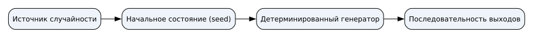
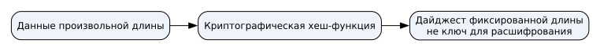

## Семинар 5 — Случайность и криптография {#sec-seminar-5}

Случайность, ключи, шифрование, хеширование и хранение паролей.

### Состояние генератора

Детерминированный генератор повторяет последовательность при одинаковом начальном состоянии. Вид одной строки не доказывает случайность процесса.

Для секретных ключей нужен криптографический генератор с достаточной энтропией.

### Источник и состояние

Одинаковое начальное состояние детерминированного генератора повторяет последовательность.

{#fig-slide-seed fig-alt="Источник случайности задаёт начальное состояние генератора" width="75%"}

### Вопрос для аудитории {.smaller}



### Генератор: схема

{#fig-slide-lcg-overview fig-alt="Переход состояния генератора" width="85%"}

### Генератор: опыт {.smaller}

```{ojs}
//| echo: false
//| label: fig-slide-lcg
//| fig-cap: "Состояния учебного генератора"
cryptoLesson = await import(await FileAttachment("/_prepared/visualizations/crypto/lesson.js").url())
cryptoLesson.lcgTrainer()
```

### Симметричное шифрование

Стороны используют общий секретный ключ: открытый текст → шифрование → шифротекст → расшифрование → исходный текст.

{#fig-slide-symmetric fig-alt="Текст шифруется и расшифровывается с одним секретным ключом" width="75%"}

Шифр Цезаря сдвигает буквы по кругу; его 26 сдвигов легко перебрать.

### Вопрос для аудитории {.smaller}



### XOR

Одинаковые биты дают 0, разные — 1. Если `C = M XOR K`, то `M = C XOR K`.

Обратимость не доказывает секретности: повторение потока ключа раскрывает связь сообщений.

### Вопрос для аудитории {.smaller}



### Преобразования: схема

{#fig-slide-cipher-overview fig-alt="Преобразование сообщения с ключом" width="85%"}

### Преобразования: опыт {.smaller}

```{ojs}
//| echo: false
//| label: fig-slide-cipher
//| fig-cap: "Учебные преобразования Цезаря и XOR"

cryptoLesson.caesarXorTrainer()
```

### Хеширование

Хеш отображает данные в результат фиксированной длины. Разные входы могут иметь одинаковый результат. Хеширование не является обратимым шифрованием.

{#fig-slide-hash fig-alt="Данные преобразуются в дайджест фиксированной длины" width="70%"}

Сравнение с доверенным эталоном помогает обнаружить изменение; замена и файла, и эталона оставляет сравнение без доверенной основы.

### Хранение пароля

Для каждой записи: случайная соль + пароль → специальная парольная функция → сохранённый результат, соль и параметры.

При входе вычисление повторяют. Соль разделяет перебор записей, а дорогая функция увеличивает стоимость каждой попытки. Ограничение входов на сайте не останавливает офлайн-перебор украденной базы.

### Вопрос для аудитории {.smaller}



### Запасные вопросы

Следующие два условия используют по времени занятия.

### Вопрос для аудитории {.smaller}



### Вопрос для аудитории {.smaller}



### Итог

Ключ требует непредсказуемого источника; шифрование скрывает данные; хеш помогает сравнивать данные; парольная функция повышает стоимость перебора.

::: {.notes}
Разберите границу каждого средства: шифрование само по себе не гарантирует целостность, а соль не усиливает слабый пароль.
:::
