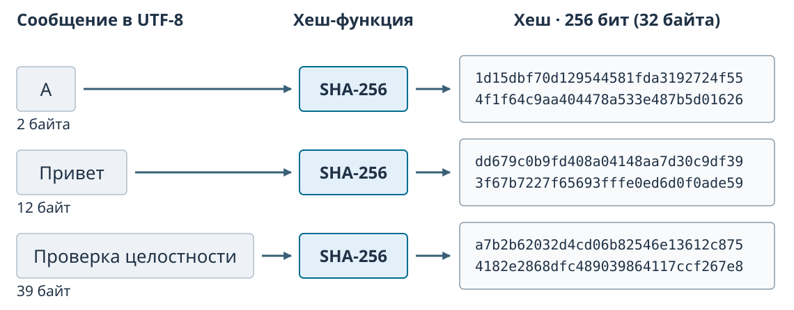
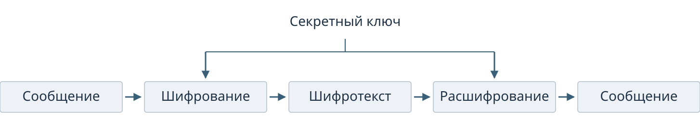
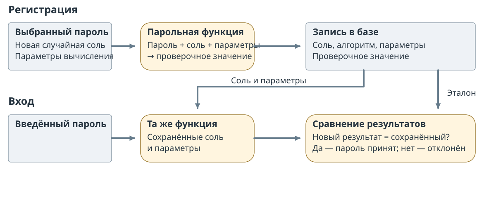

## Семинар 5 — Криптография {#sec-seminar-5}

## Случайность {#sec-seminar-5-randomness}

### Случайность

Секретный ключ должен быть труден для угадывания. Для его создания нужен способ выбора, результат которого нельзя практически предсказать.

Одна и та же строка битов может появиться при бросках монеты, вычислении по формуле или копировании из файла. По виду строки нельзя установить, как она получена.

Свойство, нужное криптографии, относится к **процессу получения значений**: наблюдатель не должен уметь угадать следующий результат по уже известным данным.

### Состояние генератора {.smaller}

::: {#def-slide-random-state name="Состояние генератора"}
**Состояние** — данные, которые генератор хранит между выдачами результатов и использует для вычисления следующего результата.
:::

Детерминированный генератор повторяет три действия:

1. Читает текущее состояние.
2. По заданному правилу вычисляет и сохраняет новое состояние.
3. Выдаёт результат, полученный из состояния.

Одинаковые правило и начальное состояние воспроизводят одну последовательность. Начальное значение называют `seed`. Подробное объяснение: @theory:def-random-state.

### Линейный конгруэнтный генератор {.smaller}

LCG в нашем примере выдаёт само новое состояние:

$$x_{n+1}=(a x_n+c)\bmod m.$$

$x_n$ — текущее состояние, $x_{n+1}$ — следующее, $x_0$ — начальное; $a$ — множитель, $c$ — слагаемое, $m$ — модуль. Остаток по модулю $m$ лежит от $0$ до $m-1$.



Устройство генератора: @theory:sec-theory-crypto-random.

### {#slide-crypto-lcg-calculation}

Для $a=5$, $c=1$, $m=16$, $x_0=2$ первый переход даёт $(5\cdot2+1)\bmod16=11$.



### Предсказуемость

В полном периоде этого LCG каждое состояние от 0 до 15 встречается один раз. Через 16 переходов состояние `2` повторяется, а за ним повторяется вся последовательность.

Младший бит чередуется: $0,1,0,1,\ldots$ Зная текущий бит, можно назвать следующий, хотя нули и единицы встречаются одинаково часто.

**Равномерные частоты сами по себе не обеспечивают непредсказуемость.** Для ключей важно, что наблюдатель сможет узнать о следующих значениях.

### RANDU {.smaller}

RANDU — LCG с правилом $x_{n+1}=65539x_n\bmod 2^{31}$. После нормализации $u_n=x_n/2^{31}$ строим точки $(u_n,u_{n+1},u_{n+2})$ из соседних выходов.

{#fig-slide-randu fig-alt="Одно облако троек RANDU показано с двух сторон; второй ракурс выявляет параллельные плоскости" width="82%"}

Параллельные плоскости обнаруживают зависимость соседних выходов, которую трудно заметить в одном списке чисел.

### Отбор параметров LCG {.smaller}

Наблюдателю известны $m=16$, диапазоны $a,c\in\{0,\ldots,7\}$ и полные выходы. Из 64 пар оставляем только те, которые воспроизводят **каждый наблюдавшийся переход**. Затем фиксируем прогноз до раскрытия следующего выхода.



## Хеширование {#sec-seminar-5-hashes}

### Хеш-функция {.smaller}

Чтобы сравнить данные с сохранённым эталоном, вычисляют компактное значение от их байтов.

::: {#def-slide-crypto-digest name="Хеш-функция"}
**Хеш-функция** преобразует последовательность байтов в **дайджест фиксированной длины**. Для одних и тех же байтов заданная функция всегда выдаёт один результат.
:::

{#fig-slide-hash-length fig-alt="Строки разной длины имеют дайджесты SHA-256 по 256 бит, то есть по 32 байта" width="78%"}

Определение и свойства: @theory:def-crypto-digest.

### Коллизия

**Коллизия** — одинаковый дайджест у двух разных входов. Число дайджестов фиксированной длины ограничено, поэтому совпадения неизбежны при достаточно большом множестве входов.



Криптографической функции требуется затруднять целенаправленный поиск таких совпадений.

### Лавинный эффект

У криптографического хеша изменение одного бита входа распространяется по дайджесту.

| Сравниваемые входы в UTF-8 | Изменение входа | Изменение SHA-256 |
|---|---:|---:|
| `abc` и `abb` | 1 бит | 124 из 256 битов |

Число изменившихся битов зависит от пары входов. Такое наблюдение показывает распространение изменения; трудность поиска прообраза или коллизии проверяют отдельно.

Свойства и битовый опыт: @theory:sec-theory-crypto-hash.

### Задачи поиска {.smaller}

Для хеш-функции $H$ различают три задачи:

| Задача | Что уже задано | Что требуется найти |
|---|---|---|
| **Прообраз** | Дайджест $y$ | Вход $x$, для которого $H(x)=y$ |
| **Второй прообраз** | Вход $x$ | Другой вход $x'$ с тем же хешем |
| **Коллизия** | Только функция $H$ | Любые два разных входа с одинаковым хешем |

Для криптографического применения все три задачи должны быть вычислительно трудными. При поиске второго прообраза первый вход выбрать уже нельзя; при поиске коллизии можно выбирать оба.

### Доверенный эталон {.smaller}

Получатель вычисляет хеш скачанного файла и сравнивает его с **доверенным эталоном**. Совпадение проверяет неизменность файла относительно этого эталона.



Происхождение эталона устанавливают отдельно, например проверкой подписи списка хешей. Объяснение: @theory:sec-theory-crypto-hash.

## Симметричное шифрование {#sec-seminar-5-encryption}

### Симметричное шифрование

::: {#def-slide-crypto-encryption name="Симметричное шифрование"}
Шифрование преобразует открытое сообщение в шифротекст, скрывая содержание от постороннего наблюдателя. В симметричной схеме отправитель и получатель используют **один и тот же секретный ключ** для прямого и обратного преобразования.
:::

{#fig-slide-symmetric-key fig-alt="Сообщение проходит шифрование, становится шифротекстом и восстанавливается расшифрованием; оба преобразования получают один секретный ключ" width="95%"}

Определение и примеры: @theory:def-crypto-encryption.

### Шифр Цезаря

Шифр Цезаря заменяет каждую букву буквой на заданное число позиций дальше по кругу алфавита. **Ключ — величина сдвига**; обратный сдвиг восстанавливает сообщение.

Русский алфавит содержит 33 буквы, включая **Ё**:

`АБВГДЕЁЖЗИЙКЛМНОПРСТУФХЦЧШЩЪЫЬЭЮЯ`

| Сообщение | Б | А | Г | А | Ж |
|---|:---:|:---:|:---:|:---:|:---:|
| Сдвиг +15 | П | О | С | О | Х |

`БАГАЖ → ПОСОХ`; сдвиг −15 возвращает `БАГАЖ`. Всего 33 возможных ключа с учётом нулевого — их легко перебрать.

### Шифр Цезаря: опыт {.smaller}



### Исключающее ИЛИ {.smaller}

Операция **XOR** ($\oplus$) сравнивает биты в одинаковых позициях: результат равен 0 для одинаковых битов и 1 для разных.

| Бит сообщения | Бит ключевого потока | Результат XOR |
|:---:|:---:|:---:|
| 0 | 0 | 0 |
| 1 | 0 | 1 |
| 0 | 1 | 1 |
| 1 | 1 | 0 |

В ключевом потоке **0 сохраняет бит, 1 меняет его**. Текст перед этой операцией представляют байтами.

### {#slide-crypto-xor-calculation .smaller}

:::: {.columns}
::: {.column width="50%"}
**Шифрование**

$$
\begin{array}{rcl}
\text{Сообщение} & & \mathtt{101101}\\
\text{Ключевой поток} &\boldsymbol{\oplus}& \underline{\mathtt{011011}}\\
\text{Шифротекст} & & \mathtt{110110}
\end{array}
$$
:::
::: {.column width="50%"}
**Расшифрование**

$$
\begin{array}{rcl}
\text{Шифротекст} & & \mathtt{110110}\\
\text{Ключевой поток} &\boldsymbol{\oplus}& \underline{\mathtt{011011}}\\
\text{Сообщение} & & \mathtt{101101}
\end{array}
$$
:::
::::

Повторный XOR с **тем же потоком** восстанавливает сообщение: каждый изменённый бит меняется ещё раз.

Поточный шифр создаёт ключевой поток из секретного ключа. Объяснение операции: @theory:sec-theory-crypto-cypher.

Один и тот же поток нельзя применять к двум сообщениям: при сравнении их шифротекстов общий поток сокращается и раскрывает связь между сообщениями.

### Стойкость {.smaller}

Алгоритм может быть известен всем. **Секретом остаётся ключ.**

- Длина ключа $b$ — число битов в его записи.
- При независимом равновероятном выборе битов доступны $2^b$ ключей.
- При полном переборе атакующий пробует возможные значения ключа.

**Ещё один случайный бит удваивает число вариантов.** Длинный ключ усложняет перебор; предсказуемый способ выбора может резко сократить число проверяемых кандидатов.

Стойкость зависит также от алгоритма, условий его применения и реализации.

## Ключи {#sec-seminar-5-keys}

### Создание ключа {.smaller}

**Криптографический генератор случайных чисел (CSPRNG)** предназначен для получения непредсказуемых значений: по наблюдаемым выходам должно быть практически трудно восстановить его защищённое состояние и предсказать следующие выходы.

Источник энтропии даёт непредсказуемые данные для создания и обновления состояния. CSPRNG развивает это состояние по криптографическому правилу и выдаёт нужное число случайных битов ключа.

Ключ требуется защитить после создания: раскрытие его копии позволяет использовать тот же секрет. Генерация и защита ключа: @theory:sec-theory-crypto-key-gen.

### Распределение ключей {.smaller}

До обмена сообщениями оба участника должны безопасно получить общий секретный ключ. Если у каждой пары собственный ключ, чужая пара его не получает.



Создание ключа и его доставка участникам — разные задачи. Распределение: @theory:sec-theory-crypto-key-gen.

### {#slide-crypto-key-pairs}

:::: {.columns}
::: {.column width="48%"}
{#fig-slide-key-pairs fig-alt="Пять участников образуют десять пар; выделенный ключ А–Б хранится у А и у Б" width="90%"}
:::
::: {.column width="52%"}
**5 участников → 10 парных ключей.** Каждая линия обозначает отдельный ключ.

Выделенный ключ А–Б хранится у обоих владельцев: у А и у Б.

Для $n$ участников нужно $n(n-1)/2$ ключей: у каждого $n-1$ партнёров, а каждую пару при таком подсчёте учли дважды.
:::
::::

## Хранение паролей {#sec-seminar-5-passwords}

### Проверка пароля {.smaller}

При входе сервису нужно установить, верен ли введённый пароль. Способ хранения определяет, что получит атакующий при утечке базы.

- **Открытые пароли** сразу становятся известны получившему базу.
- **Быстрый хеш** позволяет дёшево проверять предполагаемые пароли. Одинаковые пароли дают одинаковые значения в разных записях.

После утечки проверочных записей атакующий подбирает пароли **офлайн**, без обращения к сервису. Ограничение частоты входов на сайте не останавливает эти вычисления.

### Парольная функция {.smaller}

**Парольная функция выработки ключа (KDF)** вычисляет проверочное значение из пароля и соли с заданной стоимостью.

- **Соль** — случайное значение, выбранное отдельно для записи и сохраняемое открыто. Для разных солей каждый кандидат приходится вычислять отдельно.
- **Стоимость** задаёт расход вычислений или памяти на одну проверку. Её увеличение удорожает подбор каждого кандидата.

Соль затрудняет повторное использование вычислений между записями; затратная функция повышает цену одной попытки. Слабый пароль по-прежнему можно угадать. Объяснение: @theory:sec-theory-password-storage.

### Хранение пароля {.smaller}

При регистрации сохраняют соль, алгоритм, параметры и проверочное значение. Сам пароль в эту запись не помещают.

{#fig-slide-password-record .nostretch fig-alt="При регистрации парольная функция получает пароль, случайную соль и параметры; в базе сохраняются соль, алгоритм, параметры и результат. При входе та же функция обрабатывает введённый пароль с сохранёнными солью и параметрами, а новый результат сравнивается с записью" width="100%"}

При входе повторяют вычисление с сохранёнными солью и параметрами и сравнивают результаты. Процедура: @theory:sec-theory-password-storage.

### Пространство паролей {.smaller}

При независимом равновероятном выборе $L$ символов из алфавита размера $A$ возможны $N=A^L$ паролей.

Если проверять каждый вариант один раз, средний номер правильной проверки равен $(N+1)/2$.



### Стоимость подбора {.smaller}

Пароль состоит ровно из $L$ независимо и равномерно выбранных **строчных латинских букв**: $26^L$ вариантов.

| Длина $L$ | Полный перебор |
|---:|---:|
| 6 букв | около 37 минут |
| 8 букв | около 17 суток |
| 10 букв | около 32 лет |

Условия оценки: одна запись; bcrypt, `cost = 10`; 16 RTX 5090; **138 675 проверок/с**. Скорость считается постоянной, кандидаты не повторяются.

Каждая дополнительная буква увеличивает время в 26 раз. Здесь проверяются **все** варианты; среднее время для случайного пароля примерно вдвое меньше. Словарный пароль может быть найден значительно раньше.

[Измерение Hive Systems, 14 июля 2026 года](https://www.hivesystems.com/newsroom-posts/07-14-2026). Расчёт и границы оценки: @theory:sec-theory-password-storage.

## Известные алгоритмы {#sec-seminar-5-algorithms}

### Известные алгоритмы {.smaller}

| Назначение | Примеры | Существенное различие |
|---|---|---|
| Симметричное шифрование | AES, ChaCha20 | AES — блочный шифр; ChaCha20 создаёт ключевой поток |
| Хеширование | SHA-256, SHA-512 | Дайджесты длиной 256 и 512 бит соответственно |
| Парольная функция | PBKDF2, Argon2id | Соль и настраиваемая стоимость проверки кандидата |

Название алгоритма выбирают вместе с его назначением и условиями применения. Краткий справочник: @theory:sec-theory-crypto-algorithms.
