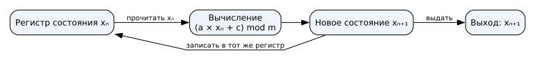
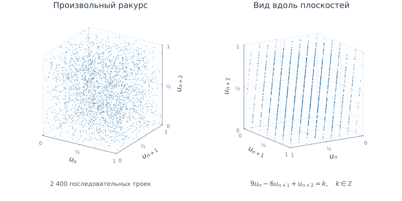
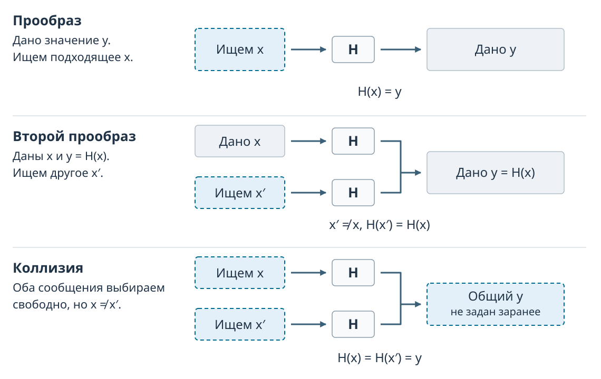

## Семинар 5 — Криптография {#sec-seminar-5}

## Случайность {#sec-seminar-5-randomness}

### Назначение случайности

Секретный ключ должен быть труден для угадывания. Для его создания нужна непредсказуемость способа выбора. Один набор битов по своему виду не раскрывает, как он получен.

### Генератор случайных чисел

Генератор выдаёт последовательность значений. Детерминированный генератор хранит **состояние**, вычисляет по нему следующее состояние и выдаёт результат.

Одинаковые начальное состояние и правило перехода воспроизводят одинаковую последовательность. Начальное значение называют `seed`. Устройство генератора: @theory:sec-theory-crypto-random.

### Линейный конгруэнтный генератор

Линейный конгруэнтный генератор (LCG) обновляет состояние по правилу

$$x_{n+1}=(a x_n+c)\bmod m.$$

$x_n$ — текущее состояние, $x_{n+1}$ — следующее; $a$ — множитель, $c$ — слагаемое, $m$ — модуль. Начальное состояние обозначено $x_0$. Остаток по модулю $m$ лежит от $0$ до $m-1$.

### Обратная связь генератора

{#fig-slide-lcg-feedback .nostretch fig-alt="Вычисление получает текущее состояние, записывает новое в тот же регистр и выдаёт выход" width="95%"}

Регистр хранит $x_n$; вычисление записывает $x_{n+1}$ обратно и выдаёт его. Следующий переход начинается с нового состояния.

### Пример LCG

Для $a=5$, $c=1$, $m=16$, $x_0=2$ правило имеет вид $x_{n+1}=(5x_n+1)\bmod16$.

| Шаг | Вычисление | Состояние |
|---|---|---:|
| 1 | $(5\times2+1)\bmod16$ | 11 |
| 2 | $(5\times11+1)\bmod16$ | 8 |
| 3 | $(5\times8+1)\bmod16$ | 9 |

Через 16 переходов состояние 2 повторится, после чего повторится последовательность. Это период данного запуска.

### Генератор: опыт {.smaller}

Для $x_{n+1}=(5x_n+1)\bmod16$ и $x_0=2$ нажмите «Шаг» три раза: выходы `11`, `8`, `9`. Сбросьте состояние до `2` и сравните повторную последовательность.



### Предсказуемость

В полном периоде примера каждое состояние от 0 до 15 встречается один раз. Младший бит чередуется: $0,1,0,1,\ldots$; зная текущий бит, можно назвать следующий, хотя частоты нулей и единиц равны.

Для секретных ключей используют криптографический генератор CSPRNG: его состояние защищено, а источник энтропии даёт непредсказуемые данные.

### RANDU

RANDU — LCG с правилом $x_{n+1}=65539x_n\bmod 2^{31}$. Нормализуем выход: $u_n=x_n/2^{31}$. Каждая точка задаётся тройкой последовательных выходов $(u_n,u_{n+1},u_{n+2})$.

### RANDU {.continuation}

{#fig-slide-randu fig-alt="Одно облако троек RANDU показано с двух сторон; второй ракурс выявляет параллельные плоскости" width="95%"}

Параллельные плоскости справа обнаруживают зависимость соседних выходов.

### Прогноз LCG

Выход равен состоянию. Для известных $a$, $c$, $m$ последний выход позволяет вычислить следующий. Если параметры неизвестны, несколько переходов дают уравнения для их восстановления. Для шести выходов примера получены $a=25173$, $c=13849$, $m=65536$.

### Прогноз LCG {.continuation}

{#fig-slide-lcg-recovery fig-alt="В конкретном примере по шести полным выходам восстановлены неизвестные параметры и предсказано продолжение" width="100%"}

Последний выход $21259$ даёт прогноз $65216$.

### Прогноз Mersenne Twister

MT19937 хранит состояние из 624 слов. Каждый полный 32-битный выход получен обратимым преобразованием слова состояния; 624 последовательных полных выхода позволяют восстановить состояние для прогноза.

### Прогноз Mersenne Twister {.continuation}

{#fig-slide-mt-prediction fig-alt="Прогноз после 624 полных 32-битных выходов совпадает с фактическим продолжением" width="100%"}

Прогноз четырёх выходов совпал с продолжением генератора.

### Вопрос для аудитории



## Хеширование {#sec-seminar-5-hashes}

### Назначение хеша

Чтобы сравнить данные с сохранённым эталоном, вычисляют компактное значение от их байтов. При проверке файла получатель повторяет вычисление и сравнивает результат с доверенным эталоном.

### Хеш-функция

**Хеш-функция** $H$ преобразует допустимую последовательность байтов в дайджест фиксированной длины. Для одной и той же последовательности байтов заданная функция всегда выдаёт одинаковый результат.

Входы могут иметь разную допустимую длину. SHA-256 выдаёт 256 бит, или 32 байта, для каждого входа. Свойства хеша: @theory:sec-theory-crypto-hash.

### Длина дайджеста

{#fig-slide-hash-length fig-alt="Три строки разной длины имеют дайджесты SHA-256 по 256 бит" width="100%"}

Разные входы могут дать одинаковый дайджест: такое совпадение называется **коллизией**.

### Пример коллизии

Для `String.hashCode` в Java строки `Aa` и `BB` обе дают **2112**:

$31\cdot65+97=2112$; $31\cdot66+66=2112$.

Хеш-таблица при совпадении хешей сравнивает сами ключи и различает эти записи.

### Вопрос: совпадение хешей



### Лавинный эффект

У криптографического хеша изменение одного бита входа распространяется по дайджесту. Для UTF-8 строк `abc` и `abb` различаются 124 из 256 битов SHA-256.

Число изменившихся битов зависит от пары входов. Вычислительная трудность поиска коллизии определяется отдельно.

### Криптографическая стойкость

Для функции $H$ рассматривают три задачи поиска:

- **Прообраз:** по заданному дайджесту $y$ найти $x$ с $H(x)=y$.
- **Второй прообраз:** по заданному $x$ найти другой $x'$ с $H(x')=H(x)$.
- **Коллизия:** найти любые два разных входа с одинаковым дайджестом.

Для криптографического применения эти задачи должны быть вычислительно трудными.

### Задачи поиска

{#fig-slide-hash-security-goals fig-alt="В задаче прообраза задан хеш, второго прообраза — вход, коллизии — выбираются оба разных входа" width="95%"}

При поиске второго прообраза исходный вход уже задан; при поиске коллизии можно выбирать оба входа.

### Коллизия при усечении

Если оставить 12 первых бит SHA-256 от UTF-8, `Файл 16` и `Файл 46` имеют общий префикс `2a5`. Это коллизия усечённого результата; полные SHA-256 различаются.

### Проверка файла

Получатель вычисляет хеш скачанного файла и сравнивает его с **доверенным** эталоном. Совпадение позволяет проверить неизменность файла относительно эталона.

Если атакующий заменил файл вместе с опубликованным рядом хешем, совпадение сохранится. Происхождение эталона проверяют отдельно, например по подписи списка хешей.

### Вопрос: проверка файла



## Ключи {#sec-seminar-5-keys}

### Секретный ключ

Шифрование защищает содержание сообщения от постороннего наблюдателя. **Ключ** задаёт секрет преобразования; его создают с помощью CSPRNG и защищают от раскрытия.

При симметричном шифровании отправитель и получатель используют общий секретный ключ. Участникам требуется безопасно получить его до обмена. Создание ключа: @theory:sec-theory-crypto-key-gen.

### Распределение ключей

Для $n$ участников с отдельным общим ключом для каждой пары нужно $n(n-1)/2$ ключей: каждая пара посчитана дважды при перечислении партнёров каждого участника.

Для пяти человек это $5\cdot4/2=10$ ключей. Каждый ключ требуется доставить обоим участникам своей пары.

### Вопрос: распределение ключей



## Симметричное шифрование {#sec-seminar-5-encryption}

### Шифротекст

При шифровании открытое сообщение $M$ преобразуется ключом $K$ в шифротекст $C$: $C=E_K(M)$. Получатель применяет обратное преобразование с тем же секретным ключом: $M=D_K(C)$.

Описание алгоритма может быть открытым; секретность зависит от ключа и соблюдения условий схемы. Симметричное шифрование: @theory:sec-theory-crypto-cypher.

### Шифр Цезаря

Шифр Цезаря сдвигает каждую букву на заданное число позиций по кругу алфавита. Обратный сдвиг восстанавливает текст; число позиций играет роль ключа.

В русском алфавите 33 возможных сдвига, включая нулевой. Их перебор делает шифр непригодным для защиты сообщения.

### Цезарь: целая фраза

Алфавит: `абвгдеёжзийклмнопрстуфхцчшщъыьэюя`; сдвиг на 3 вправо, включая `ё`, по кругу. Регистр сохраняется, пробелы и знаки не меняются.

`привет, ёж!` → `тулезх, ий!` → при сдвиге на 3 влево `привет, ёж!`.

### Цезарь: опыт {.smaller}

Зашифруйте `привет, ёж!` сдвигом на 3: получится `тулезх, ий!`. Обратным сдвигом −3 восстановите исходную фразу.



### Исключающее ИЛИ

Операция XOR ($\oplus$) даёт 0 для одинаковых битов и 1 для разных. Повторный XOR с тем же битом восстанавливает исходное значение.

Для сообщения $M$, потока $K$ и шифротекста $C$: $C=M\oplus K$, $M=C\oplus K$. Текст перед операцией кодируется в байты.

### Пример XOR

UTF-8 строки `AB` — байты `41 42` в hex. При потоке `10 20`:

$\mathtt{41\ 42}\oplus\mathtt{10\ 20}=\mathtt{51\ 62}$.

Повторный XOR с `10 20` восстанавливает `41 42`, то есть `AB` в UTF-8.

### Повтор потока

Если для двух сообщений повторён поток $K$, то $C_1=M_1\oplus K$ и $C_2=M_2\oplus K$. При сравнении шифротекстов одинаковые потоки сокращаются:

$$C_1\oplus C_2=M_1\oplus M_2.$$

Если известно первое сообщение, второе восстанавливается как $M_2=C_1\oplus C_2\oplus M_1$.

### Вопрос: обратное преобразование



### Аутентифицированное шифрование

AES и ChaCha20 — симметричные шифры. Схемы AEAD, например AES-GCM и ChaCha20-Poly1305, защищают содержимое и проверяют его подлинность.

Передаваемая запись содержит `nonce | шифртекст | тег`. При неверном теге получатель отвергает данные; дополнительные открытые данные также могут проверяться.

### Nonce

**Nonce** различает операции шифрования. Для AES-GCM и ChaCha20-Poly1305 его нельзя повторять с одним ключом: повтор воспроизводит поток шифрования и нарушает гарантии проверки подлинности.

Nonce обычно передаётся открыто вместе с шифртекстом. Правила выбора и длина определяются схемой.

## Хранение паролей {#sec-seminar-5-passwords}

### Проверка пароля

Сервису нужно проверить введённый пароль при входе. Он сохраняет проверочное значение парольной функции, соль и параметры вычисления.

При входе сервис снова вычисляет значение из введённого пароля с сохранёнными солью и параметрами. Совпадение с записью позволяет принять пароль. Проверочная запись: @theory:sec-theory-password-storage.

### Соль

**Соль** — открыто сохраняемое случайное значение, выбранное отдельно для парольной записи. Оно входит в вычисление вместе с паролем.

Разные соли требуют отдельного вычисления каждого кандидата для разных записей. Слабый пароль по-прежнему можно угадать перебором.

### Парольная функция

Парольная функция выработки ключа (KDF) вычисляет результат из пароля и соли с заданной стоимостью. PBKDF2-HMAC-SHA-256 задаёт число итераций; Argon2id также позволяет задать расход памяти и параллелизм.

При утечке записей атакующий проверяет кандидатов **офлайн**, без обращения к сервису. Затратная функция увеличивает стоимость каждой такой проверки.

### Пространство паролей

При независимом равновероятном выборе $L$ символов из алфавита размера $A$ возможны $N=A^L$ паролей. При проверке каждого кандидата один раз средний номер правильной проверки равен $(N+1)/2$.

### Стоимость перебора

Для четырёх десятичных цифр $N=10^4=10000$; средний номер проверки — $5000{,}5$. При условных 20 мс на последовательную проверку это около 100 секунд.

Люди выбирают пароли неравномерно: словарь распространённых вариантов может найти пароль раньше средней позиции равномерной модели.

### Вопрос: цена перебора


