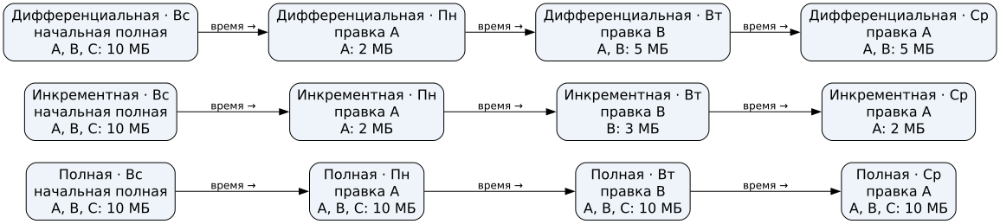
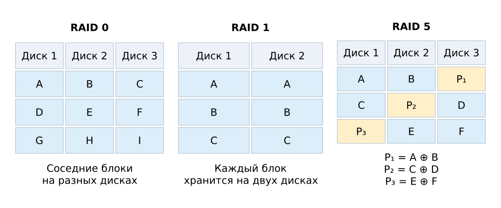

## Занятие 6 – Целостность и копии {#sec-seminar-6}

## Проверка целостности {#sec-seminar-6-integrity}

### Что показывает проверка

Простая сумма обнаруживает некоторые изменения, но `[10,20,30]` и `[20,10,30]` дают 60. Криптографический хеш сравнивают с **доверенным эталоном**. Совпадение с подменённым эталоном не доказывает происхождение файла.


### Сравнение контрольных значений

{#fig-slide-integrity-sum-hash fig-alt="Сравнение контрольных значений"}

### Вопрос для аудитории




### Замена файла и эталона

```{ojs}
//| echo: false
//| label: fig-slide-integrity-reference
//| fig-cap: "Замена файла и эталона"
integrityLesson = await import(await FileAttachment("/_prepared/visualizations/data-integrity/lesson.js").url())
integrityLesson.referenceReplacement()
```

## Резервное копирование и восстановление {#sec-seminar-6-backups}

### Три схемы на одних изменениях

Целые файлы A = 2, B = 3, C = 5 МБ; воскресенье — полная копия, затем изменяются A, B и снова A. Копируем ежедневно после правки.

| День | Полная | Инкрементная | Дифференциальная |
|---|---|---|---|
| Пн | A, B, C | A | A |
| Вт | A, B, C | B | A, B |
| Ср | A, B, C | A | A, B |

::: {.notes}
Инкремент зависит от предыдущей копии; дифференциальная копия содержит изменения с последней полной. Повторная правка A не создаёт второй файл A в копии среды.
:::

### Вопрос для аудитории {.smaller}




### Сравнение объёма копий

{#fig-slide-integrity-copy-scales fig-alt="Сравнение трёх схем копирования"}

### Восстановление копии

Для состояния среды в этой цепочке нужны:

- инкрементная схема: воскресная полная и все три инкремента по порядку;
- дифференциальная схема: воскресная полная и копия среды.

Копию хранят независимо и проверяют восстановлением.

## Массивы дисков и восстановление {#sec-seminar-6-raid}

### RAID 0, 1 и 5

| Массив | Принцип | Диски по 2 ТБ | Полезно | Один отказ |
|---|---|---:|---:|---|
| RAID 0 | Чередование | 3 | 6 ТБ | Весь набор недоступен |
| RAID 1 | Зеркало | 2 | 2 ТБ | Выдерживает |
| RAID 5 | Данные и чётность | 3 | 4 ТБ | Выдерживает |

Предполагаются исправные остальные диски и метаданные; служебными расходами пренебрегаем.


### Размещение данных в RAID

{#fig-slide-integrity-raid fig-alt="Размещение блоков по дискам"}

### Восстановление XOR

`P = A XOR B`, `A = 1010`, `P = 0110` → `B = A XOR P = 1100`.

Из одного P нельзя однозначно вернуть оба отсутствующих блока: `0000 XOR 0110 = 0110` и `1010 XOR 1100 = 0110`.


### Иллюстрация восстановления XOR

```{ojs}
//| echo: false
//| label: fig-slide-integrity-xor
//| fig-cap: "Восстановление блока по XOR"
integrityLesson.xorRecovery()
```

### Вопрос для обсуждения {.smaller}



## Дополнительные материалы {#sec-seminar-6-additional}

### Запас: простая сумма

```{ojs}
//| echo: false
//| label: fig-slide-integrity-collision
//| fig-cap: "Коллизия простой суммы"
integrityLesson.sumCollision()
```

### Запас: изменение байта

```{ojs}
//| echo: false
//| label: fig-slide-integrity-byte
//| fig-cap: "Изменение байта"
integrityLesson.byteChange()
```

### Запасные вопросы {.smaller}

По времени занятия выберите один: @tasks:exr-data-integrity-sum, @tasks:exr-data-integrity-backup-chain, @tasks:exr-data-integrity-raid-capacity, @tasks:exr-data-integrity-mirror-history или @tasks:exr-data-integrity-xor.

### Дополнительная работа

@tasks:exr-data-integrity-backup.
