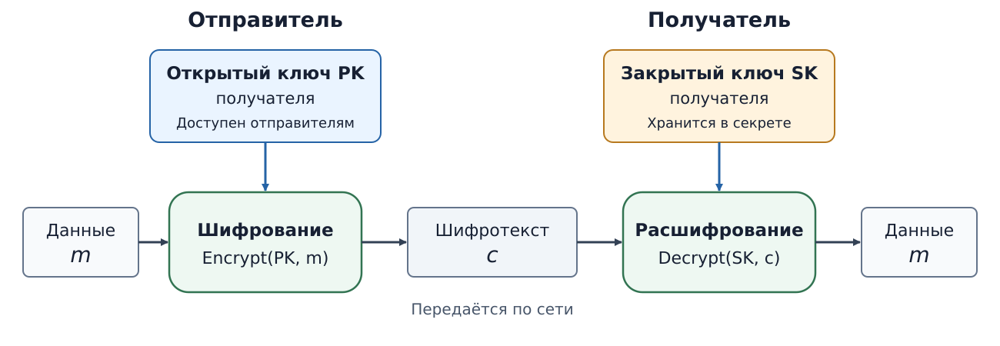
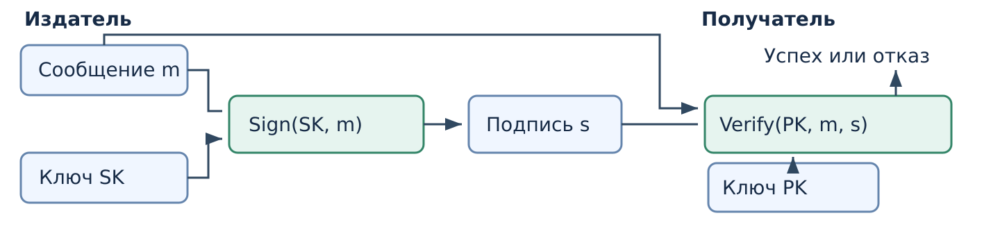

## Асимметричное шифрование {#sec-seminar-6}

При симметричном шифровании отправитель и получатель используют
**общий секретный ключ**. Чтобы передать конфиденциальный отчёт, им нужно
сначала получить один и тот же ключ, не раскрыв его постороннему.
Если стороны ещё не согласовали секрет, асимметричное шифрование позволяет
отправителю защитить сообщение для получателя без заранее общего ключа.

### Пара асимметричных ключей {#sec-seminar-6-key-pair}

Получатель создаёт **два связанных ключа**:

| Ключ | Кому доступен | Для чего служит при шифровании |
|---|---|---|
| Открытый $PK$ | Можно сообщить отправителям | Зашифровать данные получателю |
| Закрытый $SK$ | Сохраняется у получателя | Расшифровать адресованные ему данные |

Связь ключей устроена так, что сообщение, зашифрованное открытым ключом,
расшифровывается соответствующим закрытым. Знание открытого ключа
позволяет любому отправить сообщение владельцу, но не даёт практически
осуществимого способа прочитать чужой шифротекст или восстановить закрытый
ключ. Открытый ключ можно передать по сети; отправителю при этом важно
установить, что он принадлежит **нужному получателю**.

.

### Шифрование получателю {#sec-seminar-6-encryption}

$m$ — байты отчёта, $c$ — передаваемый шифротекст.

::: {.trust-figure}
{#fig-seminar-6-asymmetric-encryption fig-alt="Отправитель шифрует данные m открытым ключом PK получателя. Получатель расшифровывает переданный шифротекст c своим закрытым ключом SK."}
:::

Отправитель шифрует **открытым ключом получателя**;
получатель расшифровывает **своим закрытым**.
Общий секрет заранее не передавали.

.

### Выбор ключа для отчёта

:::: {#exr-data-trust-slide-wrong-recipient difficulty="introductory"}
#### Отчёт не открывается

**Отправитель** по ошибке зашифровал отчёт **своим открытым ключом**.
**Получатель** не смог расшифровать пакет своим закрытым ключом.
Исходный отчёт сохранился; открытый ключ получателя известен.

1. Чей закрытый ключ подходит к ошибочному пакету?
   Какой ключ выбрать для повторного шифрования получателю?
2. Посторонний знает открытый ключ получателя. Может ли он зашифровать
   свой файл для получателя? А расшифровать чужие отчёты?
::::

.

### Ключевая пара RSA {#sec-seminar-6-rsa}

RSA — пример семейства асимметричных схем. При создании пары выбирают
большие простые числа $p$ и $q$ и вычисляют модуль $n=pq$.

| Открытая часть | Закрытая часть |
|---|---|
| Модуль $n$ и показатель $e$: $(n,e)$ | Секретный показатель и параметры, связанные с $p$ и $q$ |

Открытая часть доступна отправителям; секретные параметры владелец защищает.
Для шифрования применяют схему RSA-OAEP, для подписи — RSA-PSS.

.

### Стойкость RSA {#sec-seminar-6-rsa-security}

При создании ключа перемножают большие простые числа:

$$p \times q = n$$

Обратная задача — найти множители по известному $n$ — называется
**факторизацией**. Для правильно выбранного большого модуля она практически
трудна. Знание множителей позволяет восстановить секретные параметры RSA.

Это не означает, что любая атака на RSA обязательно сводится к факторизации.
Безопасность зависит также от выбора параметров и схемы применения.

### Длина криптографического ключа {#sec-seminar-6-key-length}

Длина записи ключа и оценка стойкости — разные величины. Для классических
атак NIST приводит такие ориентиры:

| Схема | Размер ключа или модуля | Оценка стойкости |
|---|---:|---:|
| AES | ключ 128 бит | 128 бит |
| RSA | модуль 3072 бита | около 128 бит |

Сопоставление означает близкую оценку трудоёмкости атак, а не способ
превратить ключ AES в пару RSA. Сравнение не учитывает квантовые атаки.

Источник: [\[\*\]](https://nvlpubs.nist.gov/nistpubs/SpecialPublications/NIST.SP.800-57pt1r5.pdf#page=66){title="NIST SP 800-57 Part 1 Rev. 5, таблица 2"}.

## Хеш скачанного файла {#sec-seminar-6-download}

Хеш $d=G(m)$ — дайджест фиксированной длины, вычисленный по байтам
файла $m$. Его сравнивают с эталоном ожидаемого файла.

Пример из выпуска PowerShell 7.4.6: SHA-256 файла
*PowerShell-7.4.6-win-x64.msi*:

```text
ED331A04679B83D4C013705282D1F3F8D8300485EB04C081F36E11EAF1148BD0
```

Проверка скачанного файла:

```powershell
Get-FileHash .\PowerShell-7.4.6-win-x64.msi -Algorithm SHA256
```

Для вычисления хеша **секретный ключ не нужен**. Чтобы сверка позволяла
судить о содержимом ожидаемого файла, нужен достоверный эталон; его
источник оценивают отдельно.

Источник: [\[\*\]](https://github.com/PowerShell/PowerShell/releases/tag/v7.4.6){title="выпуск PowerShell 7.4.6"}.
.

### Проверка установщика

:::: {#exr-data-trust-slide-download-reference difficulty="introductory"}
#### Две проверки установщика

Хеш установщика совпал с хешем на странице загрузки. Но сайт взломан:
посторонний мог заменить **и файл, и значение на странице**.

1. Как подменить файл, чтобы эта проверка прошла? Нужна ли коллизия?
2. До взлома хеш этого выпуска получили от разработчика и сохранили
   на отключённой флешке. Хеш скачанного файла совпал и с этой записью.
   Что теперь можно заключить?
::::

.

## Подписываемое сообщение {#sec-seminar-6-signature-message}

Хеш может вычислить любой, у кого есть файл. Сам по себе хеш
не подтверждает, **кто подготовил данные**: файл можно заменить,
а хеш пересчитать.

**Цифровая подпись** связывает сообщение с ключом подписывающего.
Учебный отдел публикует:

| Данные | Что это |
|---|---|
| Сообщение $m$: *notice.txt* | Точные байты текста «Кабинет 214» |
| Подпись $s$: *notice.sig* | Дополнительные данные для проверки сообщения |

Читать объявление может любой. Подпись нужна для проверки происхождения,
а не для сокрытия текста.

### Создание подписи {#sec-seminar-6-signature}

Отдел создаёт подпись **своим закрытым ключом $SK$**.
Читатель проверяет её **открытым ключом отдела $PK$**.

::: {.trust-figure}
{#fig-seminar-6-signature-flow fig-alt="Учебный отдел создаёт подпись s операцией Sign по сообщению m и закрытому ключу SK. Читателю передаются сообщение и подпись. Проверка Verify использует m, s и открытый ключ PK отдела и возвращает успех или отказ."}
:::

`Sign` получает сообщение и закрытый ключ и создаёт подпись $s$.
`Verify` получает сообщение $m$, подпись $s$ и открытый ключ и возвращает
**успех или отказ**. Оба ключа принадлежат **подписывающему**.
Успех связывает сообщение с этим ключом; чтобы назвать автора, нужно
доверять принадлежности открытого ключа отделу и сохранности закрытого.

.

### Подпись дайджеста {#sec-seminar-6-signature-digest}

Хеш представляет файл дайджестом фиксированной длины, который можно
подписать вместо полного файла. Проверка связывает подпись с полученными
байтами, если проверяющий сам вычисляет дайджест.
$m$ — сообщение; $d$ — его дайджест; $s$ — подпись.

::: {.columns}
:::: {.column width="48%"}
**Подписывающий**

1. Вычисляет $d=G(m)$ по всем байтам файла.
2. Создаёт $s=\operatorname{SignDigest}(SK,d)$ своим закрытым ключом.

Передаёт **файл $m$ и подпись $s$**.
::::

:::: {.column width="48%"}
**Проверяющий**

1. Сам вычисляет $d=G(m)$ по полученному файлу.
2. Выполняет $\operatorname{VerifyDigest}(PK,d,s)$ открытым ключом подписывающего.

Получает **успех или отказ**.
::::
:::

Здесь `SignDigest` создаёт подпись дайджеста, `VerifyDigest` проверяет её.
Проверяющий вычисляет дайджест заново: переданного кем-либо значения
недостаточно для проверки полученного файла. Для безопасности этой схемы
нужны стойкая к коллизиям хеш-функция и безопасная схема подписи дайджеста.
Подпись — отдельные данные; текст файла остаётся читаемым.

.

### Исправление подписанного файла

:::: {#exr-data-trust-slide-edited-notice difficulty="introductory"}
#### Новый номер кабинета

**Учебный отдел** подписал файл объявления своим закрытым ключом.
**Редактор** изменил номер кабинета: прежняя подпись больше не проверяется.
Он подписал исправленный файл своим ключом; новая подпись проверяется.

1. Подписан ли исправленный файл ключом учебного отдела?
   Что подтверждает подпись редактора?
2. Какой файл передать отделу для новой подписи?
   Какими ключами её создать и проверить?
::::

.

### Назначение ключей {#sec-seminar-6-key-roles}

:::: {#exr-data-trust-slide-key-roles difficulty="introductory"}
#### Выбор ключей для четырёх операций

Нужно передать секретный отчёт **получателю** и проверить публичное
объявление **издателя**. У каждого своя пара ключей. Обозначения:
$m$ — сообщение, $c$ — шифротекст, $d=G(m)$ — дайджест, $s$ — подпись.

Для каждой операции укажите вход, результат, тип ключа и его владельца.

| Операция | Вход | Результат | Тип ключа и владелец |
|---|---|---|---|
| Зашифровать отчёт | ? | ? | ? |
| Расшифровать отчёт | ? | ? | ? |
| Создать подпись дайджеста | ? | ? | ? |
| Проверить подпись дайджеста | ? | ? | ? |

Файл объявления $m$ и подпись $s$ лежат в открытой папке.
Нужен ли постороннему ключ, чтобы **прочитать объявление**?
::::

.

### Издатель программы в Windows {#sec-seminar-6-authenticode}

Успешная проверка подписи сама по себе не устанавливает, кому принадлежит
открытый ключ. Сертификат связывает ключ с именем; этой связи доверяют
при проверке подписи удостоверяющей стороны.

Для выбранного *setup.exe* можно получить состояние подписи и имя
субъекта сертификата:

```powershell
$sig = Get-AuthenticodeSignature -FilePath .\setup.exe
$sig.Status
$sig.SignerCertificate.Subject
```

Например, **учебный результат** для программы ожидаемого издателя
`Example Software Ltd` может выглядеть так:

```text
Valid
CN=Example Software Ltd
```

`Valid` означает, что система приняла подпись; имя в `Subject` сопоставляют
с ожидаемым издателем. Значения зависят от файла и среды проверки.

[\[\*\]](https://learn.microsoft.com/en-us/powershell/module/microsoft.powershell.security/get-authenticodesignature){title="Get-AuthenticodeSignature"}.

## Сертификат открытого ключа {#sec-seminar-6-certificate}

Сертификат связывает имя субъекта с его открытым ключом; эту связь
подписывает удостоверяющая сторона.

Браузер открывает `https://portal.example`. Сертификат сайта содержит имя
`portal.example` и открытый ключ $P$. Браузер проверяет имя, назначение,
срок действия и путь к доверенной стороне. Сервер также подтверждает,
что владеет соответствующим закрытым ключом.

Сертификат другого сайта не подтверждает ключ `portal.example`.

.

### Цепочка сертификатов {#sec-seminar-6-certificate-chain}

В хранилище браузера заранее принят корневой ключ $R$. Сайт передаёт
сертификат центра с ключом $C$ и сертификат сайта с ключом $P$.

| Проверяемая подпись | Какой ключ нужен | Что устанавливается |
|---|---|---|
| На сертификате центра $C$ | Заранее доверенный $R$ | Ключ $C$ принадлежит центру, которому разрешена выдача сертификатов |
| На сертификате сайта $P$ | Проверенный ключ $C$ | Ключ $P$ связан с именем `portal.example` |

Проверка начинается с заранее принятого $R$ и устанавливает путь к $P$.
Самоподпись неизвестного корня сама по себе доверия не создаёт.

.

### Проверка сертификатов

::: {#exr-data-trust-slide-certificate-check difficulty="introductory"}
#### Два звена цепочки

Браузер заранее доверяет ключу $R$. Сертификат центра содержит ключ $C$
и подписан корневой стороной. Сертификат `portal.example` содержит ключ
$P$ и подписан центром $C$.

Студент проверил подпись сертификата сайта ключом $C$ и на этом основании
принял ключ $P$. Сертификат центра он не проверял.
Какой проверки не хватает и каким заранее доверенным ключом её выполнить?
:::

## Дополнительная работа {#sec-seminar-6-additional}

- Гибридное шифрование — : защита файла симметричным ключом и передача этого ключа получателю.
- Подпись без файла — : какие данные нужны для проверки подписи документа.
- Достроить цепочку — : выбрать путь к заранее доверенному ключу.
- Подпись Лэмпорта — : проследить внутренние действия конкретной схемы.

;
.
