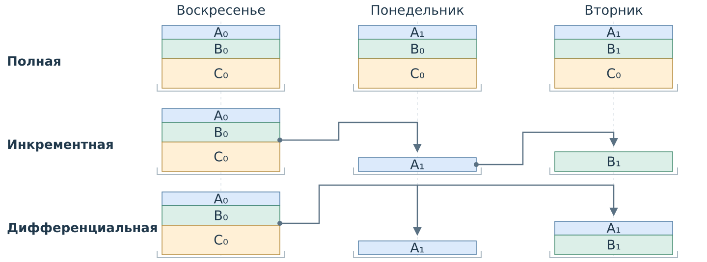
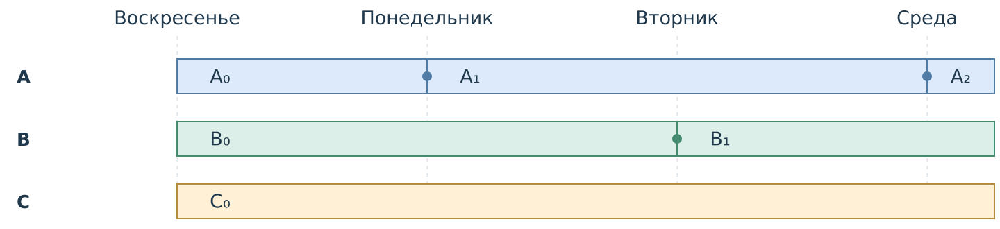
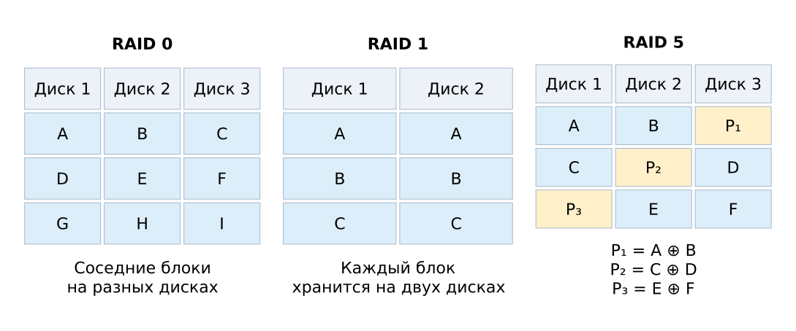
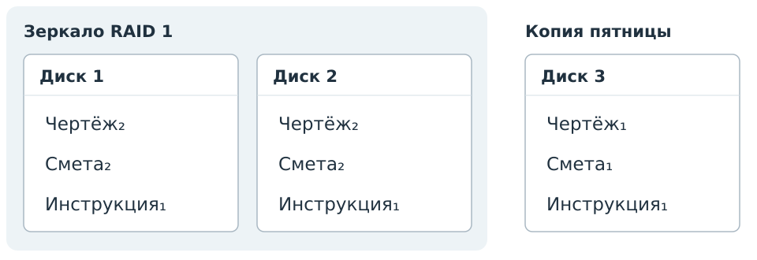

## Резервное копирование {#sec-seminar-7}

В рабочей папке могут удалить файл, ошибочно изменить документ или потерять данные при отказе диска. Для продолжения работы нужны конкретные версии файлов.

### Резервная копия

Резервная копия сохраняет данные для восстановления после потери или повреждения рабочего экземпляра. Она отражает состояние на момент создания.

Независимое хранение помогает пережить событие, затронувшее рабочие данные. Из копии можно вернуть сохранённую версию; последующие изменения требуют другого источника.

.

### Виды резервных копий

| Вид | Что сохраняется |
|---|---|
| Полная | Весь выбранный набор данных |
| Инкрементная | Изменения после предыдущей копии |
| Дифференциальная | Изменения после последней полной копии |

,  и .

### Содержимое резервных копий

В воскресенье сохранены A₀, B₀, C₀. В понедельник изменён только A,
во вторник — только B. Копируются целые файлы.

{#fig-slide-preservation-backup-types fig-alt="Полная схема: в каждую копию входят A, B и C. Инкрементная: после полной копии в понедельник сохраняется A₁, во вторник B₁. Дифференциальная: в понедельник A₁, во вторник A₁ и B₁. Стрелки указывают, после какой копии отсчитываются изменения." height=440}

Стрелки показывают, после какой копии отсчитываются изменения.

### Состав копии

:::: {#exr-slide-preservation-backup-volume difficulty="introductory"}
#### Копия среды

Копируются целые файлы: A — 2 МБ, B — 3 МБ, C — 5 МБ.
В воскресенье сохранена полная копия; далее копии создаются ежедневно после правки.
Индекс обозначает версию; точка на полосе — замену версии.

{#fig-slide-preservation-backup-history fig-alt="Воскресенье: A₀, B₀, C₀. Понедельник: A₁, B₀, C₀. Вторник: A₁, B₁, C₀. Среда: A₂, B₁, C₀." height=300}

Какие версии войдут в полную, инкрементную и дифференциальную копии среды? Каков объём каждой?
::::

## Восстановление версий

Цель восстановления задаёт нужное состояние данных (). Если копии содержат целые файлы и каждый можно извлечь отдельно, для каждой нужной версии выбирают доступный источник.

| Источник | Доступная версия файла |
|---|---|
| Копия 1 | A₁ |
| Копия 2 | A₂ |

Для цели **A₂** выбирают копию 2.

Более поздняя версия не заменяет другую версию, если требуется прежнее состояние. Правила конкретной программы восстановления могут отличаться.

### Восстановление папки

:::: {#exr-slide-preservation-restore difficulty="intermediate"}
#### Вернуть состояние вторника

Из любой копии можно извлечь отдельный целый файл. Индексы обозначают версии.

| Копия | Инкрементная схема | Дифференциальная схема |
|---|---|---|
| Воскресенье, полная | A₀, B₀, C₀ | A₀, B₀, C₀ |
| Понедельник | A₁ | A₁ |
| Вторник | B₁ | A₁, B₁ |
| Среда | C₁ | A₁, B₁, C₁ |

Нужно собрать папку **A₁, B₁, C₀**. Для каждой схемы выберите минимальное число копий и источник каждой версии. Используйте только столбец выбранной схемы.
::::

### Проверка резервной копии

Пробное восстановление проверяет, доступны ли копия и нужные версии и можно ли получить пригодные данные.

- Выбрать копию и восстановить данные в отдельное место.
- Проверить наличие нужных файлов, их версии и возможность работы с ними.
- Устранить обнаруженные проблемы и повторить проверку.

## Дисковый массив {#sec-seminar-7-raid}

RAID объединяет диски в массив и распределяет по ним блоки данных. Избыточность в некоторых уровнях позволяет сохранить доступ к данным при отказе диска. Чередование блоков может также распределять операции между дисками.

.

### Размещение данных в RAID

{#fig-slide-integrity-raid fig-alt="Размещение блоков данных и чётности на дисках RAID 0, RAID 1 и RAID 5"}

### Ёмкость дискового массива

Один диск полностью отказал; отказ обнаружен, остальные диски исправны.

| Массив | Диски по 2 ТБ | Полезно | Один отказ диска |
|---|---:|---:|---|
| RAID 0 | 3 | 6 ТБ | Набор недоступен |
| RAID 1 | 2 | 2 ТБ | Доступен |
| RAID 5 | 3 | 4 ТБ | Доступен |

### Дисковое зеркало

RAID 1 хранит одинаковое текущее состояние на двух дисках. Запись новой версии и удаление файла отражаются на обоих дисках. При отказе одного диска данные доступны с исправного.

Зеркало само по себе не хранит прежние версии: для них нужна отдельно сохранённая копия.

### Восстановление проекта

:::: {#exr-slide-preservation-project difficulty="intermediate"}
#### Собрать папку проекта

Папка хранится на зеркале RAID 1. Есть отдельная копия пятницы. Индексы обозначают версии файлов.

{#fig-slide-preservation-project fig-alt="На каждом диске зеркала: чертёж₂, смета₂, инструкция₁. В копии пятницы: чертёж₁, смета₁, инструкция₁."}

Затем сохранили **чертёж₃**, удалили смету и потеряли диск 1. Для каждого файла выберите самую новую доступную версию и источник. Удастся ли вернуть последнюю сохранённую смету?
::::

### Выбор средства защиты

:::: {#exr-slide-preservation-choice difficulty="introductory"}
#### После события

Есть исправное зеркало RAID 1 и отдельная копия вчерашнего вечера. Других версий нет.

1. Один диск отказал. Как продолжить работу с текущими данными?
2. Сегодня файл ошибочно удалили на зеркале. Откуда его вернуть?
3. Какие изменения файла после вчерашней копии удастся вернуть из неё?
::::

## Дополнительные задачи {#sec-seminar-7-additional}

- 
- 
- 
