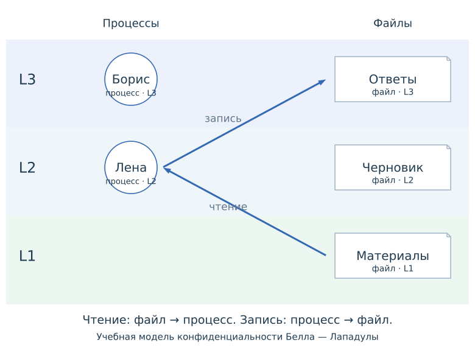

### Три уровня MAC

`L1 < L2 < L3`. Читать можно свой и нижние уровни; добавлять без чтения — свой и верхние.

{#fig-mac-overview width="60%" fig-alt="Процесс L2 и файлы L1, L2, L3"}

@fig-mac-overview — модель конфиденциальности без категорий и исключений.

### Применение политики {.smaller}



@fig-mac-decision: две схемы и пояснение следуют одному выбранному этапу.

### Независимый второй запрос {.smaller}

```{ojs}
//| echo: false
viewof macSecond = macLesson.macControls({initial:1})
```

```{ojs}
//| echo: false
//| label: fig-mac-second
//| fig-cap: "Второй запрос с удалённым пояснением уровней"
macLesson.macDiagram(macSecond, {request:"Для этого запроса выбран собственный этап."})
```

В @fig-mac-second удаление текста `levels` сохраняет проверку политики.

### Обычный банковский вопрос {.smaller}

::: {style="font-size:0.8em"}

:::

### Открытая демонстрация {.smaller}

::: {style="font-size:0.8em"}

:::
