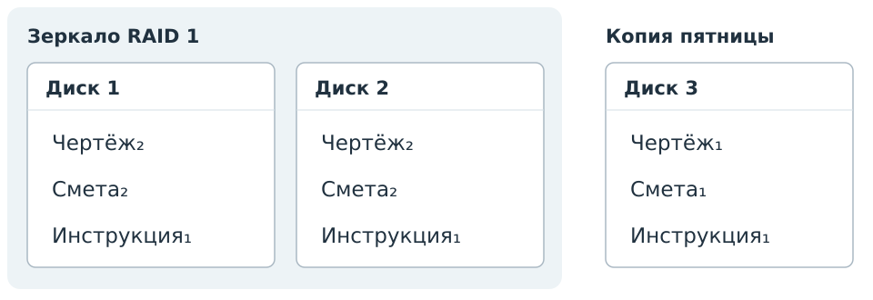
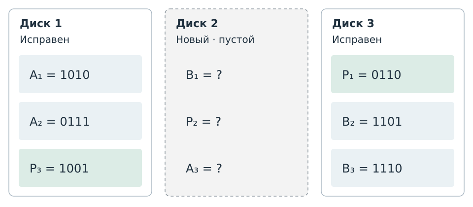

# Сохранность данных {#sec-bank-data-preservation}

::: {#exr-data-integrity-backup course-role="independent-study" difficulty="intermediate" time="90"}
### Виды резервных копий

С помощью утилиты <https://github.com/MatteoGuadrini/Butterfly-Backup> реализовать все 4 (полный, инкрементальный, дифференциальный и зеркальный) бекапы. Изменять исходные файлы, откатывать бекапы.

::: {course-role="deliverables"}
Предоставить архив с файлами резервных копий и краткий протокол изменений
и восстановления исходных файлов.
:::

::: {course-role="criteria"}
Показать каждый из четырёх способов резервного копирования и восстановление
файлов после изменений. Для каждого опыта указать исходное состояние,
содержимое резервной копии и результат восстановления.
:::
:::

::: {#exr-data-integrity-trusted-hash course-role="discussion" statement-visibility="open" difficulty="intermediate"}
### Доверие к эталону

На сайте лежали файл $F$ и его хеш $H(F)$. Атакующий заменил их на $G$ и $H(G)$. Проверка совпала. Доказано ли происхождение файла?
:::

::: {#sol-data-integrity-trusted-hash}
Нет. Совпадение проверено по подменённому эталону. Доверие к эталону нужно установить независимо; коллизию хеша здесь не искали.
:::

::: {#exr-data-integrity-backup-volume course-role="discussion" statement-visibility="open" difficulty="introductory"}
### Объём копий

Копируются целые файлы $A = 2$, $B = 3$, $C = 5$ МБ постоянного размера; добавлений, удалений, сжатия и дедупликации нет. В воскресенье сделана полная копия. В понедельник изменён A, во вторник B, в среду снова A; ежедневно после правки создаётся копия. Каков объём создаваемой в среду полной, инкрементной и дифференциальной копии?
:::

::: {#sol-data-integrity-backup-volume}
Соответственно 10, 2 и 5 МБ. Инкремент содержит A после предыдущей копии, дифференциальная — актуальные A и B после воскресной полной. Повторную правку A дважды не считают. Это объёмы копий среды, а не суммарного хранилища.
:::

::: {#exr-data-integrity-mirror-copy course-role="discussion" statement-visibility="open" difficulty="intermediate"}
### Защита от удаления

Два диска работают в RAID 1, есть отдельная исправная независимая резервная копия. В понедельник в 10:00 сотрудник удалил файл, и удаление отразилось на обоих дисках. Последняя копия воскресенья 23:00 содержит файл; после копии его изменяли. Других копий, корзины и снимков нет. Один администратор предлагает второй диск, другой — резервную копию. Сравните решения, назовите доступную версию и событие, от которого помогает зеркало.
:::

::: {#sol-data-integrity-mirror-copy}
**Событие и выбор источника.**

Зеркало повторило удаление, поэтому второй диск сам по себе прошлой версии не предоставляет. Независимая исправная копия содержит файл: из неё можно вернуть версию воскресенья 23:00.

**Граница восстановления.**

Последующие изменения по условию восстановить неоткуда. Наличие копии не доказывает сохранность более поздней версии. При отказе одного диска RAID 1 позволяет читать данные с другого исправного диска; это другая ситуация, чем отражённое удаление. Копия и зеркало отвечают на разные события и дополняют друг друга.
:::

::: {#exr-data-integrity-sum course-role="discussion" statement-visibility="open" difficulty="introductory"}
### Простая сумма

Найдите суммы байтов без переполнения для `[10,20,30]`, `[10,21,30]`, `[20,10,30]`. Какие массивы сумма не различает?
:::
::: {#sol-data-integrity-sum}
Суммы равны 60, 61 и 60. Первый и третий массивы различны, но сумма совпадает. Это простая сумма, а не криптографический хеш.
:::

::: {#exr-data-integrity-backup-chain course-role="discussion" statement-visibility="open" difficulty="introductory"}
### Цепочка восстановления

Копируются целые файлы только перезаписью. Полная копия воскресенья содержит A, B, C. В понедельник меняли только A, во вторник B, в среду C; ежедневно создаётся копия выбранного типа. Что нужно для восстановления состояния среды в инкрементной и дифференциальной схеме?
:::
::: {#sol-data-integrity-backup-chain}
В инкрементной схеме нужны три копии: понедельника с новой A, вторника с новой B и среды с новой C. В дифференциальной схеме достаточно копии среды: она содержит актуальные A, B и C. Полная копия воскресенья для этого состояния не нужна: все её файлы уже заменены новыми версиями. Выбор определяется содержимым копий; требование обязательно применять полную копию условием не задано.
:::

::: {#exr-data-integrity-raid-capacity course-role="discussion" statement-visibility="open" difficulty="introductory"}
### Ёмкость RAID

Отдельные массивы из дисков по 2 ТБ: RAID 0 — три диска, RAID 1 — два, RAID 5 — три. Служебными расходами пренебречь; остальные диски и метаданные исправны. Какова полезная ёмкость каждого массива и переживёт ли он один полный отказ диска?
:::
::: {#sol-data-integrity-raid-capacity}
Соответственно 6, 2 и 4 ТБ. Один отказ выдерживают RAID 1 и RAID 5; RAID 0 не обеспечивает чтение всего набора.
:::

::: {#exr-data-integrity-mirror-history course-role="discussion" statement-visibility="open" difficulty="introductory"}
### История изменений

Штатное удаление файла отразилось на обоих дисках RAID 1. Других копий, корзины и снимков нет. Можно ли средствами одного зеркала вернуть вчерашнюю версию?
:::
::: {#sol-data-integrity-mirror-history}
Нет: зеркало отражает текущее состояние, а история требует отдельно сохранённой версии. Восстановление секторов условием не предусмотрено.
:::

:::: {#exr-data-preservation-restore-tuesday course-role="discussion" statement-visibility="open" difficulty="introductory"}
### Вернуть состояние вторника

Копии содержат целые файлы. Из любой копии можно извлечь отдельный файл.
Индексы обозначают версии.

| День копии | Инкрементная схема | Дифференциальная схема |
|---|---|---|
| Воскресенье, полная | A₀, B₀, C₀ | A₀, B₀, C₀ |
| Понедельник | A₁ | A₁ |
| Вторник | B₁ | A₁, B₁ |
| Среда | C₁ | A₁, B₁, C₁ |

Нужно собрать папку **A₁, B₁, C₀** — состояние вторника.
Для каждой схемы выберите минимальное число копий и укажите,
из какой копии взять каждую версию. Используйте только столбец выбранной схемы.
::::

::: {#sol-data-preservation-restore-tuesday}
| Схема | Минимальный набор | Источники нужных версий |
|---|---|---|
| Инкрементная | Воскресенье, понедельник, вторник — 3 копии | A₁ из понедельника, B₁ из вторника, C₀ из воскресенья |
| Дифференциальная | Воскресенье и вторник — 2 копии | A₁ и B₁ из вторника, C₀ из воскресенья |

В инкрементном столбце каждая нужная версия находится только в одной копии;
все три источника необходимы.

В дифференциальной схеме также подходит **воскресенье и среда**:
из среды можно извлечь A₁ и B₁, оставив ненужную C₁ в копии.
По условию разрешено извлекать отдельные файлы.
Оба набора из двух копий принимаются.

Одной дифференциальной копии недостаточно: C₀ есть только в воскресной,
а в ней нет A₁ и B₁.
:::

:::: {#exr-data-preservation-missing-copy course-role="discussion" statement-visibility="open" difficulty="intermediate"}
### Копия вторника недоступна

Из каждой доступной копии можно извлекать отдельные целые файлы.
Копии вторника недоступны в обеих схемах.

| День копии | Инкрементная схема | Дифференциальная схема |
|---|---|---|
| Воскресенье, полная | A₀, B₀, C₀ | A₀, B₀, C₀ |
| Понедельник | A₁ | A₁ |
| Вторник | Недоступна | Недоступна |
| Среда | C₁ | A₁, B₁, C₁ |

Нужно состояние среды: **A₁, B₁, C₁**.
Для каждой схемы запишите самые новые доступные версии A, B и C.
Если нужную папку можно собрать, выберите минимальное число копий.
Если нельзя — укажите недостающую версию.
Используйте только столбец выбранной схемы.
::::

::: {#sol-data-preservation-missing-copy}
| Схема | Самые новые доступные версии | Достижимо состояние среды | Основание |
|---|---|---|---|
| Инкрементная | A₁, B₀, C₁ | Нет | B₁ нет ни в одной доступной копии |
| Дифференциальная | A₁, B₁, C₁ | Да | Все три версии есть в копии среды; достаточно одной копии |

Для инкрементной схемы A₁ берётся из понедельника, B₀ — из воскресенья,
C₁ — из среды. Получится папка с устаревшим B₀.
Это доступный результат, но он не совпадает с требуемым состоянием.

В дифференциальной копии среды сохранены все изменённые после воскресенья файлы.
В этом примере это вся нужная папка, поэтому полная копия для её сборки
не требуется. Недоступность вторника не мешает получить B₁ из среды.
:::

:::: {#exr-data-preservation-recovery-after-reedit course-role="discussion" statement-visibility="open" difficulty="intermediate"}
### Более поздняя версия того же файла

Сохранялись инкрементные копии с целыми файлами.
Из доступной копии можно извлечь любой сохранённый в ней файл.
Копия понедельника потеряна.

| Копия | Сохранённые версии | Доступность |
|---|---|---|
| Воскресенье, полная | A₀, B₀, C₀ | Доступна |
| Понедельник | A₁ | Потеряна |
| Вторник | B₁ | Доступна |
| Среда | A₂ | Доступна |

Нужно проверить два состояния папки:

- вторник: **A₁, B₁, C₀**;
- среда: **A₂, B₁, C₀**.

Какие из них можно собрать из доступных копий?
Для каждого достижимого состояния выберите минимальное число копий
и укажите источники файлов. Для недостижимого укажите недостающую версию.
::::

::: {#sol-data-preservation-recovery-after-reedit}
**Вторник восстановить нельзя:** A₁ находилась только в потерянной копии.
A₀ и A₂ — другие версии; наличие более позднего файла не возвращает A₁.

**Среду восстановить можно из трёх копий:**

| Нужная версия | Источник |
|---|---|
| A₂ | Среда |
| B₁ | Вторник |
| C₀ | Воскресенье |

Каждая нужная версия есть только в указанном источнике,
поэтому использовать меньше трёх копий не получится.
Потерянная A₁ для состояния среды не нужна: требуемая A₂ сохранена целиком.

Потеря одного инкремента в этой модели мешает получить определённую версию,
но не обязательно каждое более позднее состояние.
Решение определяется доступностью нужных версий файлов.
:::

:::: {#exr-data-preservation-project-recovery course-role="discussion" statement-visibility="open" difficulty="intermediate"}
### Собрать папку проекта

Папка проекта хранится на зеркале RAID 1. Есть отдельная копия пятницы.
Индексы обозначают версии файлов.

{#fig-project-storage-before fig-alt="На дисках 1 и 2 зеркала: чертёж₂, смета₂, инструкция₁. В отдельной копии пятницы: чертёж₁, смета₁, инструкция₁."}

Затем произошли три события:

1. В рабочей папке сохранили новую версию чертежа — **чертёж₃**.
2. Из рабочей папки случайно удалили смету.
3. **Диск 1 вышел из строя.**

Нужно собрать папку для продолжения работы. Для каждого файла выберите
самую новую доступную версию и укажите, откуда её взять.
Удастся ли вернуть последнюю сохранённую смету?
::::

::: {#sol-data-preservation-project-recovery}
| Файл | Самая новая доступная версия | Источник |
|---|---|---|
| Чертёж | Чертёж₃ | Диск 2 |
| Смета | Смета₁ | Отдельная копия пятницы |
| Инструкция | Инструкция₁ | Диск 2 или отдельная копия пятницы |

Новый чертёж записан на оба диска зеркала до отказа. Поэтому чертёж₃
доступен на диске 2, а возвращаться к чертежу₁ из копии не требуется.

Удаление сметы также выполнилось на обоих дисках. Последняя сохранённая
смета₂ утрачена; отдельно осталась только смета₁. Папку собрать можно,
но смета в ней будет устаревшей.

Инструкция не менялась. Оба указанных источника содержат одну и ту же
нужную версию; принимается любой из них.
:::

:::: {#exr-data-preservation-repeated-edit course-role="discussion" statement-visibility="open" difficulty="intermediate"}
### Повторная правка файла

В воскресенье сохранена полная копия. Затем копии создаются ежедневно
после изменений. Копируются целые файлы.

| День | A — 2 МБ | B — 3 МБ | C — 5 МБ |
|---|---|---|---|
| Воскресенье | A₀ | B₀ | C₀ |
| Понедельник | **A₁** | B₀ | C₀ |
| Вторник | A₁ | **B₁** | C₀ |
| Среда | **A₂** | B₁ | C₀ |

Индексы обозначают версии файлов. Жирным выделены обновлённые файлы.

1. Какие версии файлов попадут в копию среды при инкрементной
   и при дифференциальной схеме? Рассчитайте объём каждой копии.
2. Сравните дифференциальные копии вторника и среды.
   Изменился ли их объём? Можно ли считать их содержимое одинаковым?
::::

::: {#sol-data-preservation-repeated-edit}
| Копия | Файлы | Объём |
|---|---|---|
| Инкрементная среды | A₂ | 2 МБ |
| Дифференциальная вторника | A₁, B₁ | 5 МБ |
| Дифференциальная среды | A₂, B₁ | 5 МБ |

После вторничной копии изменён только A. Поэтому в инкрементную копию
среды входит A₂ — 2 МБ.

После воскресной полной менялись A и B. В дифференциальную копию среды
входят их текущие версии A₂ и B₁ — всего 5 МБ. Версия A₁ в неё
не попадает: к среде этот файл уже заменён на A₂.

Дифференциальные копии вторника и среды занимают по 5 МБ,
но содержат разные версии A. Повторная правка изменила данные,
не изменив объём копии. По одинаковому объёму нельзя установить,
что содержимое копий совпадает.
:::

:::: {#exr-data-preservation-parity-recovery course-role="independent-study" statement-visibility="open" difficulty="intermediate"}
### Восстановить новый диск

В хранилище отказал **диск 2**. Его заменили пустым диском.
Нужно заново записать на него утраченные блоки, используя исправные диски 1 и 3.

В учебной модели каждый блок состоит из **четырёх битов**.
Каждая горизонтальная строка содержит два блока данных $A_i$, $B_i$
и один контрольный блок $P_i$. Индекс $i$ — номер строки.
Для каждой строки выполняется правило

$$
P_i = A_i \oplus B_i,
$$

где $\oplus$ — побитовый XOR. В каждой позиции результат равен 1,
если биты различаются, и 0, если совпадают.
Все доступные значения показаны на схеме. Знаки вопроса обозначают места
блоков, которые нужно записать на новый диск.

{#fig-parity-storage fig-alt="Диск 2 новый и пустой; диски 1 и 3 исправны. Строка 1: A₁ = 1010, B₁ нужно восстановить, P₁ = 0110. Строка 2: A₂ = 0111, P₂ нужно восстановить, B₂ = 1101. Строка 3: P₃ = 1001, A₃ нужно восстановить, B₃ = 1110."}

1. Какие три блока нужно записать на диск 2? Выпишите их сверху вниз,
   указав обозначение, четыре бита и расчёт для каждой строки.
2. В другой строке такой же модели из-за двух отказов сохранился только
   $P = \mathtt{0110}$. Можно ли однозначно восстановить оба блока данных?
   Обоснуйте ответ; если нет — приведите две разные пары четырёхбитных
   $A$ и $B$, совместимые с этим $P$.
::::

::: {#sol-data-preservation-parity-recovery}
В первой строке утрачен блок данных B₁, во второй — контрольный блок P₂,
в третьей — блок данных A₃. Данные из разных строк не смешиваются.

| Строка | Блок для диска 2 | Расчёт | Что записать |
|---|---|---|---|
| 1 | B₁ | A₁ ⊕ P₁ = 1010 ⊕ 0110 | 1100 |
| 2 | P₂ | A₂ ⊕ B₂ = 0111 ⊕ 1101 | 1010 |
| 3 | A₃ | P₃ ⊕ B₃ = 1001 ⊕ 1110 | 0111 |

На новый диск сверху вниз записываются **1100, 1010, 0111**.
Для каждой строки два уцелевших блока однозначно определяют третий:
$A_i \oplus B_i \oplus P_i = \mathtt{0000}$.

Во втором пункте известен только один блок другой строки — $P$.
Две совместимые с ним пары:

| A | B | A ⊕ B |
|---|---|---|
| 0011 | 0101 | 0110 |
| 1111 | 1001 | 0110 |

Обе пары дают сохранённый P, поэтому единственного восстановления нет.
Принимаются любые две разные четырёхбитные пары с XOR, равным 0110.
Всего таких пар 16: каждому A соответствует B = A ⊕ 0110.
:::
