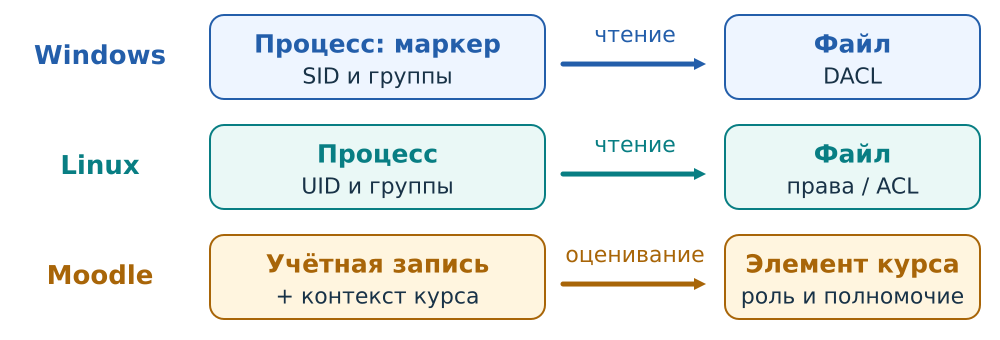
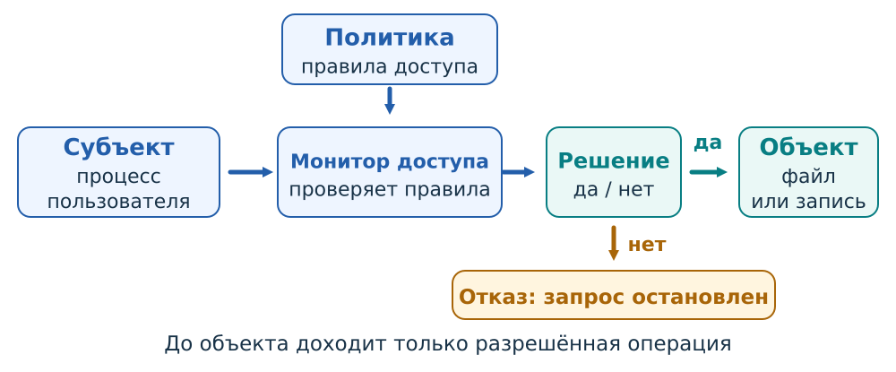
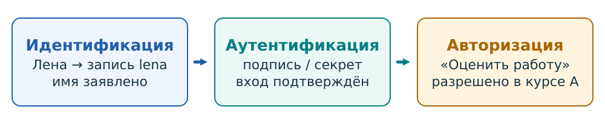
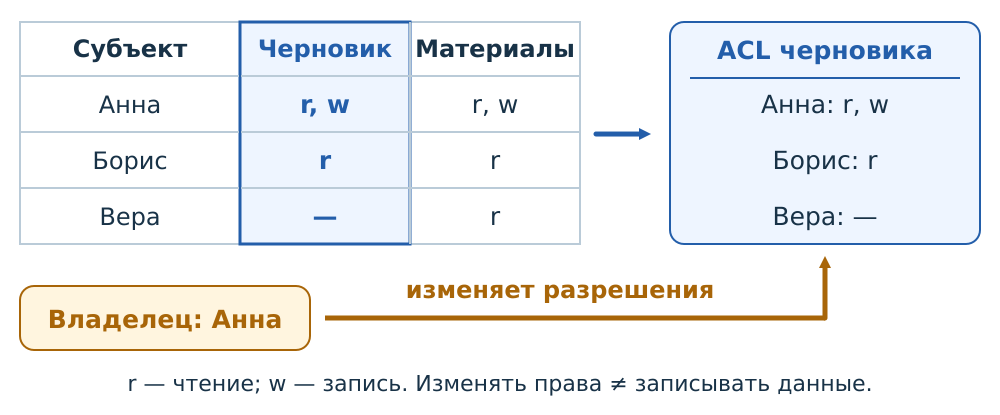
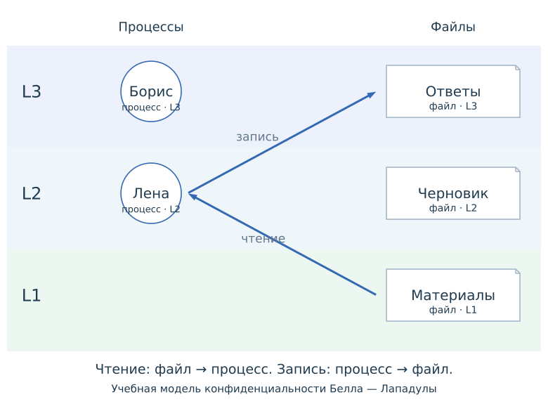
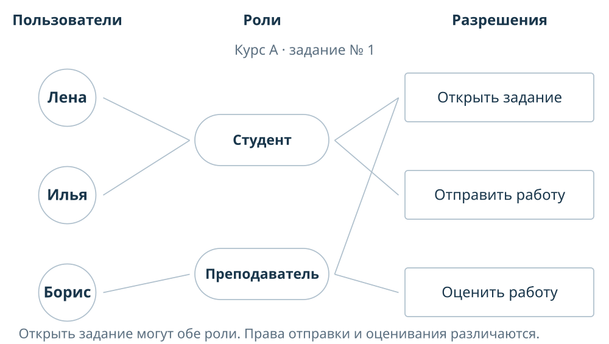
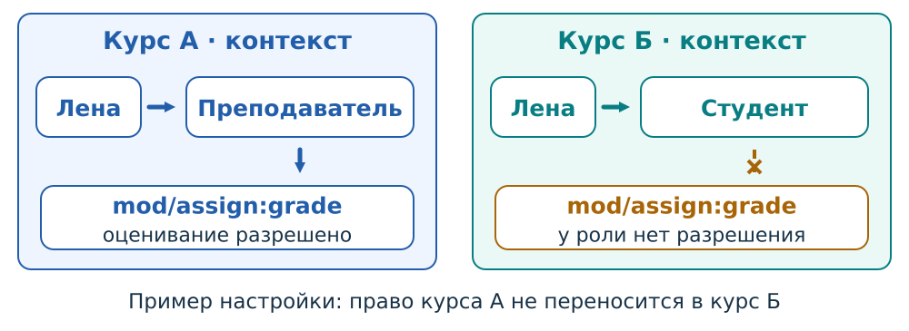

# Управление доступом {#sec-theory-access-control}

Программа открывает файл, преподаватель проверяет работу в Moodle, служба записывает данные в базу. Во всех трёх случаях системе нужно решить, разрешено ли определённому субъекту выполнить определённое действие над определённым объектом. В этой главе разберём общую схему такого решения, три процедуры работы с учётной записью и основные способы задания прав: DAC, MAC и RBAC.

## Политика доступа и монитор обращений {#sec-theory-access-policy}

**Управление доступом** задаёт и обеспечивает правила обращения к ресурсам информационной системы. Минимальное описание запроса состоит из трёх частей: **субъект — объект — операция**. Например: «процесс текстового редактора Лены — файл `report.txt` — записать изменения». Фраза «Лена имеет доступ к компьютеру» не сообщает, какие файлы ей разрешено читать, изменять или удалять.

**Субъект** — активная сущность, которая запрашивает действие. В операционной системе это обычно процесс или поток, действующий с определёнными полномочиями. В прикладном правиле удобно говорить об учётной записи пользователя: «Лена может проверять работы своего курса». Реально запрос к хранилищу выполняет серверная программа. Она должна учитывать, от имени какой записи и в каком курсе поступил запрос.

**Объект** — защищаемый ресурс: файл, каталог, процесс, запись базы, курс или отдельная работа студента. **Операция** — чтение, изменение, удаление, проверка работы, назначение права. Один объект может быть доступен для чтения и закрыт для изменения. Одна операция может быть разрешена над объектами курса А и запрещена над объектами курса Б.

{#fig-access-software .access-diagram}

В Windows сведения о пользователе, группах и привилегиях представлены в **маркере доступа** процесса или потока; объекты имеют описатели безопасности. В Linux процесс работает с идентификаторами пользователя и групп, а файл имеет владельца, группу и права. В Moodle запрос связывается с учётной записью, а право выполнять действие проверяется в определённом **контексте**, например курсе или задании. Конкретные механизмы различаются, но вопрос один: кто, над чем и что собирается сделать. [Маркеры доступа Windows](https://learn.microsoft.com/en-us/windows/win32/secauthz/access-tokens); [идентификаторы процесса Linux](https://man7.org/linux/man-pages/man7/credentials.7.html); [права и контексты Moodle](https://moodledev.io/docs/5.0/apis/subsystems/roles).

**Политика доступа** определяет допустимые действия и условия их выполнения. Например: «проверяющий курса А может оценивать работы в этом курсе». Политика также устанавливает, кто назначает и отзывает права. **Монитор обращений** — модель механизма, который применяет эти правила на пути от субъекта к объекту.

{#fig-access-architecture .access-diagram}

У такого механизма три существенных свойства: он охватывает все защищённые пути обращения, защищён от обхода и неправомерного изменения, а его устройство позволяет анализировать правильность проверки. Важно и принять решение, и исполнить его: отказ должен остановить операцию до изменения объекта. В реальной системе проверка может происходить при открытии объекта и выдаче дескриптора с ограниченными правами; последующие действия остаются в пределах выданного полномочия.

Например, скрытая кнопка «Поставить оценку» помогает показать доступные действия, но запрос можно отправить непосредственно по адресу операции. Поэтому полномочие проверяет сервер, который выполняет действие. Сам по себе внешний вид страницы правило доступа не обеспечивает.

## Идентификация {#sec-theory-access-identification}

**Идентификация** определяет, с какой учётной записью связано обращение. При создании записи система назначает ей идентификатор; при входе находит эту запись по предъявленным сведениям. В Moodle человек может вводить логин `lena`, а внутри системы использоваться числовой идентификатор записи. В Windows для субъектов безопасности применяются SID, в Linux — числовые UID. Отображаемое имя человека и системный идентификатор выполняют разные задачи.

Логин выбирает запись, для которой продолжится проверка. Его знание ещё не подтверждает право действовать от её имени: логины нередко общедоступны. Уникальность тоже имеет область действия — `lena` в одном университете и `lena` в другом могут обозначать разных людей.

Отдельного поля логина может не быть. Например, средство входа помогает системе выбрать нужную запись. При этом функция идентификации сохраняется: результат проверки и последующие действия должны быть связаны с определённым субъектом.

## Аутентификация {#sec-theory-access-authentication}

**Аутентификация** проверяет подтверждение, связанное с выбранной учётной записью: пароль, одноразовый код или ответ зарегистрированного криптографического средства. Связь должна быть установлена заранее. Исправный ключ другой учётной записи не подтверждает вход в запись Лены.

### Фактор и средство проверки {#fig-access-factors}

**Фактор** описывает основание подтверждения, а средство — способ его реализации. Обычно выделяют знание секрета, владение средством и характеристику человека. Пароль относится к знанию; ключ безопасности — к владению; проверка отпечатка — к биометрической характеристике.


**Двухфакторная аутентификация, 2FA**, использует два разных типа факторов. Два пароля или пароль и секретный ответ остаются проверками знания. В рассматриваемом примере пароль вместе с кодом приложения на отдельном зарегистрированном устройстве сочетает знание пароля и владение средством, которое создаёт код. Существенны устройство проверки и её обязательность: два экрана входа сами по себе не определяют число факторов. [Факторы многофакторной аутентификации Microsoft](https://learn.microsoft.com/en-us/entra/identity/authentication/concept-mfa-howitworks).

### От пароля к OTP и passkey

Изменение способов входа удобно рассмотреть через то, какое подтверждение получает сайт и какую проблему решает механизм.

**Пароль** — многократно используемый секрет. Пользователь передаёт его для проверки. Если пароль введён на поддельном сайте, злоумышленник может попытаться использовать его на настоящем. Это одна из причин добавлять другое подтверждение.

При настройке TOTP аутентификатор и проверяющая сторона получают общий секрет `K` и согласуют параметры. Для времени `t` вычисляется номер шага `T = floor((t − T0) / X)`, а затем `TOTP = HOTP(K, T)`. Время не секретно; обычно `X` равно 30 секундам, но это параметр. Сервер вычисляет ожидаемый код сам. Допуск соседних шагов учитывает расхождение часов, но увеличивает множество принимаемых кодов. Уже принятый код следует отвергать при повторе в допустимом окне.

Секрет `K` и вычисленный из него код не являются двумя независимыми факторами. В обычном входе человек не предъявляет запомненный `K`: зарегистрированное приложение использует его как доказательство управления средством. Поэтому такой OTP без обязательной локальной активации рассматривают как владение средством. Если злоумышленник скопирует `K`, он сможет вычислять те же коды без исходного телефона. Локальный PIN или биометрия добавляют проверку активации только тогда, когда она обязательна при каждом использовании и действительно защищает применение секрета; одна блокировка экрана этого не устанавливает. Пароль аккаунта и OTP могут сочетать знание и владение, но две строки или два экрана сами по себе не создают два типа факторов.

**Одноразовый пароль, OTP**, рассчитан на ограниченное использование. Например, TOTP вычисляется приложением и проверяющей стороной из общего секрета и времени. После успешного приёма код не должен приниматься повторно в том же временном интервале. Это ограничивает повторное использование уже принятого кода. Однако поддельный сайт способен немедленно переслать ещё не использованный код настоящему сайту. Краткий срок действия не устанавливает, кто успел предъявить код первым. [Алгоритм TOTP, RFC 6238](https://www.rfc-editor.org/rfc/rfc6238.html).

**Passkey** — средство входа на основе криптографических ключей. Сайт хранит открытый ключ, а средство пользователя создаёт подтверждение для свежего запроса. Проверка через WebAuthn связывает ответ с определённым сервисом (RP) и источником запроса — адресом сайта. Поэтому подтверждение для поддельного сайта нельзя использовать как обычный пароль для другого сайта при корректной реализации протокола. Закрытый ключ сайту не передаётся; при этом некоторые passkey синхронизируются между устройствами через поставщика средства. [Проверка ответа WebAuthn](https://www.w3.org/TR/webauthn-2/#sctn-verifying-assertion).

При **регистрации** сервис (RP) выдаёт запрос, а средство создаёт учётные данные для этого сервиса. Сервер связывает идентификатор и открытый ключ с записью; закрытый ключ сайт не получает. Привязка нового средства требует отдельного основания доверять действующему пользователю: создание ключа само не устанавливает личность.

При **входе** сервис выдаёт свежий challenge. Средство подписывает ответ; сервер проверяет challenge, тип операции, ожидаемый origin, RP ID, флаги и подпись зарегистрированным открытым ключом. RP ID — доменное имя, а origin включает схему, хост и порт. Так, для `https://login.example.com:1337` допустимый RP ID может быть `example.com`, но origin проверяется отдельно. Ответ связан с данной церемонией, а не является постоянной строкой для пересылки. Проверка пользователя (`UV`) отличается от присутствия (`UP`): если политика требует UV, сервер проверяет соответствующий флаг. Он не подтверждает паспортную личность.

PIN или биометрия могут локально разрешать использование ключа. Сайт получает результат предусмотренной протоколом проверки, а не изображение отпечатка. Простое касание ключа подтверждает присутствие пользователя; проверка PIN или биометрии может подтверждать пользователя локально. Эти режимы различаются, поэтому произвольный вход через WebAuthn нельзя автоматически объявить 2FA. [Присутствие и проверка пользователя в WebAuthn](https://www.w3.org/TR/webauthn-2/#user-presence).

Эта последовательность показывает развитие механизма: повторяемый секрет, одноразовый код, криптографический ответ с привязкой к сайту. Для сравнения остаются вопросы о краже устройства, восстановлении доступа и защите уже открытого сеанса. В Windows Hello for Business ключ разблокируется локальным PIN или биометрией. Возможности Moodle зависят от версии и настройки: WebAuthn может использоваться как дополнительный фактор MFA. Наличие такого фактора ещё не означает, что портал настроен для входа без пароля. [Windows Hello for Business](https://learn.microsoft.com/en-us/windows/security/identity-protection/hello-for-business/how-it-works); [фактор WebAuthn в Moodle 4.5](https://github.com/moodle/moodle/blob/MOODLE_405_STABLE/admin/tool/mfa/factor/webauthn/classes/factor.php).

## Авторизация конкретного запроса {#sec-theory-access-authorization}

**Авторизация** определяет, разрешено ли субъекту выполнить указанную операцию над выбранным объектом при действующих условиях. Назначение прав заранее и применение этих прав при обращении — разные действия.

{#fig-access-procedures .access-diagram}

Пусть Лена успешно вошла в Moodle и назначена проверяющей только в курсе А. Для оценки работы из курса Б сервер должен проверить её полномочие именно в контексте этой работы. Успешная аутентификация не добавляет назначения в другой курс. Повторный ввод правильного пароля результата не изменит.

Для решения нужны установленный субъект, свойства объекта и операции, действующие назначения и дополнительные условия. Например, ведомость может уже быть закрыта для правки. Эти сведения берут из доверенного состояния системы: поле запроса «моя роль — администратор» не заменяет назначение роли на сервере.

Таким образом, идентификация выбирает запись, аутентификация проверяет подтверждение для неё, авторизация решает вопрос о конкретном действии. После входа сеанс позволяет связывать следующие запросы с записью без повторного ввода пароля на каждом шаге. Полномочия на объекты при этом по-прежнему задаёт политика доступа.

## Дискреционное управление доступом {#sec-theory-access-dac}

При **дискреционном управлении доступом, DAC**, владелец или иной уполномоченный субъект может предоставлять права на объект в установленных пределах. Главное здесь — кто вправе менять распределение доступа.

Рассмотрим файл Алисы. Её запись в ACL разрешает чтение и запись; запись Боба — только чтение. Иные разрешения и привилегии в примере исключены. Это позволяет отдельно проверить запрошенное действие.

{#fig-access-dac fig-alt="Алиса может читать и писать файл, Боб только читать"}

**Матрица доступа** располагает субъектов по строкам, объекты по столбцам, разрешённые операции — в клетках. **Список управления доступом, ACL**, собирает записи со стороны одного объекта: кому какие действия разрешены. Таблица сама по себе ещё не задаёт DAC: эффективные права можно получить и из ролей. Дискреционный характер определяет полномочие назначать права по усмотрению владельца или другого уполномоченного субъекта.


```{ojs}
//| echo: false
import {dacControls, dacDiagram} from "/_prepared/visualizations/access-control/dac/lesson.js"
viewof theoryDac = dacControls()
```

```{ojs}
//| echo: false
//| label: fig-theory-dac-decision
//| fig-cap: "Применение дискреционной политики"
dacDiagram(theoryDac)
```

В динамическом примере сравните чтение и запись Боба, а затем запись Алисы. Право Боба читать не даёт ему права записи; полномочие изменять ACL здесь не моделируется.

В Windows DACL объекта содержит записи ACE, которые связывают субъектов безопасности с разрешаемыми или запрещаемыми правами. При проверке используются SID из маркера доступа и запрошенные права; порядок применимых ACE имеет значение. Право записать содержимое файла и право изменить его DACL различаются: для изменения списка используется `WRITE_DAC`. Поэтому разрешение редактировать документ не следует автоматически понимать как возможность раздать к нему доступ. [Проверка DACL](https://learn.microsoft.com/en-us/windows/win32/secauthz/how-dacls-control-access-to-an-object); [стандартные права Windows](https://learn.microsoft.com/en-us/windows/win32/secauthz/standard-access-rights).

В Linux простой пример — файл `report.txt` с режимом `640`: владелец читает и пишет, группа читает, остальные не получают прав. Если владелец — Лена, а Борис входит в группу файла, Борис может читать его, но не изменять. Здесь предполагаются доступные родительские каталоги, отсутствие расширенного ACL и других ограничений. Владелец может менять биты разрешений; расширенные ACL позволяют задавать более подробные назначения. [Режимы файла](https://man7.org/linux/man-pages/man2/chmod.2.html); [ACL Linux](https://man7.org/linux/man-pages/man5/acl.5.html).

При отзыве важно учитывать все основания. Если чтение предоставлено и лично Борису, и группе, удаление только личного назначения может сохранить доступ через группу. А отзыв серверного разрешения не удаляет локальную копию, которую Борис ранее законно сохранил.

## Мандатное управление доступом {#sec-theory-access-mac}

При **мандатном управлении доступом, MAC**, обязательная политика ограничивает действия субъектов независимо от обычного усмотрения владельца объекта. Решение может учитывать метки субъектов и объектов и разрешённые отношения между ними. Назначение меток и изменение самой политики регулируются отдельно; обычное приглашение владельца не отменяет обязательный запрет.

### Обязательное правило в Windows и Linux

Windows использует **Mandatory Integrity Control, MIC**, совместно с DACL. По умолчанию процесс с более низким уровнем целостности не может изменять объект более высокого уровня, даже если DACL даёт такое право. Например, процесс уровня Low не получает возможность записать в объект Medium только из-за разрешения в списке. Этот механизм защищает целостность. [Mandatory Integrity Control](https://learn.microsoft.com/en-us/windows/win32/secauthz/mandatory-integrity-control).

В Linux SELinux может дополнительно ограничивать доступ по домену процесса, типу объекта и правилам политики. В режиме enforcing для доступа должны выполняться применимые обычные проверки и правила SELinux. Типы в механизме Type Enforcement описывают назначение субъектов и объектов; их нельзя в общем случае выстроить в одну лестницу «выше — ниже». Например, разрешение чтения файла в обычных правах ещё не даёт серверному процессу разрешения SELinux работать с любым типом файла. [Type Enforcement в SELinux](https://github.com/SELinuxProject/selinux-notebook/blob/main/src/type_enforcement.md).

### Учебная модель потока информации

Для объяснения конфиденциальности рассмотрим упрощённую модель Белла — Лападулы с фиксированными уровнями процесса и объекта. Для отдельного примера файлам назначены три метки: `handout.txt` — **L1, открытые**; `draft.txt` — **L2, служебные**; `answers.txt` — **L3, закрытые**. Это условная учебная шкала, а не юридические категории информации. На схеме процесс Лены работает на L2: горизонтальные зоны разделяют уровни, процессы и файлы расположены в отдельных столбцах.

{#fig-access-mac fig-alt="Процесс L2 и файлы трёх уровней"}

При **чтении** данные переходят из объекта в процесс: процесс не должен читать более высокий уровень. При **размещении данных без чтения назначения** информация переходит из процесса в объект: процесс не должен записывать в более низкий уровень. Равные уровни допускают оба направления. Поэтому обычное редактирование, включающее чтение и запись того же объекта, требует совпадения уровней в этой модели.

Процесс Лены на L2 читает памятку L1, но не записывает в неё: результат способен содержать служебные сведения. Черновик L2 он может читать и изменять. В файл L3 разрешено разместить данные без чтения назначения, однако прочитать ответы L3 или открыть их для обычного редактирования этот процесс не может.



В динамическом примере сравните чтение и запись на трёх уровнях; для редактирования нужны обе проверки. В виджете рассматривается процесс L2. В отдельном мысленном опыте для копирования ответов рассмотрим процесс Лены на L3: он читает `answers.txt`, но запись в памятку L1 блокируется. Это не понижение метки уже работавшего процесса после чтения закрытых данных.

Для решения берётся **текущий уровень процесса**, а не максимальный допуск сотрудника. Допуск Лены до L3 позволяет запускать предусмотренные политикой рабочие контексты; он не заменяет текущий L2 на первой схеме. Процесс Бориса в нашем примере работает на L1. Обычная выдача ему права на файл не меняет обязательных меток.

Модель Белла — Лападулы здесь объясняет ограничения конфиденциальности. Направления её запретов отличаются от стандартного запрета записи вверх в Windows MIC; механизмы SELinux тоже не сводятся к этой шкале. MAC — более широкое понятие, чем одна модель потока. [Исходное описание модели Белла — Лападулы](https://csrc.nist.gov/files/pubs/conference/1998/10/08/proceedings-of-the-21st-nissc-1998/final/docs/early-cs-papers/bell76.pdf).

## Ролевое управление доступом {#sec-theory-access-rbac}

При **ролевом управлении доступом, RBAC**, разрешения объединяются по обязанностям, а пользователям назначаются роли. При смене обязанностей меняют назначения.

Анне назначена роль `teacher` в курсе А и роль `student` в курсе Б. Роль `teacher` разрешает просмотр и проверку работ, `student` — просмотр. Наследование и запреты в примере не заданы.

{#fig-access-rbac fig-alt="Анна — преподаватель в курсе А и студент в курсе Б"}

```{ojs}
//| echo: false
import {rbacControls, rbacDiagram} from "/_prepared/visualizations/access-control/rbac/lesson.js"
viewof theoryRbac = rbacControls()
```

```{ojs}
//| echo: false
//| label: fig-theory-rbac-decision
//| fig-cap: "Применение ролевой политики"
rbacDiagram(theoryRbac)
```

Сравните проверку работы в курсе А с проверкой и просмотром в курсе Б. В А проверка разрешена ролью `teacher`, в Б роль `student` разрешает просмотр, но не проверку. Назначение роли в одном курсе не распространяется автоматически на другой.

В других конфигурациях RBAC может быть задано наследование ролей. Если «Ответственный за курс» наследует «Проверяющего», он получает и разрешения проверяющего. У пользователя могут существовать несколько независимых назначений. Тогда снятие роли ответственного не прекращает проверку работ, если роль проверяющего назначена ему ещё и напрямую. Для отзыва нужно проследить все пути к нужному действию.

### Роль в контексте Moodle

В Moodle назначение роли связывает пользователя с набором разрешений **в определённом контексте**. Например, право `mod/assign:grade` относится к оцениванию заданий. Одинаковая роль, назначенная в курсе А и в курсе Б, действует в разных областях. Название роли само по себе недостаточно для решения.

{#fig-access-moodle .access-diagram}

Контексты Moodle вложены: система, категория, курс, учебный элемент. Назначения и настройки разрешений учитываются в этой структуре; в нижележащем контексте могут быть предусмотрены переопределения. Для обычных ролей явный `Prohibit` нельзя снять нижележащим `Allow`. Поэтому итоговое разрешение требует учитывать контекст и правила разрешения конфликтов.

Наследование настроек по контекстам Moodle отличается от наследования прав между ролями; одно не устанавливает другое. Moodle — наглядный пример роли и области её действия; конкретный алгоритм его разрешений нужно читать по правилам этой системы. [Модель ролей, разрешений и контекстов Moodle](https://moodledev.io/docs/5.0/apis/subsystems/roles).

## Сопоставление политик {#sec-theory-access-comparison}

Одно действие может получить разные решения при разных основаниях доступа. В DAC право назначают на объект, в RBAC оно следует из роли, а обязательная политика может ограничить действие независимо от такого назначения.

## Сочетание правил и разделение обязанностей {#sec-theory-access-combined}

В одной системе могут совместно работать несколько механизмов. Windows сочетает DACL и обязательные ограничения целостности; Linux может сочетать права файла, ACL и SELinux; приложение добавляет правила предметной области. Итог зависит от установленного порядка: обязательное ограничение может запретить действие, для которого уже найдено обычное разрешение.

**Принцип минимальных привилегий** требует дать субъекту права, необходимые для его работы, в нужной области и на нужное время. Проверяющему курса А достаточно полномочий в этом курсе. Назначение таких же прав на весь сайт расширяет возможные последствия ошибки или использования его записи посторонним.

**Разделение обязанностей** требует участия разных исполнителей там, где одному человеку не следует контролировать весь процесс. Например, Лена подаёт заявку на исправление итоговой оценки, а другой уполномоченный сотрудник её утверждает. Нужны и роль утверждающего, и допустимое состояние заявки, и отличие сотрудника от автора. Получение второй роли или открытие другого браузера не превращает Лену в другого человека.

Для разбора доступа последовательно назовите субъект, объект и действие; определите действующие назначения и ограничения; объясните, где принимается и исполняется решение. Такой порядок одинаково полезен для файла Windows, процесса Linux и задания Moodle, хотя конкретные правила у них различаются.
