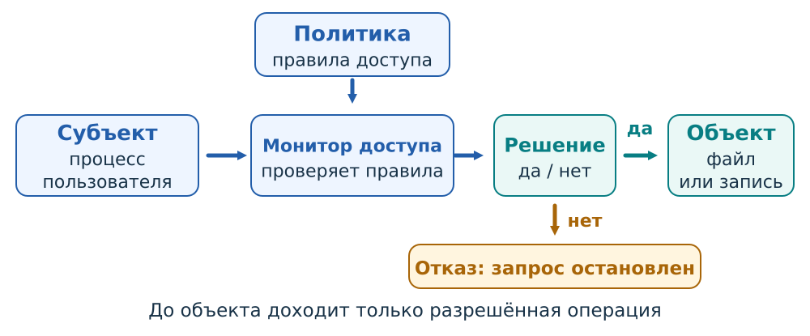
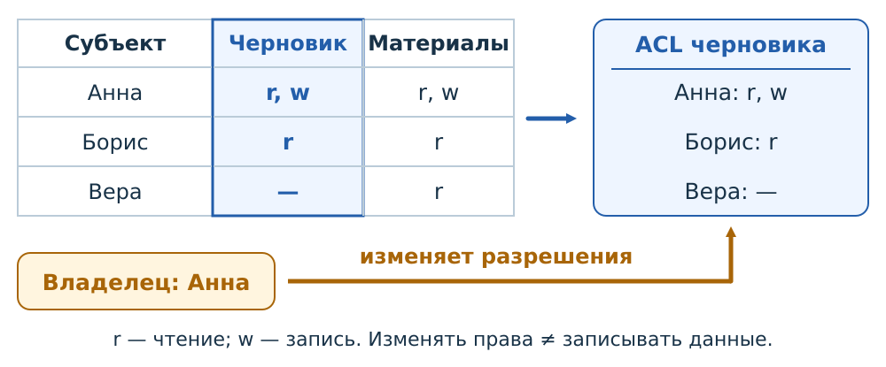
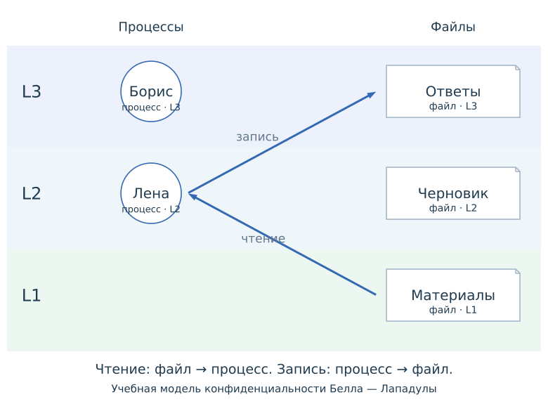
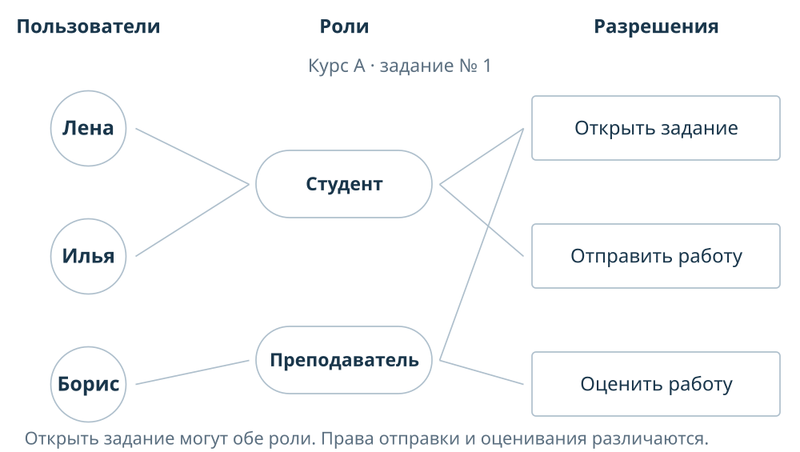

# Авторизация {#sec-theory-authorization}

Информационная система должна ограничивать действия с защищёнными ресурсами. Правила определяют, кто может читать файл, изменять оценку или назначать полномочия, а система обеспечивает их исполнение при обращениях.

::: {#def-access-control name="Управление доступом"}
Управление доступом — установление и обеспечение правил обращения к ресурсам информационной системы.
:::

Успешная аутентификация связывает сеанс с учётной записью (@sec-theory-authentication). Допустимость каждого действия определяется отдельно: сведения о записи, её полномочиях и состоянии ресурса применяются к конкретному запросу.

## Авторизация конкретного запроса {#sec-theory-access-authorization}

::: {#def-access-authorization name="Авторизация"}
Авторизация определяет, разрешено ли субъекту выполнить указанную операцию над выбранным объектом при действующих условиях.
:::

Полномочия назначаются заранее, а при обращении система применяет их к конкретному запросу.

Лена успешно вошла в Moodle и открыла задание курса А. Ей назначена роль студента: она может отправить работу, но не выставить оценку. Если Лена отправит запрос на оценивание, сервер отклонит его. Борису как преподавателю этого курса та же операция разрешена. Решение меняется при изменении назначения роли или контекста, в котором она действует.

### Запрос доступа {#sec-theory-access-request}

::: {#def-access-request name="Запрос доступа"}
Запрос доступа описывается субъектом, объектом и операцией. **Субъект** — активная сущность, выполняющая обращение; **объект** — ресурс, к которому обращаются; **операция** — запрошенное действие над ресурсом.
:::

Например, **процесс редактора** записывает изменения в *report.txt*: процесс является субъектом, файл — объектом, запись — операцией. Разрешения читать файл и изменять его содержимое представляют собой разные права.

В операционной системе субъектом обычно выступает процесс или поток с определёнными полномочиями. **Служба резервного копирования**, запущенная под отдельной служебной записью, читает файлы с полномочиями этой записи, даже если копирование инициировал пользователь. На портале запрос к хранилищу выполняет серверная программа; прикладное правило дополнительно связывает действие с записью участника и выбранным курсом.

::: {#def-access-policy name="Политика доступа"}
Политика доступа задаёт допустимые действия и условия их выполнения, а также определяет, кто назначает и отзывает полномочия.
:::

Студенту разрешено отправлять собственную работу, преподавателю курса — оценивать работы участников этого курса.

::: {#def-access-monitor name="Монитор обращений"}
Монитор обращений — абстрактный механизм, который контролирует обращение субъекта к объекту и применяет действующую политику. Он получает сведения о запросе, выносит решение и обеспечивает его исполнение.
:::

При разрешении действие достигает объекта; при отказе выполнение останавливается (@fig-access-architecture).

{#fig-access-architecture fig-alt="Запрос субъекта проходит через монитор, применяющий политику; разрешённое действие достигает объекта, запрещённое останавливается"}

Монитор должен контролировать защищённые пути обращения и быть защищён от обхода и изменения. На портале проверка выполняется на сервере, который сохраняет оценку. Скрытая кнопка в браузере лишь меняет интерфейс: пользователь может отправить запрос другим способом, и сервер всё равно обязан проверить полномочие. В операционной системе проверка часто происходит при открытии файла; полученный дескриптор затем позволяет выполнять операции в пределах предоставленных прав.

Политика может учитывать дополнительные условия: например, ведомость уже закрыта для правки. Сведения о полномочиях и состоянии объекта берутся из доверенного состояния системы. Поле пользовательского запроса «моя роль — преподаватель» не заменяет назначение на сервере.

Способ представления и изменения полномочий описывают **модели управления доступом**. В дискреционной модели существенны полномочия владельца распределять доступ, в мандатной — обязательные ограничения политики, в ролевой — связь разрешений с обязанностями пользователей.

## Модели управления доступом {#sec-theory-access-models}

### Дискреционное управление доступом {#sec-theory-access-dac}

::: {#def-access-dac name="Дискреционное управление доступом"}
При дискреционном управлении доступом (DAC, discretionary access control) владелец объекта или другой уполномоченный субъект может предоставлять права на этот объект по своему усмотрению в установленных системой пределах.
:::

Для решения о конкретном обращении проверяются уже назначенные права; для изменения доступа проверяется отдельное полномочие управлять ими.

На @fig-access-dac показаны два файла: «Черновик» и «Материалы». Анна владеет черновиком и может его читать и изменять. Борису она предоставила чтение; Вера доступа к черновику не получила. Когда Борис открывает файл для чтения, существующее назначение разрешает операцию. Запрос на запись отклоняется, пока Анна не предоставит ему соответствующее право.

{#fig-access-dac fig-alt="В матрице строки соответствуют Анне, Борису и Вере, столбцы — черновику и материалам; выделенный столбец образует ACL черновика, которым управляет владелец Анна"}

::: {#def-access-matrix name="Матрица доступа"}
Матрица доступа располагает субъектов по строкам, объекты по столбцам, а разрешённые операции — в клетках.
:::

**Список управления доступом (ACL)** собирает записи для одного объекта: кому какие действия разрешены. На рисунке выделенный столбец «Черновик» преобразован в его ACL. Обозначение `r` соответствует чтению, `w` — записи.

Матрица и ACL представляют назначения прав. Такие представления применяются и в других моделях; например, таблица может показывать права, полученные через роли. В DAC уполномоченный субъект может менять распределение доступа по своему усмотрению. На рисунке эту связь показывает владелец, который меняет ACL черновика.



Сначала сравните чтение и запись Бориса. Затем выберите вариант, в котором Анна выдала ему `w`: изменится запись в ACL, а проверка того же запроса на запись завершится разрешением. Изменение политики и применение политики здесь происходят на разных этапах.

### Мандатное управление доступом {#sec-theory-access-mac}

::: {#def-access-mac name="Мандатное управление доступом"}
При мандатном управлении доступом (MAC, mandatory access control) обязательная политика ограничивает действия субъектов независимо от обычного усмотрения владельца объекта. Решение может учитывать метки субъектов и объектов и установленные отношения между ними.
:::

Учебный вариант **модели Белла — Лападулы** защищает конфиденциальность информации. В нём заданы три упорядоченных уровня: $L_1 < L_2 < L_3$. Файл «Материалы» (`handout.txt`) имеет метку $L_1$, «Черновик» (`draft.txt`) — $L_2$, «Ответы» (`answers.txt`) — $L_3$. Процесс Лены работает на $L_2$. Широкие полосы на @fig-access-mac обозначают уровни; круг обозначает действующий процесс, значки документов — объекты.

{#fig-access-mac fig-alt="Три вертикально расположенные области L3, L2 и L1; процесс Лены на L2 и файлы с отдельными метками уровней"}

При **чтении** информация переходит из файла в процесс. Правило «**не читать выше**» разрешает чтение, если уровень процесса не ниже уровня файла. Поэтому процесс $L_2$ читает материалы $L_1$ и черновик $L_2$, но не получает ответы $L_3$.

При **записи** информация переходит из процесса в файл. Правило «**не писать ниже**» разрешает запись, если уровень файла не ниже уровня процесса. Процесс $L_2$ может записать данные в черновик $L_2$ или добавить данные в файл $L_3$, но запись в материалы $L_1$ запрещена: результат мог бы перенести сведения $L_2$ на более низкий уровень.

В этом примере запись на $L_3$ означает операцию без чтения существующего содержимого файла. **Обычное редактирование** требует обеих возможностей: прочитать файл и записать изменения. Для процесса $L_2$ обе проверки разрешают работу с черновиком $L_2$. Ответы $L_3$ доступны ему лишь для предусмотренной записи без чтения, материалы $L_1$ — лишь для чтения.



В интерактивной схеме сначала выбирается запрос, затем определяются метки процесса и файла. После этого применяется правило для выбранной операции и выносится решение. Стрелка на модели показывает направление передачи данных, а подсветка блок-схемы — выполняемую проверку. Сравните чтение ответов $L_3$ и запись в них: уровни те же, но направление потока меняет результат.

Для проверки берётся **текущий уровень процесса**. Если допуск Лены позволяет ей работать до $L_3$, запущенный на $L_2$ процесс всё равно проверяется по $L_2$. Показанный процесс Бориса на $L_3$ может читать ответы, однако записать полученные сведения в материалы $L_1$ ему запрещено. Так политика препятствует переносу закрытой информации вниз по шкале.

### Ролевое управление доступом {#sec-theory-access-rbac}

::: {#def-access-rbac name="Ролевое управление доступом"}
При ролевом управлении доступом (RBAC, role-based access control) разрешения объединяются по обязанностям в роли, а пользователям назначаются роли.
:::

Роль связывает организационную функцию с набором действий: например, студент отправляет работу, преподаватель оценивает её. Изменение обязанностей выражается в изменении назначений. Если пользователю назначены несколько ролей, разрешения в рассматриваемой базовой модели объединяются: операция доступна, когда её предоставляет хотя бы одна роль. Дополнительные ограничения задаются отдельно.

На @fig-access-rbac Лене и Илье назначена роль «Студент», Борису — «Преподаватель». Обе роли разрешают открыть задание. Студенту дополнительно разрешено отправить работу, преподавателю — оценить работу. Все эти назначения действуют в курсе А.

{#fig-access-rbac fig-alt="Лена и Илья связаны с ролью Студент, Борис — с ролью Преподаватель; роли соединены с разрешениями открыть задание, отправить и оценить работу"}

Проверку можно проследить как путь **пользователь → назначенная роль → требуемое разрешение**. Для запроса Лены «отправить работу» существует путь через роль студента. Для запроса «оценить работу» у Лены такого пути нет. У Бориса оценивание разрешено через роль преподавателя. Если курс получит ещё одного студента, ему достаточно назначить существующую роль; связи роли с разрешениями сохраняются.



Сначала сравните запросы Лены на открытие, отправку и оценивание. Затем выберите оценивание от имени Бориса.

## Совместное применение политик {#sec-theory-access-combined}

Модели управления доступом описывают разные основания решения и могут применяться совместно. Роли связывают разрешения с обязанностями, владелец распределяет предоставленные ему права на объект, а обязательная политика ограничивает допустимые потоки информации.

Правило объединения разрешений задаётся явно. Например, система может разрешать чтение, если оно предоставлено хотя бы одной ролью или личной записью в ACL. Если дополнительно действует обязательное ограничение по уровням, запрос должен пройти и эту проверку. Право, полученное через роль или ACL, само по себе не отменяет требования обязательной политики.

При отзыве доступа учитывают все основания его предоставления. Удаление одной роли не запрещает операцию, если другая назначенная роль или личная запись по-прежнему предоставляет требуемое право. После изменения назначений следует проверить решение для конкретного запроса: субъект, объект и операция остаются теми же, а применяемые полномочия меняются.
