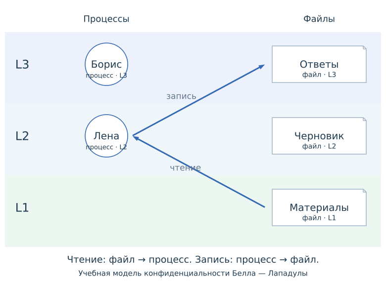

Это проверочный материал вне списка глав. Политика конфиденциальности:
`L1 < L2 < L3`; чтение — свой и нижние уровни, добавление без чтения — свой и верхние.
Без категорий и доверенных исключений; это не модель целостности Windows MIC.

{#fig-mac-overview width="65%" fig-alt="Процесс L2 и файлы трёх уровней"}

На @fig-mac-overview показана структура; @fig-mac-decision применяет политику.



## Независимый второй экземпляр

```{ojs}
//| echo: false
viewof macSecond = macControls({initial:1})
```

```{ojs}
//| echo: false
//| label: fig-mac-second
//| fig-cap: "Независимый запрос без пояснения этапа уровней"
macDiagram(macSecond, {request:"Другой запрос; собственный выбранный этап."})
```

В @fig-mac-second пояснение `levels` отсутствует: этап, подсветка и результат сохраняются.
