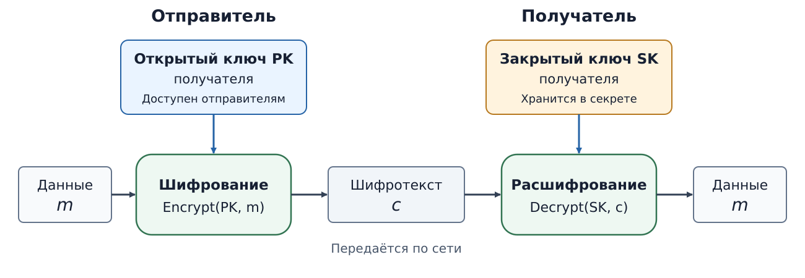

# Асимметричная криптография {#sec-theory-asymmetric-cryptography}

[Симметричное шифрование](symmetric-encryption.qmd#sec-theory-symmetric-encryption) позволяет
сторонам защитить данные общим секретным ключом. Если общего секрета пока
нет, нужно решить, как передать данные нужному получателю, не сообщив
ключ посторонним. Асимметрические механизмы разделяют возможности
владельца закрытого ключа и остальных участников.

## Пара ключей {#sec-theory-public-key-pair}

Нужно отправить конфиденциальный *report.pdf* получателю через сеть,
которую могут прослушивать. При симметричном шифровании отправителю
и получателю заранее нужен общий секрет. Если они ещё не обменялись
таким секретом, простая отправка ключа рядом с файлом раскрыла бы его
тому же наблюдателю.

Асимметричное шифрование разделяет возможности отправки и чтения.
Получатель создаёт пару ключей: открытый сообщает отправителям,
закрытый сохраняет у себя.

::: {#def-trust-public-key-pair name="Пара асимметричных ключей"}
Пара асимметричных ключей — связанные открытый и закрытый ключи,
созданные для определённой криптографической схемы. Открытый ключ можно
передавать другим; закрытый ключ сохраняют в секрете. По открытому ключу
практически невозможно получить закрытый или выполнить операцию,
для которой нужен закрытый ключ.
:::

## Шифрование получателю {#sec-theory-asymmetric-encryption}

Обозначим исходные данные через $m$, шифротекст — через $c$,
открытый ключ получателя — через $PK$, закрытый — через $SK$.
Отправитель вычисляет $c=\operatorname{Encrypt}(PK,m)$ и передаёт $c$.
Получатель восстанавливает данные:
$m=\operatorname{Decrypt}(SK,c)$.

{#fig-trust-asymmetric-encryption fig-alt="Отправитель подаёт исходные данные m и открытый ключ PK получателя на шифрование. Шифротекст c передаётся по сети. Получатель расшифровывает c своим закрытым ключом SK и получает m. Открытый ключ доступен отправителям; закрытый остаётся у получателя."}

В @fig-trust-asymmetric-encryption оба ключа принадлежат **получателю**.
Для *report.pdf* отправитель выбирает именно его открытый ключ.
Отправителю не требуется получать закрытый ключ или заранее иметь
общий секрет с получателем.

| Участник | Доступное действие |
|---|---|
| **Отправитель** с $PK$ | Зашифровать свой файл для получателя |
| **Получатель** с $SK$ | Расшифровать адресованный ему шифротекст |
| **Посторонний** с $PK$ и перехваченным $c$ | Зашифровать свой файл; открытого ключа недостаточно для чтения чужого $c$ |

Если посторонний тоже может создать шифротекст для получателя,
успешное расшифрование само по себе не устанавливает отправителя.
Также нужно убедиться, что выбранный открытый ключ действительно
принадлежит ожидаемому получателю.

## Ключевая пара RSA {#sec-theory-rsa}

RSA — пример семейства асимметричных схем. При создании пары выбирают
большие простые числа $p$ и $q$ и вычисляют их произведение $n=pq$.
Число $n$ называют **модулем RSA**. Открытый ключ содержит модуль $n$
и открытый показатель $e$. Закрытый ключ включает секретный показатель;
для вычислений в нём могут храниться и параметры, полученные из $p$ и $q$.
Эти множители также нужно сохранять в секрете.

Перемножить выбранные числа легко; обратная задача — разложение известного
модуля на множители — при правильном выборе больших $p$ и $q$ практически
трудна. Найдя множители, нарушитель может восстановить секретные параметры.
Из этого не следует, что всякая атака на RSA равносильна факторизации.

Само математическое преобразование RSA не составляет безопасной схемы
для произвольных данных. RFC 8017 задаёт отдельные способы подготовки
данных: RSA-OAEP для шифрования и RSA-PSS для подписи. Последняя не является
общим определением подписи как «шифрования закрытым ключом».

## Длина ключа {#sec-theory-key-length}

Размер ключа описывает его запись, а оценка стойкости — трудоёмкость
атак. Для AES указывают число битов секретного ключа, для RSA — число
битов модуля $n$. В [таблице 2 NIST SP 800-57 Part 1 Rev. 5](https://nvlpubs.nist.gov/nistpubs/SpecialPublications/NIST.SP.800-57pt1r5.pdf#page=67)
приведены следующие сопоставления для классических атак:

| Оценка стойкости | Ключ AES | Модуль RSA |
|---:|---:|---:|
| 128 бит | 128 бит | 3072 бита |
| 192 бита | 192 бита | 7680 битов |
| 256 бит | 256 бит | 15360 битов |

Одинаковая оценка означает сопоставимую трудоёмкость известных атак
при соответствующих предположениях. Она не задаёт способа преобразовать
ключ AES в пару RSA: RSA требует собственных связанных параметров.
Квантовые атаки в этом сопоставлении не учитываются.

## Гибридное шифрование {#sec-theory-hybrid-encryption}

Для больших объёмов данных обычно сочетают асимметрические механизмы
с симметричным шифрованием. Например, отправитель создаёт случайный
симметричный ключ для файла, шифрует им данные, а сам ключ защищает
открытым ключом получателя. Получатель своим закрытым ключом получает
симметричный ключ, затем читает файл.

В TLS 1.3 при обычном соединении браузера с сайтом роли также разделены:
сертификат и цифровая подпись помогают подтвердить сервер, при обмене
ключами участники вырабатывают сеансовые ключи, а прикладные данные
защищаются симметричным шифрованием. Сертификат связывает имя сайта
с открытым ключом; страницы шифруются ключами установленного соединения.

## Ключ проверки подписи {#sec-theory-public-key-signature}

Для подписи выбирают пару **подписывающего**. Издатель создаёт подпись
обновления закрытым ключом; получатели проверяют её открытым ключом
издателя. Подпись позволяет проверять происхождение данных, сохраняя их
доступными для чтения. Пара ключей используется для операции,
предусмотренной выбранной схемой.

Как создают подпись и связывают открытый ключ с издателем,
рассмотрено в [главе о подписи](digital-signature.qmd#sec-theory-digital-signature).

## Применение асимметрических схем

Разные схемы предусматривают разные операции:

| Схема | Назначение |
|---|---|
| RSA-OAEP | Шифрование небольшого сообщения получателю |
| ECDH | Согласование общего секрета; затем ключ выводят с помощью KDF |
| ECDSA, Ed25519 | Создание и открытая проверка цифровой подписи |

ECDH само по себе не устанавливает личность сторон. Для любого применения
нужно связать открытый ключ с ожидаемым владельцем. При подписи эту связь
[проверяют отдельно](../data-trust/certificates.qmd#sec-theory-signature-key-owner)
от соответствия самой подписи данным и ключу.

## Источники

Назначение пары при шифровании описано в
[The Structure of Secure Systems, § 10.5](https://securitybook.eecs.berkeley.edu/chapters/lec10.html#defining-public-key-encryption),
а при подписи — в
[§ 5.1](https://securitybook.eecs.berkeley.edu/chapters/lec05.html#definitions).
Принцип гибридного шифрования рассмотрен в
[RFC 9180, § 1](https://www.rfc-editor.org/rfc/rfc9180.html#section-1).
Роли согласования ключей, подписи и защиты записей в TLS 1.3 заданы в
[RFC 8446, §§ 1–2 и 5](https://www.rfc-editor.org/rfc/rfc8446.html#section-1).

Параметры RSA и схемы OAEP и PSS определены в [RFC 8017, §§ 3, 7.1, 8.1](https://www.rfc-editor.org/rfc/rfc8017.html). Стойкость обсуждается в [статье RSA, § IX](https://people.csail.mit.edu/rivest/Rsapaper.pdf). Сопоставление размеров приведено в [NIST SP 800-57 Part 1 Rev. 5, таблица 2](https://nvlpubs.nist.gov/nistpubs/SpecialPublications/NIST.SP.800-57pt1r5.pdf#page=66).
