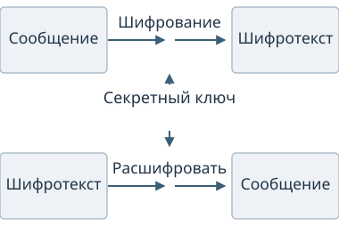

# Симметричное шифрование {#sec-theory-crypto-cypher}

## Общий секрет

Шифрование нужно, чтобы передавать или хранить данные в форме, доступной для чтения обладателю ключа. Например, сотрудники могут хранить зашифрованный список контактов: копия файла должна оставаться непонятной постороннему, а участники должны уметь восстановить исходный список.

::: {#def-crypto-encryption name="Шифрование"}
**Шифрование** преобразует открытое сообщение в шифротекст с помощью ключа. Расшифрование с подходящим ключом восстанавливает исходные данные.
:::

::: {#def-crypto-key name="Ключ шифрования"}
**Ключ шифрования** — значение, которое выбирает конкретное преобразование среди предусмотренных алгоритмом. При симметричном шифровании отправитель и получатель используют один общий секретный ключ.
:::

Алгоритм задаёт правило преобразования, а ключ — его секретный параметр. Участники списка контактов могут пользоваться общедоступной программой шифрования и сохранять в секрете только ключ. На @fig-crypto-symmetric-key он поступает в оба преобразования: зашифрование и расшифрование.

{#fig-crypto-symmetric-key fig-alt="Сообщение проходит шифрование и расшифрование; один ключ K поступает в оба преобразования" width="380"}

## Шифр Цезаря

В учебном шифре Цезаря каждая буква сдвигается на одинаковое число позиций по кругу выбранного алфавита. Алгоритм задаёт правило замены, а ключом служит число позиций. Возьмём русский алфавит из 33 букв, включая `Ё` между `Е` и `Ж`:

`А Б В Г Д Е Ё Ж З И Й К Л М Н О П Р С Т У Ф Х Ц Ч Ш Щ Ъ Ы Ь Э Ю Я`.

При ключе $15$ слово `БАГАЖ` превращается в другое осмысленное слово — `ПОСОХ`:

| Сообщение | Сдвиг на 15 | Обратный сдвиг на 15 |
|---|---|---|
| `БАГАЖ` | `ПОСОХ` | `БАГАЖ` |

Преобразование действует побуквенно: `Б → П`, `А → О`, `Г → С`, `А → О`, `Ж → Х`. После конца алфавита отсчёт продолжается с начала. Получатель сдвигает буквы на 15 позиций в обратную сторону и восстанавливает `БАГАЖ`. Регистр сохраняется; пробелы и знаки препинания остаются на месте.

Наблюдатель, знающий алгоритм, может перебрать все 33 значения ключа, включая нулевое. Одинаковые буквы всегда заменяются одинаково, поэтому сохраняется распределение частот. Малое пространство ключей и эта зависимость позволяют атаковать шифр Цезаря. Даже осмысленный шифротекст `ПОСОХ` не сообщает, что исходным словом был именно `БАГАЖ`: кандидата оценивают с учётом языка и контекста сообщения.



## Исключающее ИЛИ

Цифровые данные представляют битами. Операция **исключающее ИЛИ**, или XOR, позволяет управлять изменением каждого бита: XOR с $0$ сохраняет бит, XOR с $1$ меняет его на противоположный. Поэтому одинаковые входные биты дают $0$, разные — $1$. В формулах операция обозначается $\oplus$.

Возьмём сообщение из восьми битов и ключевой поток той же длины. Применим XOR в каждом столбце:

$$
\begin{array}{rcr}
\text{Сообщение}      &        & \mathtt{10110010} \\
\text{Ключевой поток} & \oplus & \mathtt{01101001} \\
\hline
\text{Шифротекст}     &        & \mathtt{11011011}
\end{array}
$$

В первом столбце $0$ сохраняет исходную единицу; во втором $1$ меняет ноль на единицу. Повторный XOR с тем же ключевым битом восстанавливает исходный: два изменения отменяют друг друга, а два сохранения оставляют бит прежним. Для сообщения $M$, ключевого потока $K$ и шифротекста $C$ это записывается как $C=M\oplus K$ и $M=C\oplus K$. В нашем примере расшифрование даёт $11011011\oplus01101001=10110010$.

Для текста сначала нужна кодировка: один символ может занимать несколько байтов. Например, `Я` в UTF-8 записывается байтами `d0 af`. Если учебный поток равен `10 20`, побайтовый XOR даёт шифротекст `c0 8f`; повторный XOR с `10 20` восстанавливает `d0 af`, а декодирование UTF-8 — `Я`. Здесь числа записаны шестнадцатерично, по две цифры на байт.

### Повтор ключевого потока

Рассмотрим два коротких сообщения с одним и тем же потоком. ASCII-байты этих латинских строк совпадают с их байтами UTF-8:

| Величина | Байты в шестнадцатеричной записи |
|---|---|
| $M_1 =$ `CAT` | `43 41 54` |
| $M_2 =$ `DOG` | `44 4f 47` |
| Повторённый поток $K$ | `10 20 30` |
| $C_1$ | `53 61 64` |
| $C_2$ | `54 6f 77` |

Наблюдатель видит $C_1$ и $C_2$. Он может вычислить $C_1\oplus C_2=M_1\oplus M_2=\mathtt{07\ 0e\ 13}$: два одинаковых потока сокращаются. Если первое сообщение известно, то

$$M_2=C_1\oplus C_2\oplus M_1.$$

В таблице $\mathtt{07\ 0e\ 13}\oplus\mathtt{43\ 41\ 54}=\mathtt{44\ 4f\ 47}$, то есть получается `DOG`. Для этой атаки знать сам поток не требуется. Его байты приведены в таблице для проверки вычислений.

Одноразовый блокнот даёт теоретическую совершенную секретность, когда поток действительно случаен, равен сообщению по длине, хранится в секрете и никогда не используется повторно. Изменение бита шифротекста всё же меняет соответствующий бит восстановленного сообщения: XOR с секретным потоком не проверяет целостность.



XOR входит в число базовых операций многих шифров. В потоковом шифре специальная конструкция вырабатывает ключевой поток из короткого секретного ключа. Стойкость такого шифра зависит от непредсказуемости потока и соблюдения правил его применения. Блочный AES и потоковый ChaCha20 описаны по назначению в @sec-theory-crypto-algorithms.

## Стойкость шифра

При проектировании защиты предполагают, что противник знает алгоритм. Публичное описание позволяет исследовать конструкцию; секретность общего ключа должна сохраняться и при известном правиле преобразования. У Цезаря правило известно, но всего 33 ключа можно проверить полностью. У современного шифра пространство ключей должно делать такой перебор практически недоступным.

Если ключ содержит $b$ битов, существует $2^b$ битовых строк этой длины. При независимом равномерном выборе всех битов каждая строка имеет вероятность $2^{-b}$; полный перебор проверяет $2^b$ кандидатов, а среднее число проверок в фиксированном порядке равно $(2^b+1)/2$. Например, для 128 битов пространство содержит $2^{128}$ вариантов.

Предсказуемый выбор уменьшает неопределённость ключа. Если 256-битная строка детерминированно получается из одного 32-битного начального значения, возможны не более $2^{32}$ таких строк. Противник может перебирать начальные значения, поэтому длина записи ключа и его [энтропия](random.qmd#def-random-entropy) различаются. Получение непредсказуемого ключа разобрано в @sec-theory-crypto-key-gen.

Большое пространство ключей затрудняет полный перебор. Уязвимость конструкции может дать более короткий способ восстановления данных; повтор потока, как в разобранном примере, связывает два сообщения даже без перебора. Реализация также должна защищать ключ при хранении и вычислениях: его утечка предоставляет противнику тот же секрет, которым пользуется получатель. Стойкость зависит от конструкции, применения и реализации шифра.

Общий секрет требуется безопасно доставить участникам. Асимметричные механизмы помогают согласовать или передать секрет; гибридное применение рассмотрено в @sec-theory-public-key.
