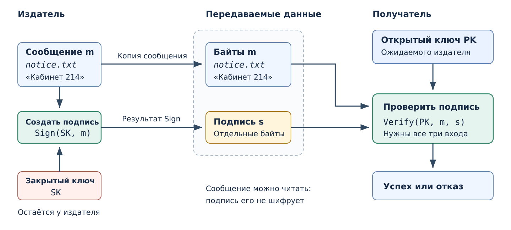

# Цифровая подпись {#sec-theory-digital-signature}

Подпись позволяет проверить связь данных с определённым ключом,
не передавая проверяющим секрет владельца. Так проверяют опубликованные
объявления, документы и обновления программ.

[Хеш файла](hash-functions.qmd#sec-theory-hash-functions) может вычислить любой,
кто располагает его байтами. Если посторонний заменит и файл, и хеш рядом
с ним, их совпадение сохранится. Подпись создают с закрытым ключом,
которым посторонний не располагает.
Проверяющим достаточно соответствующего открытого ключа;
его принадлежность ожидаемому издателю устанавливают отдельно.

## Подписываемые данные {#sec-theory-signature-message}

::: {#def-trust-signed-message name="Сообщение в схеме подписи"}
Сообщение $m$ — точная последовательность байтов, для которой создают
или проверяют подпись. Сообщением может быть текст, изображение,
программа или другой файл.
:::

Например, **учебный отдел** подготовил *notice.txt* с объявлением:

```text
Кабинет 214
```

В этой ситуации $m$ — байты файла *notice.txt*, а не только смысл фразы.
Исправление номера на 215 даёт другое сообщение $m'$. Даже если новая
аудитория указана правильно, прежняя подпись относится к прежним данным.

## Создание подписи {#sec-theory-signature-check}

::: {#def-trust-digital-signature name="Цифровая подпись"}
Цифровая подпись $s$ — дополнительные данные, созданные для сообщения
с закрытым ключом. Подпись проверяют по сообщению и соответствующему
открытому ключу. Стойкая схема препятствует созданию допустимой подписи
нового сообщения без закрытого ключа.
:::

Подпись можно передать отдельным файлом, например *notice.sig*, вместе
с *notice.txt*. В других форматах данные подписи помещают в один контейнер
с подписываемыми данными. Проверяющему в обоих случаях нужны **сообщение
и подпись**: одна подпись не заменяет документ и не скрывает его содержание.

Для подписи используют [пару асимметричных ключей](asymmetric-cryptography.qmd#def-trust-public-key-pair):

| Обозначение | Что хранится | Что позволяет сделать |
|---|---|---|
| $SK$ | Закрытый ключ подписывающего; хранится в секрете | Создать подпись сообщения |
| $PK$ | Соответствующий открытый ключ; заранее известен проверяющему | Проверить сообщение и подпись |

При создании подписи выполняют операцию

$$
s=\operatorname{Sign}(SK,m).
$$

Здесь $m$ — подготовленные байты сообщения, $SK$ — закрытый ключ,
$s$ — полученная подпись. Отдел передаёт *notice.txt* и *notice.sig*;
закрытый ключ остаётся у отдела.

При проверке нужны три входа:

| Вход | Что получает проверяющий |
|---|---|
| Сообщение $m$ | Байты файла *notice.txt* |
| Подпись $s$ | Данные из *notice.sig* |
| Открытый ключ $PK$ | Ключ, по которому проверяют подпись отдела |

Операция $\operatorname{Verify}(PK,m,s)$ возвращает «проверка прошла»
или «отказ». Если передать исправленное сообщение $m'$ с прежней подписью,
проверка этой пары уже не должна проходить. Для принятой отделом правки
отдел создаёт новую подпись $s'=\operatorname{Sign}(SK,m')$.

{#fig-trust-signature-flow fig-alt="Подписывающий создаёт подпись s по сообщению m и закрытому ключу SK. Получателю передаются сообщение и подпись. Проверяющий использует m, s и открытый ключ PK и получает успех или отказ. Закрытый ключ ему не передаётся."}

На @fig-trust-signature-flow закрытый ключ используется только при
создании подписи. Для проверки не требуется получать его у отдела.
Чтобы связать подпись с отделом, отдельно устанавливают
[принадлежность открытого ключа](../data-trust/certificates.qmd#sec-theory-signature-key-owner).

Подпись связывает сообщение с ключом отдела. Правильность номера
кабинета отдел проверяет перед подписанием: криптографическая операция
не определяет, где состоится занятие. Операции $\operatorname{Sign}$
и $\operatorname{Verify}$ имеют это назначение в разных схемах подписи;
внутреннее устройство схем может различаться.

## Подписанная программа в Windows {#sec-theory-signature-windows}

Знакомый пример — установщик *setup.exe*. В Windows сведения о его
подписи Authenticode можно получить в PowerShell:

```powershell
$sig = Get-AuthenticodeSignature -FilePath .\setup.exe
$sig.Status
$sig.SignerCertificate.Subject
```

Первая команда проверяет указанный файл. Две следующие показывают
состояние проверки и имя субъекта сертификата. Например, для программы
ожидаемого издателя `Example Software Ltd` учебный результат может быть таким:

```text
Valid
CN=Example Software Ltd
```

Значение `Valid` означает успешный результат проверки подписи этим
средством. Имя из `Subject` сопоставляют с ожидаемым издателем. Пример
иллюстрирует вид результата; фактические значения зависят от файла
и среды проверки.

Например, при загрузке программы конкретного разработчика подпись
постороннего издателя не отвечает ожиданию, даже если сама проверка
прошла. Подпись известного разработчика тоже не гарантирует отсутствия
ошибок или нежелательных функций. Решение запустить программу требует
учитывать её назначение и источник получения.

Это явная проверка выбранного файла. Условия автоматической проверки
или запроса разрешения на запуск зависят от настроек Windows и вида
запуска. Видимое имя издателя связано с сертификатом; как проверяют
такую связь, объясняет [раздел о сертификатах](../data-trust/certificates.qmd#sec-theory-certificates).

## Подпись хеша {#sec-theory-signature-digest}

Файл может содержать три байта или несколько мегабайт.
[Криптографический хеш](hash-functions.qmd#sec-theory-hash-functions)
представляет его значением фиксированной длины. В схеме подписи с
предварительным хешированием операция подписания получает дайджест
вместо полного файла. Чтобы проверка относилась к полученному файлу,
проверяющий вычисляет его дайджест заново. Для безопасности необходимы
стойкость хеш-функции к коллизиям и безопасная схема подписи дайджеста.
Обозначим хеш-функцию $G$, а дайджест — $d$:

$$
m \xrightarrow{G} d=G(m)
\xrightarrow{\operatorname{SignDigest}(SK,\,\cdot)} s.
$$

Здесь $m$ — все байты файла, $SK$ — закрытый ключ, $s$ — подпись.
Общее имя $\operatorname{SignDigest}$ означает операцию создания
подписи дайджеста выбранной схемой. При $G=\mathrm{SHA\text{-}256}$
дайджест $d$ содержит 256 бит независимо от длины $m$.

В этой схеме операция $s=\operatorname{Sign}(SK,m)$ состоит из двух шагов:

1. Вычислить $d=G(m)$ по всем байтам файла.
2. Создать $s=\operatorname{SignDigest}(SK,d)$ закрытым ключом.

Получателю передают файл $m$ и подпись $s$. У него уже есть открытый
ключ $PK$. Проверка $\operatorname{Verify}(PK,m,s)$ также состоит
из двух шагов:

1. Заново вычислить $d=G(m)$ по полученному файлу.
2. Выполнить $\operatorname{VerifyDigest}(PK,d,s)$ — проверить подпись
   этого дайджеста открытым ключом.

Так проверка зависит от байтов полученного файла. Переданный рядом
готовый дайджест не заменяет первого шага. Эти обозначения показывают
устройство схемы; в программе оба шага может выполнять одна функция
подписания или проверки.

Например, файл *sample.txt* содержит три байта в шестнадцатеричной записи
`61 62 63`, то есть текст `abc` без перевода строки. При $G=\mathrm{SHA\text{-}256}$
его дайджест $d$ имеет следующую шестнадцатеричную запись:

```text
ba7816bf8f01cfea414140de5dae2223b00361a396177a9cb410ff61f20015ad
```

Это 64 шестнадцатеричные цифры, то есть 32 байта или 256 бит.
Подписывающий получает $s=\operatorname{SignDigest}(SK,d)$ и передаёт
*sample.txt* вместе с $s$. Проверяющий хеширует полученный *sample.txt*
и использует результат при проверке подписи.

## Назначение ключей {#sec-theory-key-operations}

При [шифровании получателю](asymmetric-cryptography.qmd#sec-theory-asymmetric-encryption)
используют пару ключей **получателя**. При подписи — пару ключей
**подписывающего**. В учебной схеме подписи с предварительным хешированием
операции сопоставляются так:

| Действие | Входные данные | Каким ключом выполняется | Результат |
|---|---|---|---|
| Шифрование | Сообщение $m$ | Открытым ключом получателя | Шифротекст $c$ |
| Расшифрование | Шифротекст $c$ | Закрытым ключом получателя | Сообщение $m$ |
| Создание подписи дайджеста | Вычисленный по сообщению дайджест $d=G(m)$ | Закрытым ключом подписывающего | Подпись $s$ |
| Проверка подписи дайджеста | Самостоятельно вычисленный по полученному сообщению $d$ и подпись $s$ | Открытым ключом подписывающего | Успех или отказ |

Для конфиденциальной передачи по сети отправляют $c$; для открытой
публикации с подписью — $m$ и $s$. Во втором случае сообщение уже доступно
проверяющему. Открытый ключ позволяет проверить подпись, а результатом
проверки является решение о соответствии, а не расшифрованное сообщение.
Названия `Sign` и `Verify` описывают эти операции для разных схем подписи;
их нельзя в общем случае заменить шифрованием и расшифрованием.

## Связь подписи с документом {#sec-theory-signature-collision}

Подпись дайджеста связывает документ с подписью через $G(m)$.
Если изменить файл, обычно изменится и дайджест. Прежняя подпись
для нового дайджеста не подойдёт; без закрытого ключа получить
допустимую новую подпись практически трудно.

Но если найти два разных документа $m$ и $m'$ с одинаковым дайджестом,

$$
G(m)=G(m'), \qquad m\ne m',
$$

одна подпись пройдёт проверку для обоих. Операция
$\operatorname{VerifyDigest}$ получит одинаковые $d$ и $s$.
Нарушитель может добиться подписи одного документа, а затем предъявить
второй с той же подписью. Поэтому используемая здесь хеш-функция
должна быть стойкой к поиску коллизий — практически препятствовать
нахождению таких двух разных документов.

## Границы вывода {#sec-theory-signature-limits}

Проверка подписи, [принадлежности ключа](../data-trust/certificates.qmd#sec-theory-signature-key-owner), полномочий и актуальности данных
отвечает на разные вопросы. Например, прежняя версия объявления может
сохранять правильную подпись отдела после публикации новой версии.
Чтобы выбрать действующее объявление, нужны сведения о версии и источнике
публикации. Подпись сотрудника также не устанавливает, что ему поручено
утверждать этот документ.

## Дополнительный материал

[Подпись Лэмпорта](lamport-signature.qmd#sec-theory-lamport) — конкретная
конструкция на основе случайных секретов и хеширования. В ней можно
проследить создание ключей, выбор частей подписи и каждое сравнение
при проверке.

## Источники

Правила создания и проверки подписи изложены в
[The Structure of Secure Systems, § 5.1](https://securitybook.eecs.berkeley.edu/chapters/lec05.html#definitions).
Схема предварительного хеширования документа разобрана в
[§ 5.5](https://securitybook.eecs.berkeley.edu/chapters/lec05.html#a-one-time-signature-scheme-for-arbitrary-length-messages).
Проверка файла в Windows описана в
[документации Get-AuthenticodeSignature](https://learn.microsoft.com/en-us/powershell/module/microsoft.powershell.security/get-authenticodesignature?view=powershell-7.5).
