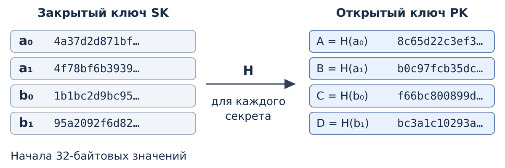
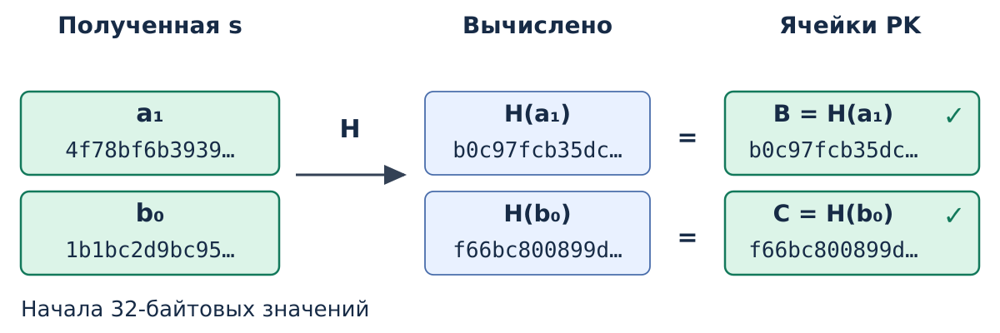
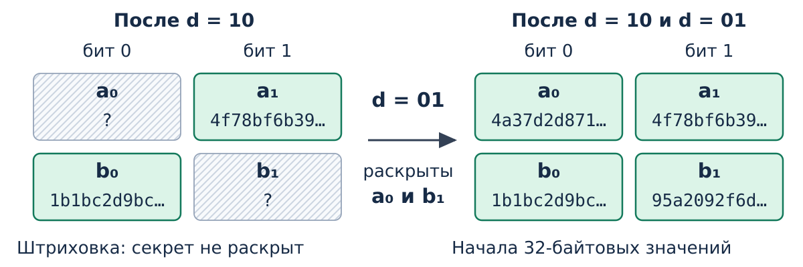

# Подпись Лэмпорта {#sec-theory-lamport}

Схема Лэмпорта строит [цифровую подпись](digital-signature.qmd#def-trust-digital-signature).
В [учебной схеме подписи хеша](digital-signature.qmd#sec-theory-signature-digest)
файл $m$ сначала преобразуют в дайджест $d=G(m)$, после чего подписывают $d$. Здесь разберём, как из битов $d$ и закрытого
ключа получают подпись и как её проверяют по открытому ключу.

Операции этой конкретной схемы обозначим
$s=\operatorname{LamportSign}(SK,d)$ и
$\operatorname{LamportVerify}(PK,d,s)$.
Файл может иметь произвольную длину; при $G=\mathrm{SHA\text{-}256}$
подписываемая последовательность $d$ содержит 256 бит.

## Устройство ключей

Лэмпорт связывает каждый бит $d$ с одним заранее выбранным секретом.
Для каждой из 256 позиций независимо создают два случайных секрета:
один для значения 0, другой для значения 1. Закрытый ключ $SK$ содержит
**512 секретов**. Возьмём секреты длиной 32 случайных байта: такие строки
практически невозможно угадать при независимом равномерном выборе.

К каждому секрету применяют хеш-функцию $H$. Полученные **512 хешей**
составляют открытый ключ $PK$: по два значения для каждой позиции.
Подпись раскрывает 256 выбранных секретов — по одному на бит $d$.
Проверяющий хеширует эти части и сравнивает с нужными ячейками $PK$.

Хеширование выполняет в конструкции две разные работы:

| Обозначение | Вход | Для чего нужен результат |
|---|---|---|
| $G(m)$ | Документ целиком | Получить дайджест $d$, биты которого выбирают части подписи |
| $H(x)$ | Один случайный секрет | Опубликовать значение, по которому можно проверить раскрытый секрет |

В обоих случаях можно использовать SHA-256. Буквы $G$ и $H$
разделяют роль и вход вычисления: дайджест документа и хеш секрета
находятся в разных частях механизма.

### Две позиции

Проследим выбор на двух позициях. Для этого зададим короткую
**подписываемую последовательность $d=10$**. В полной схеме тот же выбор выполняется
для каждой из 256 позиций дайджеста $G(m)$.

Для первой позиции выбраны секреты $a_0$ и $a_1$, для второй —
$b_0$ и $b_1$. Индекс обозначает значение бита. Их хеши получили
короткие имена $A$, $B$, $C$, $D$.

{#fig-trust-lamport-keygen fig-alt="Для каждой из двух позиций независимо выбирают по два случайных секрета: a0 и a1, b0 и b1. Их хеши A, B, C, D публикуют в соответствующих ячейках открытого ключа. Полный закрытый ключ остаётся у подписывающего."}

| Позиция | Секрет для 0 | Секрет для 1 | Открытые хеши для 0 и 1 |
|---|---|---|---|
| Первая | $a_0$ | $a_1$ | $H(a_0)=A$, $H(a_1)=B$ |
| Вторая | $b_0$ | $b_1$ | $H(b_0)=C$, $H(b_1)=D$ |

На @fig-trust-lamport-keygen из четырёх секретов получаются четыре
открытых значения. Все они различны в этом примере. Значения $A$,
$B$, $C$, $D$ известны проверяющему заранее; сами секреты остаются
у владельца $SK$ до их раскрытия в подписи.

За именами стоят обычные данные. Например, $a_1$ — следующие 32 байта
в шестнадцатеричной записи, а $B$ — их хеш SHA-256:

```text
a1 = 4f78bf6b393977b0761c35700879b05e2cb75e05aae6c8a6781b7707505c81cf
B  = b0c97fcb35dce6be90f28ac81ad655afe987ae944cd5ddcf31610bce58680b78
```

Каждые две шестнадцатеричные цифры задают один байт. Для вычисления
$B$ запись $a_1$ декодируют в 32 байта и передают эти байты SHA-256.
Получив $a_1$ в подписи, проверяющий может повторить это вычисление.
По одному $B$ практически найти подходящее значение $a_1$ трудно:
здесь используется стойкость $H$ к поиску прообраза случайного секрета.

### Создание подписи `10` {#sec-theory-lamport-signing}

{#fig-trust-lamport-signing fig-alt="Подписываемая последовательность d равна 10. Первый бит 1 выбирает секрет a1 из первой позиции закрытого ключа, второй бит 0 выбирает b0 из второй позиции. Подпись s состоит из a1 и b0, а a0 и b1 не передаются."}

Первый бит $d$ равен 1, поэтому из первой строки $SK$ берут $a_1$.
Второй бит равен 0, поэтому из второй строки берут $b_0$.
Получается **$s=(a_1,b_0)$**. Подпись содержит сами два секрета:
первый начинается с байтов `4f 78 bf 6b` из примера выше.
Имена $a_1$ и $b_0$ лишь сокращают их запись.

Владелец передаёт подпись $s$, сохраняя оставшиеся секреты $a_0$ и $b_1$.
В схеме подписи файла он передал бы файл $m$ и 256 выбранных частей,
а получатель заново вычислил бы $d=G(m)$.

### Проверка подписи `10` {#sec-theory-lamport-verification}

{#fig-trust-lamport-verification fig-alt="Проверяющий использует последовательность d равную 10, подпись с частями a1 и b0 и заранее известный открытый ключ. Он вычисляет H от каждой части и сравнивает результаты с B для первой позиции и бита 1 и с C для второй позиции и бита 0. При совпадении обеих пар проверка проходит."}

Проверяющий получает две строки байтов. Для первой части он вычисляет
$H(a_1)$ и по первому биту $d=10$ выбирает ожидаемое значение $B$.
Для второй вычисляет $H(b_0)$ и по второму биту выбирает $C$.

| Позиция | Бит $d$ | Хеш полученной части | Ожидаемый хеш из $PK$ |
|---|---|---|---|
| Первая | 1 | $H(a_1)$ | $B$ |
| Вторая | 0 | $H(b_0)$ | $C$ |

Получаются $H(a_1)=B$ и $H(b_0)=C$, поэтому обе проверки проходят.
Знания оставшихся секретов для этого не требуется. В полной схеме
проверяющий таким же способом проверяет все 256 частей подписи
по битам заново вычисленного дайджеста документа.

### Попытка заменить `10` на `11` {#sec-theory-lamport-forgery}

Пусть постороннему известны открытый ключ и подпись $(a_1,b_0)$
для последовательности `10`. Он хочет предъявить подпись для `11`.

Первая часть $a_1$ подходит: в первой позиции по-прежнему стоит 1.
Во второй позиции теперь требуется часть с хешем **$D$**.
Известный $b_0$ даёт $H(b_0)=C$, а $C\ne D$, поэтому проверка
этой части не пройдёт.

Для новой подписи нужно найти $b_1$ или другую строку $x$,
для которой $H(x)=D$. Это поиск прообраза хеша. Независимый случайный
выбор секретов и стойкость $H$ делают такой поиск практически трудным.
Алгоритм и весь $PK$ при этом известны постороннему.

## Повторное использование {#sec-theory-lamport-reuse}

::: {#def-trust-lamport-one-time name="Одноразовый ключ Лэмпорта"}
Ключ схемы Лэмпорта предназначен для подписи одной битовой
последовательности $d$. Для нового документа создают новую пару ключей.
Уже созданную подпись можно проверять многократно.
:::

{#fig-trust-lamport-disclosure fig-alt="После подписи последовательности 10 раскрыты a1 и b0. Подпись последовательности 01 тем же ключом раскрывает a0 и b1. Теперь известны оба секрета каждой позиции, поэтому можно составить подписи 00 и 11."}

Подпись раскрывает выбранные секреты. После подписи `10` получателю
известны $a_1$ и $b_0$. Если тем же ключом подписать `01`,
раскроются ещё $a_0$ и $b_1$. Теперь получатель знает все четыре
секрета и может составить подписи `00` и `11`. Искать прообраз
больше не нужно: подходящие значения уже опубликованы в двух подписях.
Повторная проверка прежней подписи новых секретов не раскрывает.

Предварительное хеширование позволяет подписывать файлы разной длины,
но не делает ключ Лэмпорта многократным. Для следующего файла можно
создать новую пару одноразовых ключей и доверенным способом передать
новый $PK$. Существуют также схемы подписи, рассчитанные на многократное
использование одной пары, в том числе схемы на основе RSA. В них также выполняют создание подписи
$\operatorname{Sign}(SK,m)$ и проверку
$\operatorname{Verify}(PK,m,s)$, но внутреннее устройство отличается.

## Связь с подписью файла

В рассмотренном примере задана последовательность $d$. Для подписи файла
её получают как $d=G(m)$, а при проверке вычисляют заново по полученному
файлу. Поэтому стойкость всей конструкции зависит и от хеш-функции $G$:
[совпадение дайджестов разных документов](digital-signature.qmd#sec-theory-signature-collision)
позволяет предъявить для них одну подпись. Стойкость $H$ к поиску секретов
не устраняет этот способ подмены: при коллизии $G$ новые секреты не нужны.

## Источники

Побитовая модель адаптирована из
[The Structure of Secure Systems, §§ 5.3–5.4](https://securitybook.eecs.berkeley.edu/chapters/lec05.html#one-time-secure-signatures-lamport-signatures).
Предварительное хеширование документа описано в
[§ 5.5](https://securitybook.eecs.berkeley.edu/chapters/lec05.html#a-one-time-signature-scheme-for-arbitrary-length-messages).
Описание исходной работы доступно
[у автора](https://www.microsoft.com/en-us/research/publication/constructing-digital-signatures-one-way-function/).
