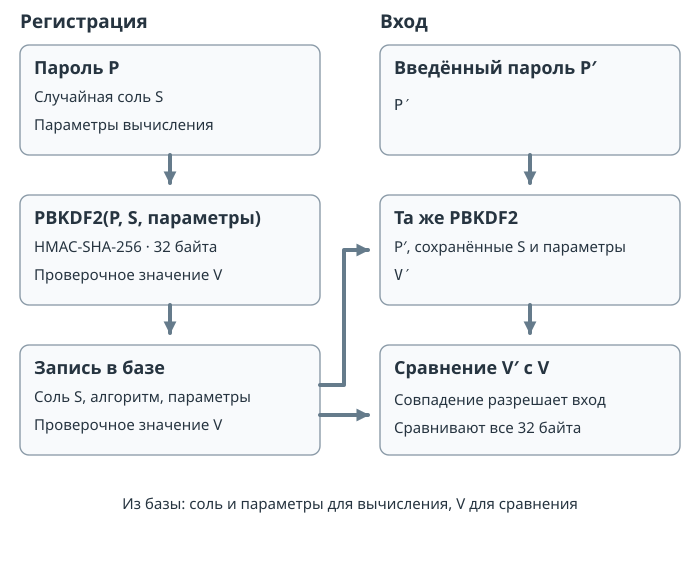

# Хранение паролей {#sec-theory-password-storage}

## Проверочная запись

Сервису нужно проверять пароль, но для этого не требуется сохранять его открытым текстом. При регистрации сервер получает пароль по защищённому соединению, создаёт случайную индивидуальную **соль** и вычисляет проверочное значение специальной парольной функцией. Соль поступает из криптографического генератора, свойства которого разобраны в @sec-theory-crypto-random. В записи хранят пользователя, название и версию алгоритма, его параметры, соль и результат. Пароль после вычисления не записывают в эту таблицу.

При входе сервер находит запись пользователя, берёт из неё соль и параметры, вычисляет ту же функцию от введённого кандидата и сравнивает результат с сохранённым. Совпадение позволяет принять кандидат как правильный с учётом свойств функции; несовпадение означает отказ. Соль не секретна: она должна быть доступна для повторного вычисления.

На @fig-password-record показано, какие данные сохраняются при регистрации и используются при проверке входа.

{#fig-password-record fig-alt="При регистрации сохраняются соль, параметры и результат PBKDF2. При входе введённый пароль проверяется с сохранёнными солью и параметрами" width="100%"}

Следующие вымышленные записи воспроизводимы: пароль обеих учётных записей — `кот7`, его байты и соли заданы в UTF-8 и шестнадцатеричной записи соответственно. Использована PBKDF2-HMAC-SHA-256, длина результата 32 байта и 1000 итераций. Заданная стоимость предназначена для воспроизведения примера; действующему сервису нужны параметры, подобранные по его ресурсам и нагрузке.

| Пользователь | Алгоритм | Параметры | Соль, hex | Проверочное значение, hex |
|---|---|---|---|---|
| Анна | PBKDF2-HMAC-SHA-256 | 1000 итераций, 32 байта | `00010203 04050607 08090a0b 0c0d0e0f` | `d95ab0d9 d4465e11 c6bd8a1f 1f278edd e6ecc462 493ffd65 681ab8f5 9d67e3da` |
| Борис | PBKDF2-HMAC-SHA-256 | 1000 итераций, 32 байта | `10111213 14151617 18191a1b 1c1d1e1f` | `ace608e7 3b393d74 52143796 4915ea01 1bd85e7d e1177ca1 c06b9cda d93d82ab` |

Пробелы в hex-записи разделяют группы байтов для чтения и не входят в значения.

Разные соли дают в этом примере разные результаты для одинакового пароля. Равенство или различие результатов не является математическим доказательством равенства или различия паролей: возможны коллизии. На практике случайную соль генерируют отдельно для каждой записи; фиксированные соли таблицы нужны только для повторения примера.



## Утечка базы

Если база хранит открытые пароли, получивший её сразу их видит. При хранении быстрого хеша атакующий вычисляет хеши предполагаемых паролей и сравнивает их с записями. Одинаковый пароль без соли даёт одинаковый хеш в разных записях; готовый набор соответствий можно использовать повторно.

Соль меняет вход вычисления для каждой записи. Готовая таблица для одной соли не подходит напрямую к другой; одинаковый кандидат нужно вычислить отдельно для каждой соли. Соль не делает слабый пароль случайным и сама по себе не увеличивает стоимость одной проверки. Затратная парольная функция, напротив, повышает расход вычислений или памяти на каждую проверку. Вместе они затрудняют повторное использование вычислений и удорожают подбор. Дополнительный общий секрет вне базы иногда называют pepper; он имеет другую роль и не заменяет соль.

При **онлайн-подборе** кандидат проверяет работающий сервис; он может ограничивать частоту попыток и обнаруживать подозрительную активность. После утечки проверочных записей возможен **офлайн-подбор**: атакующий самостоятельно вычисляет кандидатов и не обращается к сервису. Ограничение числа входов на сайте этот процесс не останавливает.

## Способы подбора

Словарная атака перебирает вероятные пароли и их типичные изменения. Она особенно эффективна, когда люди выбирают распространённые слова и последовательности. Полный перебор проверяет все строки в заданном пространстве; он найдёт пароль, если тот действительно принадлежит пространству и ресурсов хватит на проверку нужного числа вариантов.

Предвычисленная таблица заранее связывает кандидатов с результатами функции и позволяет обменять память и подготовительную работу на быстрый поиск позже. Её применимость зависит от совпадения алгоритма, параметров и соли. **Радужная таблица** сокращает хранение ценой дополнительных вычислений: вместо всех промежуточных пар она сохраняет начало и конец цепочки, чередующей хеширование и редукцию. Редукция переводит хеш в допустимый кандидат; это не обращение хеша и не восстановление исходного пароля.

Например, в игрушечном пространстве двух цифр пусть $H(12)=\texttt{a7}$, а первая редукция даёт $R_1(\texttt{a7})=34$; далее $H(34)=\texttt{b2}$ и $R_2(\texttt{b2})=56$. Сохраним только начало `12` и конец `56`. Для поиска хеша `b2` применяем соответствующую редукцию и получаем конец `56`; затем заново строим цепочку от `12` и находим кандидат `34`, действительно давший `b2`. В реальной радужной таблице применяют много цепочек и разные редукции по позициям; совпадение конца требует повторного построения и проверки, а цепочки могут сливаться. Индивидуальные случайные соли делают такую общую предварительную таблицу непрактичной для множества разных записей.

## Парольные функции

PBKDF2 и Argon2id относятся к затратным функциям выработки из пароля; их назначения и спецификации сопоставлены в @sec-theory-crypto-algorithms.

PBKDF2-HMAC-SHA-256 многократно применяет HMAC на основе SHA-256. HMAC — код аутентификации сообщения, вычисляемый с ключом; в PBKDF2 пароль участвует в его вычислении. Свойства самой хеш-функции рассмотрены в @sec-theory-crypto-hash. Параметры PBKDF2 включают соль, число итераций и длину результата. Для каждого блока результата первое применение HMAC получает соль с номером блока; каждое следующее получает результат предыдущего. Значения всех итераций блока объединяются операцией XOR. При проверке каждого кандидата эту цепочку вычисляют заново, поэтому увеличение числа итераций увеличивает последовательную работу проверки. Порядок вычисления задан в [RFC 8018, раздел 5.2](https://www.rfc-editor.org/rfc/rfc8018#section-5.2). Argon2id также предназначена для выработки проверочного значения из пароля и соли; её параметры задают расход памяти $m$, число проходов $t$ и степень параллелизма $p$. Расход памяти затрудняет массовую параллельную проверку при ограниченных ресурсах атакующего.

[RFC 9106](https://www.rfc-editor.org/rfc/rfc9106.html#section-4) приводит для Argon2id, среди прочего, профиль $m=2^{16}\,\mathrm{KiB}$, $t=3$, $p=4$, с солью 128 бит и результатом 256 бит. Выбор рабочих параметров учитывает измеренное время, память и одновременную нагрузку конкретного сервера. При обновлении параметров сервис может после успешного входа вычислить новую запись из введённого пароля. Число итераций из учебной таблицы выше слишком мало, чтобы служить готовой настройкой.

## Пространство паролей

Пусть пароль состоит ровно из $L$ независимо и равновероятно выбранных символов алфавита из $A$ различных символов; повторение символов разрешено. Тогда число возможных паролей $N=A^L$. Например, для четырёх десятичных цифр $N=10^4=10000$, включая `0000`.

Если все эти пароли равновероятны и каждый кандидат проверяют ровно один раз в фиксированном порядке, средний номер правильной проверки равен $(N+1)/2$, здесь $5000{,}5$. При постоянной условной скорости 100 проверок в секунду среднее время составляет $50{,}005$ секунды, а полный перебор — 100 секунд. Это модель для заданной скорости и одного процесса проверки; оборудование, параллелизм, параметры функции и накладные расходы меняют фактическое время. При другой условной стоимости 20 мс на одну последовательную проверку среднее время составляет $5000{,}5\cdot0{,}02=100{,}01$ секунды, то есть примерно 100 секунд. Человек выбирает пароли неравномерно, поэтому словарь может найти распространённый пароль намного раньше средней позиции в равномерной модели.

### Оценка по измеренной скорости

В исследовании [Hive Systems от 14 июля 2026 года](https://www.hivesystems.com/newsroom-posts/07-14-2026) для bcrypt — парольной функции с настраиваемой стоимостью — использован параметр `cost = 10`. Два набора по восемь RTX 5090 дали суммарно $r = 138675$ проверок в секунду. [Авторы описывают измерение и предпосылки расчёта](https://www.hivesystems.com/blog/are-your-passwords-in-the-green).

Для случайного пароля из строчных латинских букв, то есть $A = 26$, пересчитаем эту скорость во время полного исчерпания пространства: $T = 26^L/r$. Проверяется одна парольная запись, кандидаты перебираются без повторений, скорость считается постоянной.

| Длина $L$ | Число вариантов | Полный перебор при указанной скорости |
|---:|---:|---:|
| 6 | $26^6$ | около 37 минут |
| 8 | $26^8$ | около 17 суток |
| 10 | $26^{10}$ | около 32 лет |

: Расчёт по измерению Hive Systems, июль 2026 года {#tbl-password-search-estimate}

Здесь рассчитано время проверки **всех** вариантов; при равновероятном выборе пароля средний номер правильной проверки находится примерно посередине. Каждая дополнительная буква увеличивает пространство и время в 26 раз. Оценки относятся к указанным bcrypt и оборудованию; для PBKDF2 или Argon2id потребуется отдельное измерение. Словарный подбор использует неравномерность человеческого выбора и может найти пароль значительно раньше.
