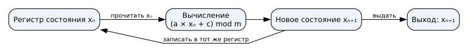

# Генераторы случайных чисел {#sec-theory-crypto-random}

## Основные понятия {#sec-random-concepts}

Случайные значения нужны, например, для секретных ключей и солей. Случайность относится к способу выбора, а не к внешнему виду отдельной строки. При восьми независимых бросках честной монеты каждая заранее заданная последовательность, в том числе `01010101` и `00110110`, имеет вероятность `1/256`. По одной строке нельзя установить, как она получена, и доказать непредсказуемость следующих битов.

Генератор поддерживает **состояние**: данные, от которых зависит его следующий шаг. Детерминированный генератор вычисляет новое состояние по старому и выдаёт значение. При одинаковых начальном состоянии и правиле перехода он повторяет всю последовательность. Начальное состояние называют seed. Ниже выходом каждого шага служит само новое состояние.

## Переход и период

Рассмотрим линейный конгруэнтный генератор с формулой

$$x_{n+1}=(5x_n+1)\bmod 16, \qquad x_0=2.$$

Операция `mod 16` оставляет остаток от деления на 16. Регистр содержит текущее состояние; вычислитель берёт его из регистра, применяет формулу и записывает результат обратно. От нового состояния отходит отдельная ветвь выхода. Обратная связь нужна потому, что следующий шаг использует результат предыдущего.

{#fig-random-lcg-overview fig-alt="Текущее состояние поступает в вычисление, новое возвращается в тот же регистр и отдельно выдаётся на выход"}

::: {#exm-random-output}
Первый шаг даёт $x_1=(5\cdot2+1)\bmod16=11$. Затем $x_2=(5\cdot11+1)\bmod16=8$ и $x_3=(5\cdot8+1)\bmod16=9$.
:::

Полная трасса, включая начальное состояние:

```text
2 → 11 → 8 → 9 → 14 → 7 → 4 → 5 → 10
  → 3 → 0 → 1 → 6 → 15 → 12 → 13 → 2
```

Через 16 шагов состояние `2` повторилось. Поскольку правило детерминировано, после этого повторится и вся последовательность. **Период** — число переходов до повторения состояния в цикле; здесь он равен 16 и охватывает все возможные остатки. При других множителе, слагаемом, модуле или начальном состоянии период может быть короче. Например, при правиле $x_{n+1}=(4x_n)\bmod16$ и $x_0=2$ получаем `8, 0, 0`: состояние `0` затем повторяется на каждом шаге.

```{ojs}
//| echo: false
//| label: fig-random-lcg
//| fig-cap: "Пошаговое вычисление и наблюдаемые частоты"
cryptoLesson = await import(await FileAttachment("/_prepared/visualizations/crypto/lesson.js").url())
cryptoLesson.lcgTrainer()
```

## Частоты и предсказание

В полном периоде первого примера каждое число от 0 до 15 появляется ровно один раз. Равные частоты не мешают предсказанию: зная состояние и формулу, наблюдатель вычисляет следующее значение. Младший бит здесь чередуется `0, 1, 0, 1, …`: умножение на нечётное число сохраняет чётность, прибавление единицы меняет её, а остаток по чётному модулю сохраняет младший бит. Частоты нулей и единиц равны, хотя после наблюдения одного бита следующий известен.

Аналогичная граница есть и у криптографического хеша. Пусть публичны $s_0$ и правило $s_{n+1}=\operatorname{SHA256}(s_n)$, где вход следующего шага — 32 байта предыдущего результата. Любой наблюдатель вычислит $s_1$, затем $s_2$ и последующие значения. Для предсказания не требуется обращать SHA-256: достаточно применить известную функцию вперёд. Внешне сложная последовательность сама по себе не делает известное состояние секретным.

```{ojs}
//| echo: false
//| label: fig-random-public-chain
//| fig-cap: "Прямое вычисление публичной хеш-цепочки"
cryptoLesson.publicHashChain()
```

## Энтропия и криптографический генератор

**Энтропия** характеризует неопределённость значения относительно имеющейся информации. Если начальное состояние выбирают из небольшого известного набора, атакующий может проверить варианты, даже когда детерминированная программа выдаёт много битов. Вычисление расширяет последовательность, но не создаёт новую неопределённость из полностью известного входа.

Криптографически стойкий генератор псевдослучайных чисел (CSPRNG) использует подходящий источник энтропии для инициализации и, при необходимости, обновления внутреннего состояния. Его конструкция должна делать следующие выходы практически непредсказуемыми для наблюдателя, который видит предыдущие выходы, но не знает состояние. Состояние нужно защищать от раскрытия; свойства восстановления после компрометации зависят от конкретной конструкции и поступления новой энтропии. Для ключей и солей приложение обращается к системному криптографическому API, а не подбирает параметры учебного генератора.

{#fig-random-seed fig-alt="Источник случайности задаёт начальное состояние генератора"}

## Проверьте себя

1. Продолжите первый генератор от состояния `9` на два шага. Как изменится ответ после сброса к `2`?
2. В полном периоде младший бит поровну принимает значения `0` и `1`. Почему этого наблюдения недостаточно для секретного ключа?
3. Что сможет вычислить наблюдатель публичной SHA-256-цепочки, если ему известно текущее состояние?
