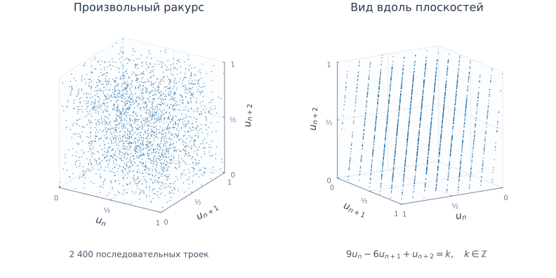
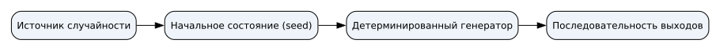

# Генераторы случайных чисел {#sec-theory-crypto-random}

## Состояние генератора {#sec-random-concepts}

Случайные значения нужны, например, для секретных ключей и солей. Случайность относится к способу выбора; внешний вид отдельной строки не устанавливает способ её получения. При восьми независимых бросках честной монеты каждая заранее заданная последовательность, в том числе `01010101` и `00110110`, имеет вероятность $\frac{1}{256}$. По одной строке нельзя установить, как она получена, и доказать непредсказуемость следующих битов.

::: {#def-random-state name="Состояние генератора"}
**Состояние генератора** — данные, от которых зависит его следующий шаг.
:::

Генератор хранит состояние между шагами. Детерминированный генератор вычисляет новое состояние по старому и выдаёт значение. При одинаковых начальном состоянии и правиле перехода он повторяет всю последовательность. Начальное состояние называют seed. Ниже выходом каждого шага служит само новое состояние.

## Период

Рассмотрим линейный конгруэнтный генератор с формулой

$$x_{n+1}=(5x_n+1)\bmod 16, \qquad x_0=2.$$

Операция $\bmod 16$ оставляет остаток от деления на 16. Регистр содержит текущее состояние; вычислитель берёт его из регистра, применяет формулу и записывает результат обратно. От нового состояния отходит отдельная ветвь выхода. Обратная связь нужна потому, что следующий шаг использует результат предыдущего.

{#fig-random-lcg-overview fig-alt="Текущее состояние поступает в вычисление, новое возвращается в тот же регистр и отдельно выдаётся на выход"}

::: {#exm-random-output}
Первый шаг даёт $x_1=(5\cdot2+1)\bmod16=11$. Затем $x_2=(5\cdot11+1)\bmod16=8$ и $x_3=(5\cdot8+1)\bmod16=9$.
:::

Полная трасса, включая начальное состояние:

$$
\begin{aligned}
2 &\to 11 \to 8 \to 9 \to 14 \to 7 \to 4 \to 5 \to 10 \\
  &\to 3 \to 0 \to 1 \to 6 \to 15 \to 12 \to 13 \to 2
\end{aligned}
$$

Через 16 шагов состояние $2$ повторилось. Поскольку правило детерминировано, после этого повторится и вся последовательность. **Период** — число переходов до повторения состояния в цикле; здесь он равен 16 и охватывает все возможные остатки. При других множителе, слагаемом, модуле или начальном состоянии период может быть короче. Например, при правиле $x_{n+1}=(4x_n)\bmod16$ и $x_0=2$ получаем $8, 0, 0$: состояние $0$ затем повторяется на каждом шаге.



## Предсказуемость

В полном периоде первого примера каждое число от 0 до 15 появляется ровно один раз. Равные частоты не мешают предсказанию: зная состояние и формулу, наблюдатель вычисляет следующее значение. Младший бит здесь чередуется $0, 1, 0, 1, \ldots$: умножение на нечётное число сохраняет чётность, прибавление единицы меняет её, а остаток по чётному модулю сохраняет младший бит. Частоты нулей и единиц равны, хотя после наблюдения одного бита следующий известен.

## Скрытая зависимость между выходами

RANDU — классический пример неудачного конгруэнтного генератора. В нём $x_{n+1}=65539x_n\bmod 2^{31}$, а нормализованный выход $u_n=x_n/2^{31}$ лежит между нулём и единицей. Если каждую тройку последовательных выходов представить точкой $(u_n,u_{n+1},u_{n+2})$, изменение ракурса обнаруживает параллельные плоскости, как на @fig-random-randu.

{#fig-random-randu fig-alt="Слева 2400 последовательных троек выглядят облаком, справа ракурс обнаруживает 15 параллельных плоскостей"}

Такая структура возникает из зависимости $9u_n-6u_{n+1}+u_{n+2}\in\mathbb{Z}$. [Документация R](https://stat.ethz.ch/R-manual/R-devel/library/datasets/html/randu.html) приводит этот классический пример. Плоскости выявляют зависимость между соседними выходами, которую гистограмма отдельных значений не показывает. Другие зависимости могут оставаться невидимыми в выбранном ракурсе; для оценки сопротивления прогнозу необходимо исследовать конструкцию генератора.

## Прогноз по наблюдаемым выходам

В первом учебном LCG параметры $a$, $c$, $m$ известны, а выход совпадает с состоянием: одного последнего выхода достаточно для вычисления следующего. Теперь рассмотрим другой LCG, параметры которого наблюдателю заранее неизвестны.

::: {#exm-random-lcg-recovery}
Даны шесть полных последовательных выходов: $39022$, $61087$, $20196$, $45005$, $3882$, $21259$. Для них удаётся восстановить $m=65536$, $a=25173$, $c=13849$. Из последнего наблюдаемого состояния получаем следующий выход:

$$x_7=(25173\cdot21259+13849)\bmod65536=65216.$$

На @fig-random-lcg-recovery прогноз записан до продолжения исходного генератора.
:::

{#fig-random-lcg-recovery fig-alt="По шести выходам восстановлены параметры LCG. Четыре заранее записанных значения совпадают с фактическим продолжением"}

Для восстановления используют разности $d_i=x_{i+1}-x_i$. Поскольку $x_{i+1}\equiv ax_i+c\pmod m$, вычитание двух соседних переходов устраняет $c$ и даёт $d_{i+1}\equiv a d_i\pmod m$. Следующее такое равенство — $d_{i+2}\equiv a d_{i+1}\pmod m$. Умножим первое на $d_{i+1}$, второе на $d_i$ и вычтем результаты: $d_id_{i+2}-d_{i+1}^2\equiv0\pmod m$. Значит, каждое число $z_i=d_id_{i+2}-d_{i+1}^2$ кратно модулю. В данном наборе $\gcd(|z_1|,|z_2|,|z_3|)=65536$, что определяет модуль: он должен превышать максимальный наблюдаемый выход $61087$. Разности равны $22065, -40891, 24809, -41123, 17377$; соответствующие три значения $z_i$ равны $-1124663296, 1066074112, -1259995136$. Здесь $d_1=22065$ взаимно просто с $65536$, поэтому имеет обратный элемент по этому модулю. Умножение $d_2\equiv a d_1\pmod{65536}$ на обратный к $d_1$ даёт $a=25173$; затем $c\equiv61087-25173\cdot39022\pmod{65536}=13849$. Подстановка в остальные переходы проверяет найденные параметры. Шести выходов достаточно именно для этого примера; при других данных возможны неоднозначность и необходимость дополнительных наблюдений. Состояние здесь не скрыто: последнее наблюдаемое число уже сообщает его.

Mersenne Twister создавался для моделирования и имеет гораздо более сложное состояние. Однако сложность и хорошие статистические свойства не делают его криптографическим генератором. Каждый полный 32-битный выход MT19937 получается обратимым побитовым преобразованием слова состояния. Обратив это преобразование для $624$ последовательных полных выходов, можно восстановить достаточно слов состояния для вычисления продолжения. Усечённые выходы не дают всех битов, необходимых для такого непосредственного обращения. На @fig-random-mt-prediction представлены полные значения в шестнадцатеричной записи; это не результаты бросков кубика и не усечённые выходы.

{#fig-random-mt-prediction fig-alt="После наблюдения 624 полных 32-битных выходов записан прогноз. Следующие четыре фактических выхода совпадают с ним"}

[Авторы Mersenne Twister](https://math.sci.hiroshima-u.ac.jp/m-mat/MT/efaq.html) предупреждают о предсказуемости продолжения по достаточно длинной последовательности выходов. Восстановленное состояние позволяет вычислить продолжение даже при хорошем распределении значений в наблюдаемой выборке.

## Криптографический генератор

**Энтропия** характеризует неопределённость значения относительно имеющейся информации. Если начальное состояние выбирают из небольшого известного набора, атакующий может проверить варианты, даже когда детерминированная программа выдаёт много битов. Вычисление расширяет последовательность, но не создаёт новую неопределённость из полностью известного входа.

Криптографически стойкий генератор псевдослучайных чисел (CSPRNG) использует подходящий источник энтропии для инициализации и, при необходимости, обновления внутреннего состояния. Его конструкция должна делать следующие выходы практически непредсказуемыми для наблюдателя, который видит предыдущие выходы, но не знает состояние. Состояние нужно защищать от раскрытия; свойства восстановления после компрометации зависят от конкретной конструкции и поступления новой энтропии. Для ключей и солей приложение обращается к системному криптографическому API. Роль полученных значений в создании ключа и парольной записи различается: ключ защищают от раскрытия, а соль сохраняют вместе с записью. Эти применения разобраны в @sec-theory-crypto-key-gen и @sec-theory-password-storage.

{#fig-random-seed fig-alt="Источник случайности задаёт начальное состояние генератора"}

Конечная выборка CSPRNG может иметь неравные частоты. У учебного LCG частоты равны за полный период, но известное состояние вместе с формулой позволяет вычислить следующий выход. Для защиты ключей требуется генератор, чья конструкция препятствует такому прогнозу при скрытом состоянии.
