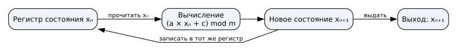
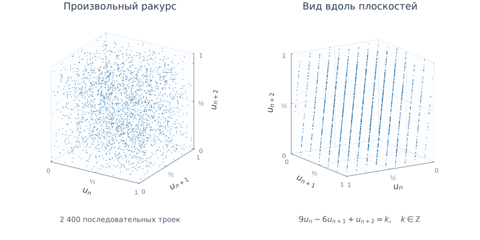

# Криптографическая случайность {#sec-theory-randomness}

## Непредсказуемый выбор

Для секретного ключа нужен способ выбора, результат которого посторонний не сможет практически предсказать по доступным сведениям. В моделировании повторяемость опыта полезна: одинаковые начальные данные позволяют сравнивать результаты. При создании ключа известные начальные данные позволяют повторить вычисление и получить тот же секрет.

Случайность относится к способу выбора. По внешнему виду отдельной строки нельзя установить, как она получена. При восьми независимых бросках честной монеты каждая заранее заданная последовательность, в том числе `01010101` и `00110110`, имеет вероятность $1/256$. Узоры в одной строке сами по себе не доказывают предсказуемость следующих битов.

## Состояние генератора {#sec-random-concepts}

::: {#def-random-state name="Состояние генератора"}
**Состояние генератора** — сохраняемые данные, от которых зависит его дальнейшая работа. Начальные данные для создания состояния обычно называют seed.
:::

Упрощённый шаг детерминированного генератора записывается так:

$$
(S_{i+1},r_i)=G(S_i).
$$

Здесь $S_i$ — состояние перед шагом $i$, $S_{i+1}$ — новое состояние, $r_i$ — выданные биты, а $G$ — известный алгоритм перехода и выдачи. Выход и внутреннее состояние — разные части модели. Генератор не обязан раскрывать всё состояние в каждом результате.

При одинаковом состоянии и одинаковых последующих входах детерминированные копии работают одинаково. Если сохранить состояние в образе виртуальной машины и запустить две его копии, одни лишь разные имена машин не добавят неизвестных данных в это состояние. Для независимой работы генератора нужны предусмотренные его конструкцией создание и обновление состояния.

## Источник энтропии {#sec-random-entropy-source}

::: {#def-random-entropy name="Энтропия"}
**Энтропия** характеризует неопределённость значения в заданной вероятностной модели с учётом доступных наблюдателю сведений.
:::

Если известная программа выбирает начальное значение из восьми вариантов, а затем превращает его в длинную строку, результатов остаётся не более восьми. Детерминированная обработка удлиняет запись, но не создаёт дополнительной неопределённости исходного выбора.

::: {#def-random-source name="Источник энтропии"}
**Источник энтропии** получает данные из процесса с неопределённостью; его устройство может включать измерение, проверки работы и обработку полученных данных.
:::

Физическим основанием могут служить шумовые процессы в электронной схеме. Нужно различать получение новых измерений и последующие вычисления:

| Стадия | Что происходит |
|---|---|
| Физический процесс и измерение | Поступают данные с неопределённостью |
| Проверки источника | Выявляются предусмотренные моделью отказы |
| Обработка измерений | Данные преобразуются, например уменьшается смещение |
| Создание или обновление состояния | Подготовленные данные вводятся в генератор |
| Генерация | Из состояния быстро получается нужное число битов |

Обработка может улучшить распределение результата. Она не восстанавливает неизвестность, которой не было во входных данных. [NIST SP 800-90B](https://csrc.nist.gov/pubs/sp/800/90/b/final) рассматривает устройство и оценку таких источников.

### Аппаратный пример

В описанной Intel архитектуре DRNG источник использует тепловой шум в кремнии. Измеренные биты проходят обработку и используются для инициализации аппаратного детерминированного генератора. Инструкция `RDRAND` получает результат этого генератора; `RDSEED` предназначена для получения подготовленных исходных данных, которыми можно инициализировать другой генератор. Эти роли относятся к [описанной архитектуре Intel DRNG, ред. 2.1, §§ 3.2 и 4](https://www.intel.com/content/www/us/en/developer/articles/guide/intel-digital-random-number-generator-drng-software-implementation-guide.html).

Прикладная программа обычно обращается к системному криптографическому интерфейсу. Например, Windows предоставляет [`BCryptGenRandom`](https://learn.microsoft.com/en-us/windows/win32/api/bcrypt/nf-bcrypt-bcryptgenrandom) с выбором системного генератора и кодом результата. Подготовку источников и внутреннее состояние обслуживает системная реализация.

## Криптографический генератор {#sec-random-csprng}

::: {#def-random-csprng name="Криптографический генератор"}
**Криптографически стойкий генератор псевдослучайных чисел (CSPRNG)** предназначен для получения битов, которые наблюдатель без секретного состояния не может практически предсказывать по предыдущим выходам при соблюдении условий конструкции.
:::

Криптографический генератор соединяет подходящую конструкцию с исходными данными достаточной энтропии. Он быстро выдаёт биты из защищённого состояния; новые данные источника позволяют предусмотренным способом обновлять состояние. Детерминированность совместима с непредсказуемостью, когда состояние неизвестно и его нельзя практически восстановить по выходам.

{#fig-random-seed fig-alt="Источник случайности задаёт начальное состояние генератора"}

Раскрытие состояния меняет сведения наблюдателя. Продолжение известного вычисления само по себе не возвращает секретность. Повторное внесение свежих данных источника называют reseed; результат зависит от конструкции и качества этих данных.

Для ключей и солей приложение использует системный криптографический генератор. Полученный ключ защищают от раскрытия, а соль сохраняют вместе с парольной записью. Эти применения рассмотрены в @sec-theory-key-management и @sec-theory-password-storage.

Длинный период и равные частоты помогают описывать последовательность, но не устанавливают сопротивление прогнозу. Следующие учебные опыты показывают это на генераторе с малым состоянием.

## Дополнительные опыты {#sec-random-lcg-experiments}

В линейном конгруэнтном генераторе (LCG) новое состояние вычисляют по предыдущему. Здесь выходом служит само новое состояние; это позволяет проследить зависимость по небольшим числам.

### Период

Рассмотрим линейный конгруэнтный генератор с формулой

$$x_{n+1}=(5x_n+1)\bmod 16, \qquad x_0=2.$$

Операция $\bmod 16$ оставляет остаток от деления на 16. Регистр содержит текущее состояние; вычислитель берёт его из регистра, применяет формулу и записывает результат обратно. От нового состояния отходит отдельная ветвь выхода. Обратная связь нужна потому, что следующий шаг использует результат предыдущего.

{#fig-random-lcg-overview fig-alt="Текущее состояние поступает в вычисление, новое возвращается в тот же регистр и отдельно выдаётся на выход"}

::: {#exm-random-output}
Первый шаг даёт $x_1=(5\cdot2+1)\bmod16=11$. Затем $x_2=(5\cdot11+1)\bmod16=8$ и $x_3=(5\cdot8+1)\bmod16=9$.
:::

Полная трасса, включая начальное состояние:

$$
\begin{aligned}
2 &\to 11 \to 8 \to 9 \to 14 \\
  &\to 7 \to 4 \to 5 \to 10 \\
  &\to 3 \to 0 \to 1 \to 6 \\
  &\to 15 \to 12 \to 13 \to 2
\end{aligned}
$$

Через 16 шагов состояние $2$ повторилось. Поскольку правило детерминировано, после этого повторится и вся последовательность. **Период** — число переходов до повторения состояния в цикле; здесь он равен 16 и охватывает все возможные остатки. При других множителе, слагаемом, модуле или начальном состоянии период может быть короче. Например, при правиле $x_{n+1}=(4x_n)\bmod16$ и $x_0=2$ получаем $8, 0, 0$: состояние $0$ затем повторяется на каждом шаге.



### Предсказуемость

В полном периоде первого примера каждое число от 0 до 15 появляется ровно один раз. Равные частоты не мешают предсказанию: зная состояние и формулу, наблюдатель вычисляет следующее значение. Младший бит здесь чередуется $0, 1, 0, 1, \ldots$: умножение на нечётное число сохраняет чётность, прибавление единицы меняет её, а остаток по чётному модулю сохраняет младший бит. Частоты нулей и единиц равны, хотя после наблюдения одного бита следующий известен.

### Скрытая зависимость между выходами

RANDU — классический пример неудачного конгруэнтного генератора. В нём $x_{n+1}=65539x_n\bmod 2^{31}$, а нормализованный выход $u_n=x_n/2^{31}$ лежит между нулём и единицей. Если каждую тройку последовательных выходов представить точкой $(u_n,u_{n+1},u_{n+2})$, изменение ракурса обнаруживает параллельные плоскости, как на @fig-random-randu.

{#fig-random-randu fig-alt="Слева 2400 последовательных троек выглядят облаком, справа ракурс обнаруживает 15 параллельных плоскостей"}

Такая структура возникает из зависимости $9u_n-6u_{n+1}+u_{n+2}\in\mathbb{Z}$. [Документация R](https://stat.ethz.ch/R-manual/R-devel/library/datasets/html/randu.html) приводит этот классический пример. Плоскости выявляют зависимость между соседними выходами, которую гистограмма отдельных значений не показывает. Другие зависимости могут оставаться невидимыми в выбранном ракурсе; для оценки сопротивления прогнозу необходимо исследовать конструкцию генератора.

### Прогноз по наблюдаемым выходам

Если формула и текущее состояние известны, следующий выход вычисляется напрямую. Теперь представим наблюдателя, который видит полные состояния учебного генератора, знает модуль $m=16$ и правило

$$x_{n+1}=(ax_n+c)\bmod16,$$

но пока не знает множитель $a$ и слагаемое $c$. Для опыта ограничим каждое из них целыми числами от 0 до 7. Получаются $8\cdot8=64$ пары $(a,c)$; каждая пара задаёт отдельную возможную модель генератора. Наблюдаемые переходы позволяют исключать модели, которые дают неверный следующий выход.

После наблюдения $2\to11$ остаются четыре пары: $(2,7)$, $(3,5)$, $(4,3)$ и $(5,1)$. Например, первая удовлетворяет проверке $(2\cdot2+7)\bmod16=11$. Все остальные пары из выбранных 64 дают другой результат. Переход $11\to8$ оставляет только $(5,1)$, поскольку $(5\cdot11+1)\bmod16=8$. Следующий переход $8\to9$ подтверждает эту пару. Так число подходящих моделей уменьшается $64\to4\to1$.

В @fig-lcg-model-selection каждая клетка сетки соответствует одной паре $(a,c)$, а проверки связывают её с наблюдаемыми переходами. Получив единственную подходящую пару, можно **до продолжения исходного генератора** записать прогноз: $(5\cdot9+1)\bmod16=14$. Затем раскрывается фактический выход для сравнения.



Однозначность получена внутри заданного семейства из 64 пар. Если допустить другие параметры, усечённые выходы или другое правило генерации, набор возможных моделей изменится. Для прогноза здесь удалось установить правило перехода, а последнее наблюдаемое число уже сообщает текущее состояние.

#### Восстановление неизвестного модуля

Когда модуль заранее неизвестен, зависимости между полными выходами позволяют искать и его. Рассмотрим отдельный набор данных.

::: {#exm-random-lcg-recovery}
Даны шесть полных последовательных выходов: $39022$, $61087$, $20196$, $45005$, $3882$, $21259$. Для них удаётся восстановить $m=65536$, $a=25173$, $c=13849$. Из последнего наблюдаемого состояния получаем следующий выход:

$$
\begin{aligned}
x_7 &=(25173\cdot21259+13849)\\
    &\quad\bmod65536\\
    &=65216.
\end{aligned}
$$
:::

Для восстановления используют разности $d_i=x_{i+1}-x_i$. Поскольку $x_{i+1}\equiv ax_i+c\pmod m$, вычитание двух соседних переходов устраняет $c$ и даёт $d_{i+1}\equiv a d_i\pmod m$. Следующее такое равенство — $d_{i+2}\equiv a d_{i+1}\pmod m$. Умножим первое на $d_{i+1}$, второе на $d_i$ и вычтем результаты:

$$d_id_{i+2}-d_{i+1}^2\equiv0\pmod m.$$

Значит, каждое число $z_i=d_id_{i+2}-d_{i+1}^2$ кратно модулю. Разности равны $22065, -40891, 24809, -41123, 17377$; соответствующие три значения $z_i$ равны $-1124663296, 1066074112, -1259995136$. Для них $\gcd(|z_1|,|z_2|,|z_3|)=65536$. Искомый модуль делит этот НОД и превышает максимальный наблюдаемый выход $61087$; единственный подходящий делитель — $65536$.

Здесь $d_1=22065$ взаимно просто с $65536$, поэтому имеет обратный элемент по этому модулю. Умножение $d_2\equiv a d_1\pmod{65536}$ на обратный к $d_1$ даёт $a=25173$; подставив его в первый переход, получаем $c=13849$. Подстановка в остальные переходы проверяет найденные параметры. Шести выходов достаточно для этого набора; при других данных возможны неоднозначность и необходимость дополнительных наблюдений.
