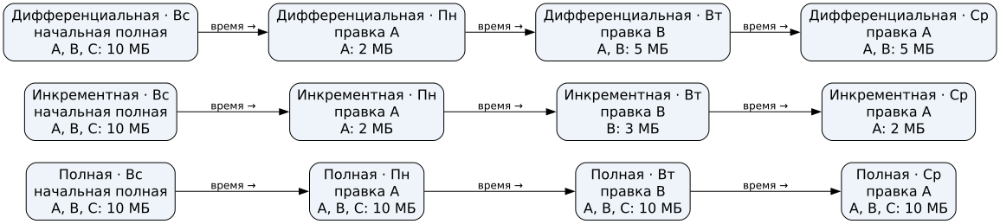
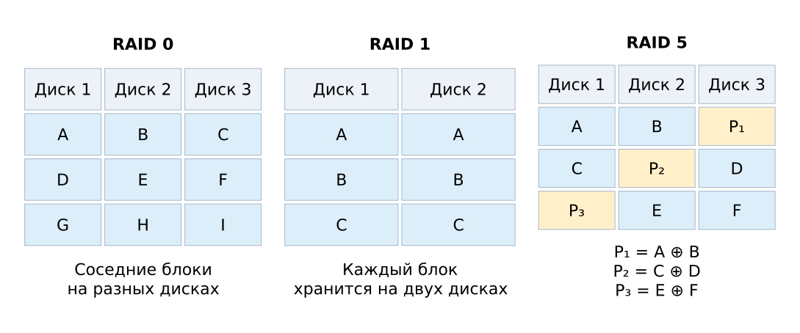

# Целостность данных {#sec-theory-data-integrity}

Целостность означает сохранение данных от несанкционированного изменения и уничтожения. Проверка может обнаружить изменение, но само обнаружение ещё не возвращает прежнюю версию: для восстановления нужна сохранённая копия.


{#fig-integrity-sum-hash fig-alt="Два способа получить контрольное значение данных"}

## Сумма и хеш

Простая сумма байтов позволяет обнаружить некоторые ошибки. Для `[10,20,30]` и `[20,10,30]` она одинакова: 60. Разные данные могут дать один результат; перестановка уже служит примером такой коллизии. Криптографический хеш предназначен в том числе для проверки изменений. Требования к нему и различие прообраза, второго прообраза и коллизии разобраны в @sec-theory-crypto-hash. Сравнение имеет смысл только с **доверенным эталоном**.

Пусть сайт опубликовал файл `F` и `H(F)`. Если атакующий заменит оба на `G` и `H(G)`, проверка совпадёт, хотя происхождение `G` не установлено. Здесь никто не подбирал коллизию: эталон сам оказался подменён. Поэтому доверие к эталону устанавливают независимо от канала, в котором файл мог быть изменён.


```{ojs}
//| echo: false
//| label: fig-integrity-sum-collision
//| fig-cap: "Коллизия простой суммы"
integrityLesson = await import(await FileAttachment("/_prepared/visualizations/data-integrity/lesson.js").url())
integrityLesson.sumCollision()
```

```{ojs}
//| echo: false
//| label: fig-integrity-byte-change
//| fig-cap: "Изменение байта и результат проверки"
integrityLesson.byteChange()
```

```{ojs}
//| echo: false
//| label: fig-integrity-reference
//| fig-cap: "Замена файла и эталона"
integrityLesson.referenceReplacement()
```

## Полная, инкрементная и дифференциальная копии

Для сравнения считаем, что копируются целые файлы постоянного размера: `A = 2`, `B = 3`, `C = 5` МБ. Добавлений, удалений, сжатия и дедупликации нет. В воскресенье сохранена полная копия; в понедельник изменён A, во вторник B, в среду снова A. Копия создаётся каждый день после изменений.

| День | Полная | Инкрементная | Дифференциальная |
|---|---|---|---|
| Воскресенье | A, B, C: 10 МБ | начальная полная: 10 МБ | начальная полная: 10 МБ |
| Понедельник | A, B, C: 10 МБ | A: 2 МБ | A: 2 МБ |
| Вторник | A, B, C: 10 МБ | B: 3 МБ | A, B: 5 МБ |
| Среда | A, B, C: 10 МБ | A: 2 МБ | A, B: 5 МБ |

Полная копия содержит все три файла. Инкрементная содержит изменённое с предыдущей копии; дифференциальная — изменённое с последней полной. Повторная правка A не добавляет второй экземпляр A в дифференциальную копию среды: в ней хранится актуальный файл A.

Для восстановления состояния среды из заданной инкрементной цепочки нужны воскресная полная и все три последующих инкремента по порядку. Для дифференциальной схемы нужны воскресная полная и дифференциальная копия среды. Это объёмы отдельных копий, а не всего хранилища. Другие единицы копирования или форматы могут дать другие объёмы и зависимости. Копию необходимо проверять восстановлением и хранить независимо от основного набора данных.


{#fig-integrity-copy-scales fig-alt="Сравнение объёмов полной, инкрементной и дифференциальной копий"}

## RAID и восстановление блока

RAID объединяет диски для распределения данных или избыточности. Ниже предполагаются исправные оставшиеся диски и метаданные; служебными расходами пренебрегаем.

| Массив | Размещение | Диски по 2 ТБ | Полезная ёмкость | Один отказ |
|---|---|---:|---:|---|
| RAID 0 | Чередование блоков | 3 | 6 ТБ | Весь набор недоступен |
| RAID 1 | Зеркало | 2 | 2 ТБ | Чтение с исправного диска возможно |
| RAID 5 | Блоки данных и распределённая чётность | 3 | 4 ТБ | Данные можно восстановить из оставшихся блоков |


{#fig-integrity-raid fig-alt="Распределение данных и чётности по дискам"}

Для упрощённой полосы RAID 5 пусть `P = A XOR B`, `A = 1010`, `P = 0110`. При потере B получаем `B = A XOR P = 1100`. Если потеряны оба блока данных, одного P недостаточно: например, пары `0000, 0110` и `1010, 1100` дают один и тот же P. Пример предполагает известный отсутствующий блок и исправные остальные; он не обнаруживает автоматически произвольную скрытую ошибку.


```{ojs}
//| echo: false
//| label: fig-integrity-xor
//| fig-cap: "Восстановление одного блока по XOR"
integrityLesson.xorRecovery()
```

RAID 1 помогает пережить отказ одного диска, но обычное удаление файла отражается на обоих дисках. Если последняя независимая копия сохранена в воскресенье в 23:00, из неё можно вернуть именно воскресную версию. Изменения после копии без других сохранённых версий восстановить неоткуда. RAID и резервная копия защищают от разных событий.
