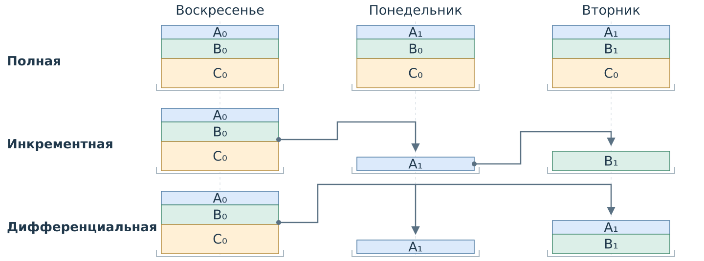

# Резервное копирование {#sec-theory-backups}

Проверка обнаруживает изменение, но не возвращает прежнюю версию. Для восстановления после удаления, ошибочной правки или отказа носителя нужны сохранённые данные. Проверка целостности и доверенный эталон рассмотрены в @sec-theory-integrity-verification.

## Резервное копирование

::: {#def-backup name="Резервная копия"}
**Резервная копия** — сохранённая копия данных, предназначенная для их восстановления после потери или повреждения рабочего экземпляра.
:::

Копия представляет данные на определённый момент. Если после её создания файл изменился, вернуть только по ней можно сохранённую версию, а не последующие изменения. Копию размещают независимо от рабочего экземпляра: отказ или удаление рабочего файла не должны уничтожать и её. Доступность нужных данных проверяют пробным восстановлением, а не только сообщением об успешном копировании.

::: {#def-full-backup name="Полная копия"}
**Полная копия** содержит весь выбранный набор данных на момент копирования.
:::

::: {#def-incremental-backup name="Инкрементная копия"}
**Инкрементная копия** содержит данные, изменившиеся после предыдущей копии.
:::

::: {#def-differential-backup name="Дифференциальная копия"}
**Дифференциальная копия** содержит данные, изменившиеся после последней полной копии.
:::

Рассмотрим папку из целых файлов A, B и C размером 2, 3 и 5 МБ. В воскресенье создают полную копию, затем ежедневно после правки — копию выбранного вида. Индекс обозначает версию; жирным выделено изменение за день.

| День | A | B | C |
|---|---|---|---|
| Воскресенье | A₀ | B₀ | C₀ |
| Понедельник | **A₁** | B₀ | C₀ |
| Вторник | A₁ | **B₁** | C₀ |
| Среда | **A₂** | B₁ | C₀ |

| Копия | Полная | Инкрементная | Дифференциальная |
|---|---|---|---|
| Воскресенье | A₀, B₀, C₀ — 10 МБ | A₀, B₀, C₀ — 10 МБ | A₀, B₀, C₀ — 10 МБ |
| Понедельник | A₁, B₀, C₀ — 10 МБ | A₁ — 2 МБ | A₁ — 2 МБ |
| Вторник | A₁, B₁, C₀ — 10 МБ | B₁ — 3 МБ | A₁, B₁ — 5 МБ |
| Среда | A₂, B₁, C₀ — 10 МБ | A₂ — 2 МБ | A₂, B₁ — 5 МБ |

На @fig-backup-types показаны первые три дня этой истории. Каждый столбец —
отдельная копия. В полной схеме вся папка сохраняется заново. В инкрементной
во вторник сохранена только B₁; в дифференциальной — и B₁, и изменённая ранее A₁.
Стрелки связывают копию с той, после которой отсчитываются изменения.

{#fig-backup-types fig-alt="По горизонтали воскресенье, понедельник и вторник. Полные копии каждый раз содержат все три файла. Инкрементная понедельника содержит A₁, вторника — B₁. Дифференциальная понедельника содержит A₁, вторника — A₁ и B₁. Показан отсчёт изменений от предыдущей копии в инкрементной схеме и от воскресной полной в дифференциальной."}

Дифференциальная копия среды содержит текущие версии обоих файлов, изменённых после полной копии. Хотя A правили дважды, в неё входит только A₂. Таблица показывает объём каждой копии, а не сумму объёмов хранилища.

## Восстановление версий

::: {#def-recovery-target name="Цель восстановления"}
**Цель восстановления** — требуемое состояние данных, определённое набором нужных версий или моментом времени.
:::

Пусть из каждой копии выше можно извлечь отдельный целый файл. Для состояния среды A₂, B₁, C₀ при инкрементной схеме нужны A₂ из среды, B₁ из вторника и C₀ из воскресенья. Копия понедельника с A₁ для этой цели не нужна. Но для состояния вторника требуется именно A₁: более поздняя A₂ её не заменяет. При дифференциальной схеме те же версии среды находятся в копиях воскресенья и среды. Выбор зависит от содержимого доступных копий и требуемых версий.

Это модель независимого извлечения целых файлов. В конкретном ПО восстановление может зависеть от формата и последовательности операций. Например, для восстановления базы SQL Server применяют полную копию, соответствующую дифференциальную копию и, если нужно, копии журнала в соответствии с выбранной стратегией. См. [описание резервного копирования и восстановления SQL Server](https://learn.microsoft.com/en-us/sql/relational-databases/backup-restore/back-up-and-restore-of-sql-server-databases?view=sql-server-ver17).
