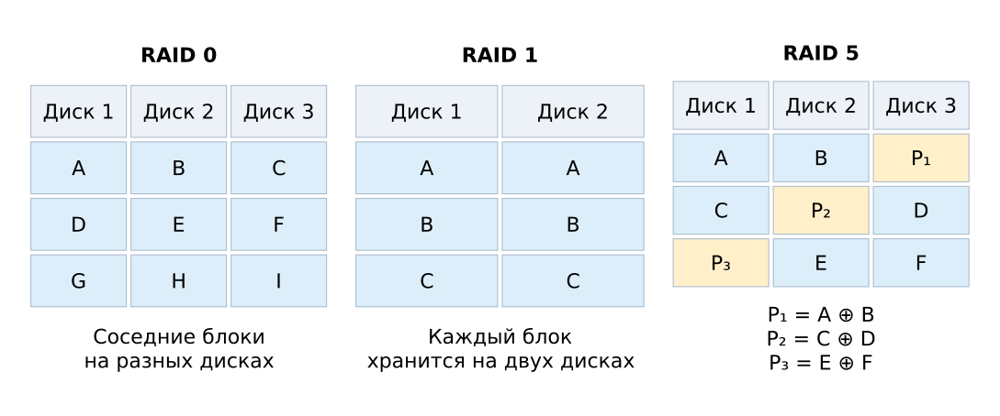

# Дисковые массивы {#sec-theory-raid}

::: {#def-raid name="RAID"}
**RAID** объединяет несколько дисков в массив, распределяя блоки данных между ними; некоторые уровни используют избыточность для сохранения доступа при отказе диска.
:::

Сравним массивы при полном обнаруженном отказе одного диска: остальные диски исправны, а ёмкости дисков одинаковы. Данные разбиваются на блоки; чётность позволяет вычислить недостающий блок по остальным.

| Массив | Размещение | Диски по 2 ТБ | Полезная ёмкость | Один отказ |
|---|---|---:|---:|---|
| RAID 0 | Чередование блоков | 3 | 6 ТБ | Весь набор недоступен |
| RAID 1 | Зеркало | 2 | 2 ТБ | Данные доступны с другого диска |
| RAID 5 | Данные и распределённая чётность | 3 | 4 ТБ | Данные восстанавливаются из оставшихся блоков |

{#fig-integrity-raid fig-alt="Распределение блоков данных и чётности по дискам"}

Для двух блоков данных A и B контрольный блок может быть вычислен как $P=A\oplus B$, где $\oplus$ — побитовый XOR. Если утрачен B, то $B=A\oplus P$. Например, при $A=\mathtt{1010}$ и $P=\mathtt{0110}$ получаем $B=\mathtt{1100}$. Одного P недостаточно для восстановления обоих неизвестных блоков: разные пары A и B могут дать одинаковый результат. Описание уровней и модели отказа приведено в [OSTEP, глава 38](https://pages.cs.wisc.edu/~remzi/OSTEP/file-raid.pdf).

Зеркало отражает текущее состояние: запись и удаление распространяются на оба диска. Оно помогает при отказе одного диска, но самостоятельно не сохраняет историю правок. Независимая резервная копия (@def-backup) позволяет вернуть сохранённую версию; изменения после неё потребуют другого источника.
