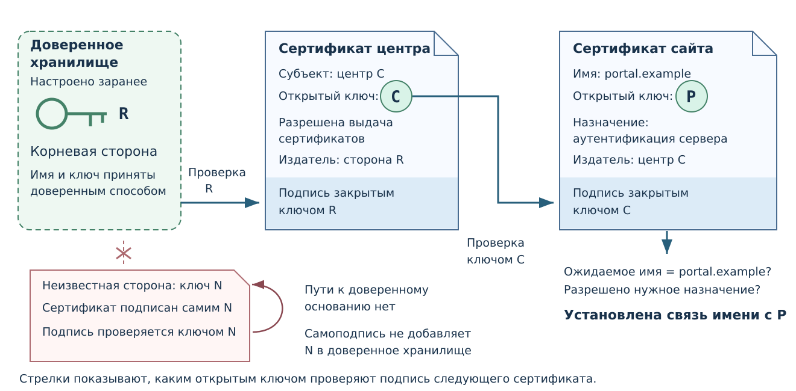

# Сертификаты открытого ключа {#sec-theory-certificates}

Проверка [цифровой подписи](../crypto/digital-signature.qmd#def-trust-digital-signature)
требует открытого ключа подписавшего. Сертификат позволяет проверить
связь ключа с именем владельца, опираясь на заранее принятую
удостоверяющую сторону. При открытии сайта браузер использует такую
связь, чтобы проверить, что соединение устанавливается с нужным сайтом.

## Принадлежность ключа {#sec-theory-signature-key-owner}

Успех проверки устанавливает соответствие подписи данным и открытому
ключу. Чтобы назвать издателя, нужно знать, что ключ принадлежит ему.
Если получить файл, подпись и неизвестный ключ из одного подменённого
пакета, нарушитель может подготовить все три части своей парой ключей.

Ключ или его контрольное значение можно получить заранее доверенным
способом. Для большого числа сайтов и издателей используют сертификаты.

## Устройство сертификата {#sec-theory-public-key-certificate}

::: {#def-trust-public-key-certificate name="Сертификат открытого ключа"}
Сертификат открытого ключа — подписанный удостоверяющей стороной документ,
который связывает имя субъекта с его открытым ключом и условиями применения.
Его подпись проверяют открытым ключом выдавшей стороны.
:::

Знакомый случай — открытие сайта по HTTPS. В адресной строке указан
нужный сайт, а браузер должен проверить связь этого имени с ключом,
используемым при установлении защищённого соединения.
Сертификат сервера предоставляет такую связь. Само соединение требует
также, чтобы сервер подтвердил владение соответствующим закрытым ключом.

Рассмотрим учебный адрес `https://portal.example`.
Имя `portal.example` здесь придумано для примера. Сертификат предъявленного
сайта должен подходить именно для этого ожидаемого имени и для
аутентификации сервера. Правильный сертификат другого сайта не заменяет
эту проверку. Сертификат также не свидетельствует об истинности
всех текстов на страницах.

## Цепочка сертификатов {#sec-theory-certificate-chain}

::: {#def-trust-anchor name="Доверенное основание"}
Доверенное основание — заранее принятые системой сведения об
удостоверяющей стороне и её открытом ключе, с которых начинается
проверка цепочки сертификатов.
:::

У браузера есть доверенное хранилище: список принятых корневых
удостоверяющих сторон. Оно поставляется с браузером или используется
из операционной системы; его состав также может задавать организация.
Полученный от сайта неизвестный корневой сертификат сам по себе
в этот список не попадает.

В учебном примере в хранилище заранее принят корневой ключ $R$.
Сайт предъявляет сертификат своего ключа $P$ и сертификат
промежуточного центра $C$.

| Проверяемый документ | Что он связывает | Каким ключом проверяют подпись |
|---|---|---|
| Сертификат промежуточного центра | Центр с ключом $C$; ему разрешена выдача сертификатов | Доверенным корневым ключом $R$ |
| Сертификат сайта | Имя `portal.example` с ключом $P$ | Проверенным ключом центра $C$ |

Проверка начинается с известного $R$. По нему проверяют сертификат центра,
затем ключом $C$ — сертификат сайта. Проверяются подписи и разрешённые
назначения; имя конечного сертификата сопоставляется с `portal.example`
из адреса. Так возникает проверенная связь между именем сайта и ключом $P$.

{#fig-trust-certificate-chain fig-alt="В доверенном хранилище заранее принят корневой ключ R. Он проверяет сертификат центра C, которому разрешена выдача сертификатов. Ключ C проверяет сертификат сайта portal.example с ключом P. Неизвестная самоподписанная сторона N не имеет пути к доверенному основанию."}

Самоподпись неизвестного корневого сертификата не даёт основания доверять
ему. Доверие к исходному ключу устанавливается отдельно от полученной
цепочки. Сертификат также может быть **отозван**, например после раскрытия
закрытого ключа. При проверке учитывают сведения об отзыве по правилам
приложения.

## Просмотр сертификата сайта {#sec-theory-certificate-browser}

В окне сертификата открытого HTTPS-сайта можно сопоставить поля с
рассмотренной цепочкой:

1. В `Subject Alternative Name` найти имя, подходящее ожидаемому адресу сайта.
2. В конечном сертификате найти открытый ключ сайта и издателя сертификата.
3. В пути сертификации проследить издателей до основания, которому доверяет
   данная установка браузера или операционной системы.

Порядок сертификатов в окне может быть обратным ходу проверки. Ключ
субъекта находится в его сертификате, а подпись этого сертификата проверяют
ключом выдавшей стороны. Настройки доверия принадлежат проверяющей системе;
получение корневого сертификата от сайта само по себе их не меняет.

## Источники

Связь имени с ключом объясняет
[The Structure of Secure Systems, § 7.4](https://securitybook.eecs.berkeley.edu/chapters/lec07.html#certificates).
Правила цепочек и отзыва определены в
[RFC 5280, §§ 3.2–3.3, 6.1](https://www.rfc-editor.org/rfc/rfc5280.html#section-6.1).
Применение доверенного хранилища показывает
[документация Firefox](https://firefox-admin-docs.mozilla.org/reference/policies/certificates/);
подтверждение владения закрытым ключом сервера описано в
[RFC 8446, § 4.4.3](https://www.rfc-editor.org/rfc/rfc8446.html#section-4.4.3).
