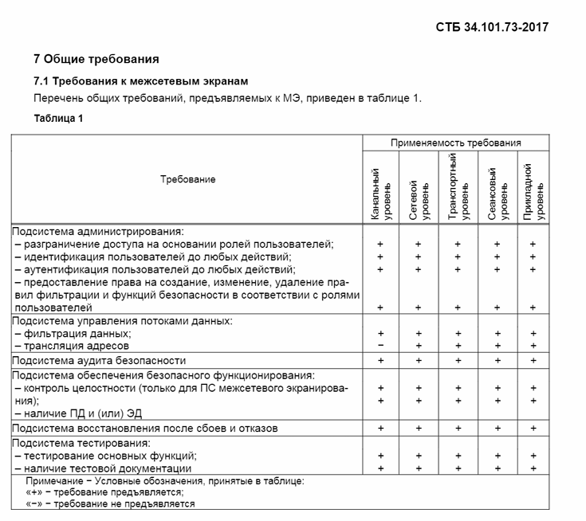
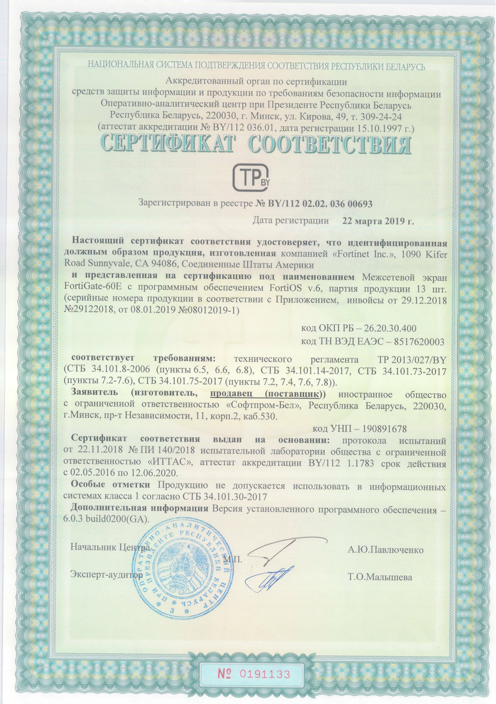

# Нормативные требования {#sec-theory-legal-standards}

В сфере информационной безопасности одновременно действуют документы разного назначения.

**Закон** может закреплять общую обязанность защищать информацию: определять, какую информацию необходимо защищать и какие общие требования предъявляются к её защите.

**Указ** может устанавливать особый режим или распределять полномочия между организациями и регулирующими органами. Например, Указ № 40 описывает национальную систему обеспечения кибербезопасности: НЦКБ в составе ОАЦ, аттестованные ЦКБ, государственные органы и другие организации. Приказ уполномоченного органа конкретизирует порядок выполнения требований. Так, приказ ОАЦ № 130 устанавливает требования в рамках системы, предусмотренной Указом № 40. Указ № 196 определяет правовые и организационные основы технической и криптографической защиты информации, а приказ ОАЦ № 66 предъявляет конкретные требования к системам соответствующих классов.

Технический регламент задаёт обязательные требования в пределах своей области применения (существуют технические регламенты на все что угодно, например Единицы величин, допущенные к применению на территории Республики Беларусь, Минеральные удобрения, О безопасности упакованной питьевой воды, включая природную минеральную воду) – этот документ на уровне закона. Он говорит о том, как и кто проверяет это на соответствие, а конкретизируют требования техрегламентов **Стандарты и ГОСТы**.

Не стоит путать их с международными стандартами в области ИБ, в частности, **СТБ ISO/IEC 27001** (полное название в актуальной редакции – *«Информационные технологии. Методы обеспечения безопасности. Системы менеджмента информационной безопасности. Требования»*) – это **стандарт по управлению информационной безопасностью организации**. Он определяет требования к **СМИБ — системе менеджмента информационной безопасности**.

## Обязательность стандартов {#sec-theory-legal-standard-obligation}

Международный стандарт не становится обязательным для всех белорусских организаций только потому, что он известен или широко применяется.

В частности, обязательность может возникать для финтех-сектора и банков (Национальный банк Республики Беларусь и отраслевые регуляторы требуют обязательного внедрения и периодического аудита СМИБ), при работе с зарубежными организациями.

Организация также может принять на себя обязательство соответствовать стандарту, например заявив об этом в документации, договоре или коммерческом предложении.

## Применение нормативных документов {#sec-theory-legal-regulatory-map}

Ниже представлена краткая сводка документов РБ в сфере защиты информации с практическими вопросами, которые они регулируют.

| Документ | Практический вопрос, с которым он связан |
| --- | --- |
| Закон Республики Беларусь № 455-З «Об информации, информатизации и защите информации» | Какие общие требования установлены к защите информации и когда требуется аттестованная СЗИ? Аттестация СЗИ: @sec-theory-legal-attestation. |
| Закон Республики Беларусь № 99-З «О защите персональных данных» | На каком основании обрабатываются персональные данные, какие права есть у субъекта и какие обязанности возникают у оператора? Место персональных данных среди категорий информации: @sec-theory-legal-information-law. |
| Указ Президента № 40 «О кибербезопасности» | Как организована национальная система обеспечения кибербезопасности и как распределены её основные функции? См. @sec-theory-security-center-national-system. |
| Указ Президента № 196 «О некоторых мерах по совершенствованию защиты информации» | Какие специальные требования связаны с технической и криптографической защитой информации и КВОИ? КВОИ и порядок отнесения: @sec-theory-legal-critical-information. |
| Приказ ОАЦ № 66 от 20.02.2020 в действующей редакции | Какие требования и процедуры применяются к технической и криптографической защите и аттестации СЗИ соответствующих информационных систем, создании СИБ для КВОИ? Создание СЗИ и отличие от СИБ: @sec-theory-legal-protection-system. |
| Приказ ОАЦ № 130 от 25.07.2023 в редакции приказа № 98 от 27.05.2026 | Какие конкретные требования по кибербезопасности установлены для объектов информационной инфраструктуры, как организуется работа ЦКБ и взаимодействие при киберинцидентах? Назначение приказа и связь с Указом № 40: @sec-theory-security-center-requirements. |
| ТР 2013/027/BY «Информационные технологии. Средства защиты информации. Информационная безопасность» | Какие требования и процедуры подтверждения соответствия могут применяться к средствам защиты информации? См. @sec-theory-legal-protection-tools. |
| СТБ ISO/IEC 27001 | Как строится система менеджмента информационной безопасности и как организация управляет рисками и улучшением системы? Оценка риска: @sec-theory-risk-assessment. Основания обязательности: @sec-theory-legal-standard-obligation. |

## Создание системы защиты информации {#sec-theory-legal-protection-system}

::: {#def-protection-system name="Система защиты информации"}

Система защиты информации (СЗИ) – совокупность мер, реализованных в информационной системе для защиты обрабатываемой информации.

:::

В частности, статья 28 Закона № 455-З устанавливает, что информация, распространение и (или) предоставление которой ограничено и которая не относится к государственным секретам, должна обрабатываться в информационных системах с применением СЗИ, аттестованной в установленном порядке, с учётом предусмотренных законодательством условий и исключений.

Для критически важных объектов информатизации (КВОИ) действуют иные требования к обеспечению защиты, для них создается **Система информационной безопасности,** она включает организационные и технические меры, распределение ответственности, управление рисками, оценку защищённости, аудит, мониторинг и реагирование в пределах применимых требований.

***Иными словами – СЗИ создается для ИС классов 3-4, а СИБ для КВОИ.***

Классы информационных систем и КВОИ (@def-critical-information-object) разобраны в @sec-theory-legal-system-classes; категории доступа к информации — в @sec-theory-legal-information-access.

Практическое правило: сначала определяют объект защиты и применимые требования, затем выбирают меры и средства, после чего устанавливают, каким способом требуется подтвердить соответствие.

Виды мер защиты разобраны в @sec-theory-legal-protection-measures. Для выполнения технических мер применяют средства защиты информации.

## Подтверждение соответствия средств защиты {#sec-theory-legal-protection-tools}

::: {#def-information-protection-tools name="Средства защиты информации"}

*Средства защиты информации – технические, программные, программно-аппаратные средства, предназначенные для защиты информации, а также средства контроля эффективности ее защищенности.*

:::

К ним относятся те устройства и программы, основная цель которых – защита информации, а также те, на которые есть стандарт в соответствии с Техническим регламентом ТР 2013/027/BY Информационные технологии. Средства защиты информации. Информационная безопасность – его основная задача заключается в **обязательной проверке надежности всех средств защиты информации (СрЗИ)** перед тем, как они попадут на рынок Республики Беларусь.

Предположим, что завод Интеграл начал выпускать белорусские межсетевые экраны «Брама», но для приобретения и использования в информационной системе они должны быть сертифицированы в соответствии с этим Техрегламентом. Конкретные критерии и методики оценки СрЗИ представлены в **стандартах (СТБ 34.101.ХХ)**. Выполнение требований государственных стандартов, взаимосвязанных с техрегламентом, автоматически означает, средство защиты информации (СЗИ) соответствует и самому техрегламенту.

Завод разрабатывает и собирает все необходимые документы по эксплуатации этого МЭ и вместе с самим продуктом передает в аккредитованную лабораторию для проведения испытаний.

{#fig-standards-risk-protection-product-requirements fig-alt="Таблица требований к средству защиты информации"}

При испытаниях проверяют выполнение требований, приведённых на @fig-standards-risk-protection-product-requirements, а также иных требований стандарта. При подтверждении соответствия средству защиты выдают сертификат соответствия.

Аналогичная ситуация происходит при ввозе в РБ средств защиты информации и необходимости их использования.

Закупка, установка и настройка сертифицированных СрЗИ не является достаточным для создания системы защиты информации, не стоит забывать о внедрении иных организационных и технических мер в соответствии с требованиями приказа ОАЦ № 66. В основе всего лежит *комплексный* подход.

{#fig-standards-risk-protection-product-certificate fig-alt="Сертификат соответствия средства защиты информации"}
