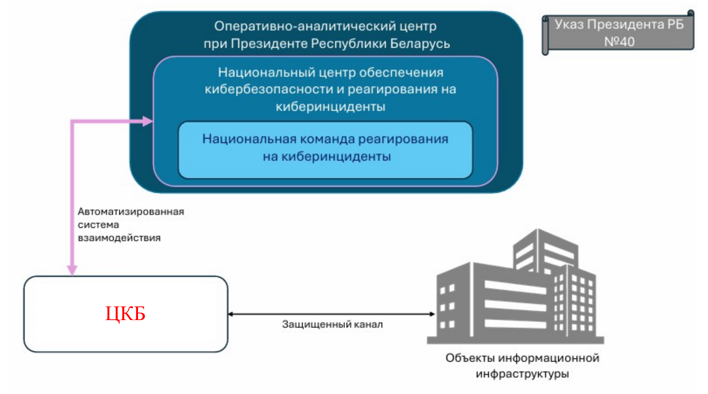

# Информационная безопасность и кибербезопасность: в чём разница? {#sec-theory-security-center-organization}

До этого момента мы говорили о защите информации в целом. Но почему в законодательстве отдельно выделяется кибербезопасность и почему для неё создана специальная национальная система?

Информационная безопасность рассматривает защиту информации независимо от того, в какой форме она существует. Информация может храниться в базе данных, находиться в электронном письме или быть распечатана на бумаге. Важно обеспечить установленный режим доступа, целостность, подлинность, доступность и сохранность.

Кибербезопасность – набор практик по защите объектов информационной инфраструктуры от кибератак, предотвращении и минимизации последствий таких атак и киберинцидентов.

Отделы информационной безопасности организаций занимаются контролем и реализацией указанных выше мер, вопросами соответствия организации требованиям национального законодательства и международным стандартам. Центры кибербезопасности решают несколько иную задачу, они следят за активностью на объектах информационной инфраструктуры, выявляют киберинциденты, проводят расследования и реагирование на киберинциденты.

В Беларуси существует национальная система кибербезопасности, предусмотренная Указом Президента Республики Беларусь № 40 от 14 февраля 2023 г. «О кибербезопасности».

В числе её задач названы координация действий по обнаружению и предотвращению кибератак, минимизация последствий атак, поиск потенциальных уязвимостей, анализ инцидентов и их причин, оценка защищённости объектов информационной инфраструктуры.

Логика документа проста: если отдельная организация сталкивается с кибератакой, важно не только устранить конкретную проблему, но и обеспечить единый универсальный порядок действий, обмен необходимой информацией и использование результатов анализа для предотвращения подобных случаев.

Иными словами, центров кибербезопасности много, а регулятор один, важно, чтобы взаимодействие происходило однообразно и оперативно, по единым правилам.

В систему входят следующие элементы:

ОАЦ – Оперативно-аналитический центр при Президенте Республики Беларусь. Он выполняет координирующую роль, определяет требования по кибербезопасности объектов информационной инфраструктуры и порядок информационного взаимодействия элементов системы.

НЦКБ – Национальный центр обеспечения кибербезопасности и реагирования на киберинциденты. Он создан внутри ОАЦ и участвует в обнаружении и анализе кибератак и киберинцидентов, взаимодействует с центрами кибербезопасности и координирует реагирование.

CERT.BY – национальная команда реагирования на киберинциденты в составе Национального центра кибербезопасности.

ЦКБ – центры обеспечения кибербезопасности и реагирования на киберинциденты объектов информационной инфраструктуры государственных органов и иных организаций. Они работают на уровне соответствующих организаций и объектов, участвуют в обнаружении инцидентов и реагировании на них.

Объекты информационной инфраструктуры (ОИИ) – объекты, на которых необходимо обеспечивать кибербезопасность.

{#fig-security-center-national-system}

Указ № 40 определяет национальную систему кибербезопасности и распределение основных функций между ее элементами. Приказ ОАЦ от 25 июля 2023 г. № 130 «О мерах по реализации Указа Президента Республики Беларусь от 14 февраля 2023 г. № 40» конкретизирует порядок её работы, и говорит о том, как именно это должно работать.

В частности, приказ определяет состав технических параметров киберинцидента, требования к центрам кибербезопасности и их типовую структуру, требования по кибербезопасности объектов информационной инфраструктуры, а также порядок информационного взаимодействия и функционирования команд реагирования.

Таким образом, Указ № 40 отвечает на вопрос «кто входит в систему и какова её общая логика», а приказ № 130 раскрывает значительную часть практических требований: как устроен обмен информацией, как реагируют команды и какие требования предъявляются к объектам и центрам.

Данный процесс также регулирует государство. В условиях цифровизации экономики и бизнеса сильно возрастает риск кибератак на госорганы и другие организации, поэтому существует перечень организаций, которые должны создать свой ЦКБ или приобрести такие услуги (а у кого же? – ответ содержится в том же постановлении), определенный [постановлением совета министров № 264 «О центрах кибербезопасности»](https://www.oac.gov.by/public/content/files/files/law/resolutions-sm/2026-246.pdf).

Чтобы создать ЦКБ необходимо в первую очередь соответствие типовой структуре:

1. Руководитель центра. Организует работу центра, распределяет задачи, обеспечивает взаимодействие с Национальным центром кибербезопасности, контролирует подготовку сотрудников и организацию реагирования на киберинциденты.

2. Заместитель руководителя. Помогает руководителю координировать работу центра и обеспечивает непрерывность управления при его отсутствии. Должность вводится по решению организации.

3. Лица, ответственные за аудит кибербезопасности. Проверяют, насколько фактическая защита инфраструктуры соответствует установленным требованиям. Изучают состав активов, настройки средств защиты, локальные документы и организацию процессов безопасности. По итогам формируют выводы и рекомендации по устранению недостатков. Можно сказать, что данный отдел – это «маленький ОАЦ» внутри ЦКБ, они следят за тем, чтобы сам центр соответствовал требованиям, выявляют и подсвечивают недочеты в процессах работы, инициируют их корректировку.

4. Лица, ответственные за выявление киберинцидентов. Это первая линия, они осуществляют первичный анализ поступающих событий, определяют, указывают ли они на кибератаку или нарушение безопасности, оценивают инцидент и передают его на реагирование. Например, расследуют подозрительный вход в учётную запись или признаки несанкционированного доступа. Принимают обращения пользователей.

5. Лица, ответственные за сбор и обработку событий кибербезопасности. Это вторя линия, в их задача проведение расследований киберинцидентов и реагирование на них, они также осуществляют разработку правил корреляции, разработку детектирующей логики, донастройку внутренних сервисов и автоматизацию процессов.

6. Лица, ответственные за администрирование активов и средств защиты информации. Поддерживают работоспособность инфраструктуры центра и применяемых средств защиты. В рамках реагирования могут выполнять согласованные технические действия: блокировать учётные записи, изолировать узлы, менять настройки фильтрации, восстанавливать системы и устранять выявленные проблемы.

7. Лица, ответственные за анализ вредоносного программного обеспечения. Исследуют подозрительные файлы и программы, определяют их поведение, механизмы запуска и возможные последствия, выявляют признаки компрометации и передают результаты специалистам по выявлению инцидентов и реагированию.

8. Лица, ответственные за оценку защищённости от кибератак. Проверяют инфраструктуру на уязвимости и слабые места, в том числе с использованием сканеров уязвимостей и тестирования на проникновение. Результаты помогают определить, какие недостатки следует устранить в первую очередь.

ЦКБ может оказывать услуги только при наличии в штате лиц, указанных в п. 7 и 8, если он создан только внутри организации, то данные штатные единицы могут закрываться при помощи подрядных организаций.
