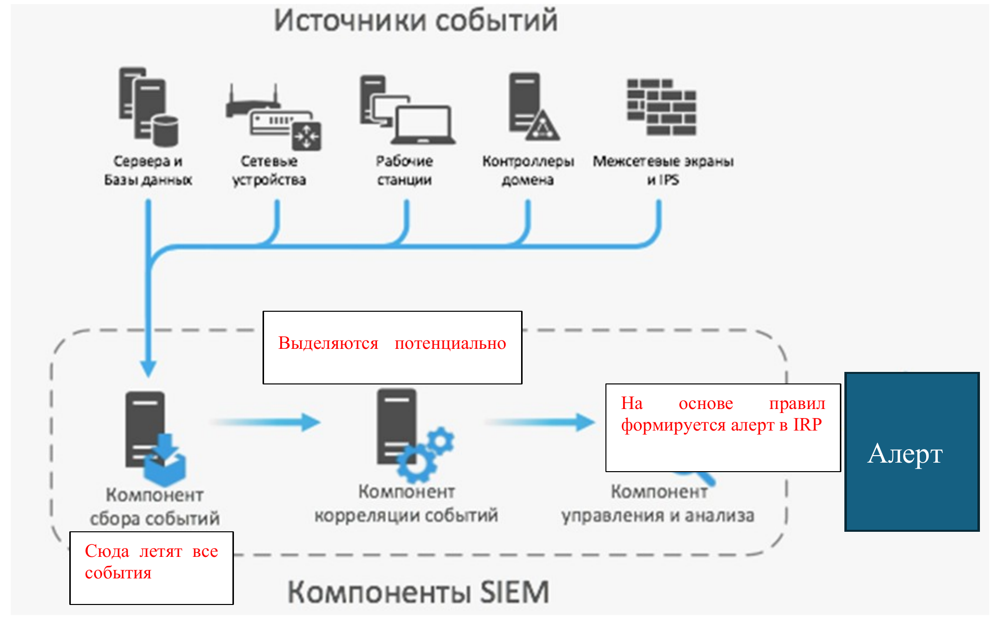
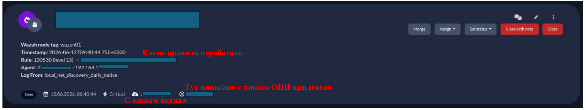

# Обобщенный процесс оказания услуги обеспечения кибербезопасности {#sec-theory-security-center-workflow}

Роли участников этого процесса разобраны в @sec-theory-security-center-roles, а его нормативная основа — в @sec-theory-security-center-requirements.

1. **Заключение договора.**

2. **Подключение объекта.** Работы выполняет группа администрирования ЦКБ:

    - настраивает сервер SIEM — систему сбора, обработки и хранения событий кибербезопасности;
    - строит защищённый канал передачи информации между ОИИ и ЦКБ;
    - подключает к серверу SIEM источники событий — активы объекта;
    - интегрирует уведомления SIEM с IRP — платформой реагирования на инциденты (Incident Response Platform), чтобы первая линия могла обрабатывать алерты.

    {#fig-security-center-siem-flow fig-alt="Схема передачи событий от источников объекта в SIEM и систему обработки инцидентов"}

    После подключения аналитики первой линии мониторинга видят алерты, приходящие с этого ОИИ.

3. **Согласование взаимодействия.** Параллельно подключению разрабатывают:

    - Регламент обеспечения кибербезопасности;
    - План мероприятий по реагированию на киберинциденты.

    Документы согласуют процесс взаимодействия ЦКБ с клиентом, в том числе основания предоставления сотрудникам ЦКБ удалённого доступа к инфраструктуре. Доступ предоставляют в пределах полномочий, описанных в регламенте.

4. **Мониторинг, анализ и реагирование.** После работ группы администрирования аналитики первой линии отдела обработки информации (L1 SOC) видят поступающие алерты:

    {#fig-security-center-incident-alert fig-alt="Пример уведомления о событии, которое анализирует первая линия мониторинга"}

    Дальнейшая обработка включает несколько действий:

    - **Анализ события.** Аналитики выясняют, где и что произошло. Причиной может быть как легитимная активность, так и киберинцидент. Поэтому важно различать событие (@def-security-event) и инцидент (@def-security-incident).
    - **Уточнение информации.** Если данных недостаточно, сотрудники ЦКБ обращаются к клиенту. Клиент также может сообщить о проблеме; аналитики проверяют события в SIEM и отвечают на обращение.
    - **Регистрация и расследование.** Выявленный киберинцидент регистрируют в IRP, проводят расследование и предоставляют клиенту результаты и инструкции по ликвидации последствий. IRP автоматизирует обработку инцидентов и реагирование на них.
    - **Обмен информацией.** Киберинциденты высокого и среднего уровня регистрируют в системе НЦКБ для обмена сведениями в рамках национальной системы кибербезопасности (@sec-theory-security-center-national-system).

## Технические средства ЦКБ {#sec-theory-security-center-tools}

ЦКБ должен иметь на праве собственности или ином законном основании:

- системы сбора, обработки и хранения событий кибербезопасности — для поступающих событий;
- платформы управления информацией о киберугрозах — для выявленных индикаторов компрометации;
- системы обработки сведений о киберинцидентах — для регистрации и обработки выявленных инцидентов;
- средства динамического анализа вредоносного программного обеспечения — например, песочницы;
- средства оценки эффективности защищённости ОИИ от кибератак — например, сканеры уязвимостей и инструменты тестирования на проникновение.

Наличие средств динамического анализа вредоносного ПО и оценки эффективности защищённости обязательно для центров, планирующих оказывать услуги по обеспечению кибербезопасности.

Регламенты, распределение ответственности и перечисленные средства дополняют друг друга: различие организационных и технических мер разобрано в @sec-theory-legal-protection-measures.
