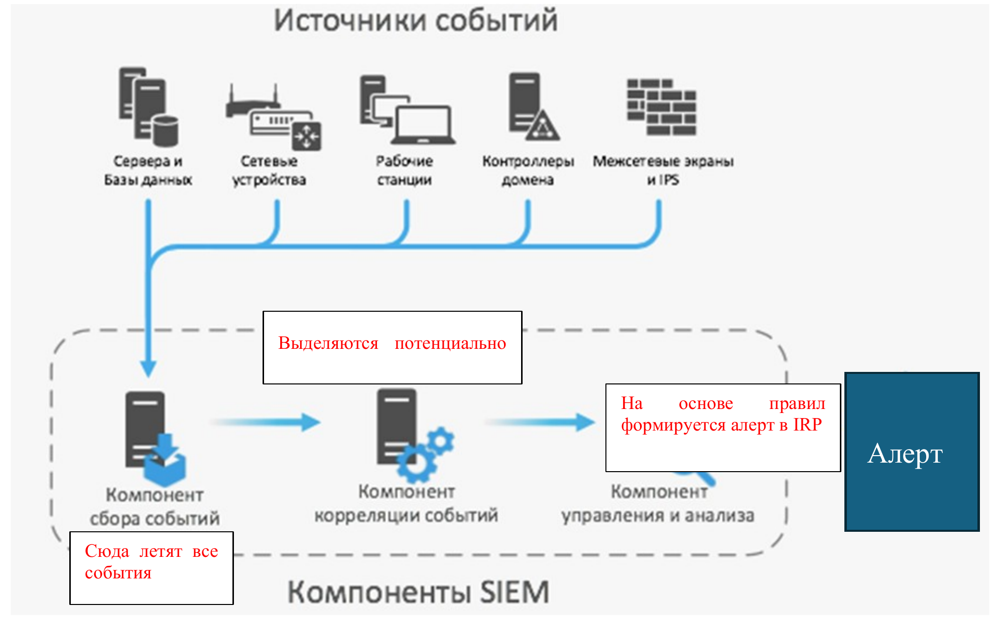
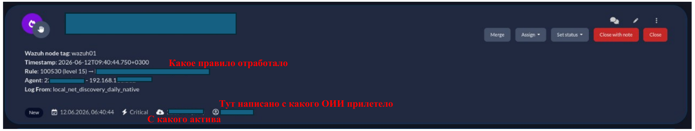

# Обобщенный процесс оказания услуги обеспечения кибербезопасности {#sec-theory-security-center-workflow}

1. Заключение договора.

2. Начинаются работы по подключению, этим занимается группа администрирования ЦКБ):

- настраивается сервер SIEM (системы сбора, обработки и хранения событий кибербезопасности), построение защищенного канала передачи информации между ОИИ и ЦКБ.

- К серверу SIEM подключаются источники, они же активы.

- Осуществляется интеграция уведомлений с SIEM-системы в IRP-систему ЦКБ для возможности реагирования первой линии на алерты.

{#fig-security-center-siem-flow}

- После того как все это выполнено, аналитики (1 линия мониторинга) видят алерты, приходящие с этого ОИИ.

3. Параллельно подключению разрабатывается Регламент обеспечения кибербезопасности и План мероприятий по реагированию на киберинциденты, это необходимо для согласования процесса взаимодействия ЦКБ с клиентом. Например выдачи доступа для удаленного подключения работников ЦКБ к инфраструктуре клиента. Разумно не пускать абы кого в свою систему, но если на то есть полномочия описанные в регламенте, доступ дать необходимо.

4. После того как проведены работы группой администрирования, 1 линия отдела обработки информации (aka аналитики, aka мониторинг, aka L1 SOC) видят алерты, вот так это выглядит:

{#fig-security-center-incident-alert}

Потом проводится детальный анализ, где и что произошло, это может быть как легитимная активность, так и инцидент.

В процессе обработки могут написать клиенту уточнить информацию, если самим выяснить конкретику не удается, либо если у клиентов что-то случилось они тоже пишут уточняют, а аналитики смотрят на SIEM и отвечают.

Если возникает киберинцидент, он регистрируется в IRP(Incident Response Platform, «платформа реагирования на инциденты») – это вид программных продуктов, предназначенных для автоматизации реагирования на киберинциденты., проводится расследование, клиенту предоставляются результаты расследования и инструкции по ликвидации последствий.

КИ высокого и среднего уровня регистрируются в системе НЦКБ, для обмена информацией в рамках национальной системы кибербезопасности.

Говоря о технических средствах, ЦКБ должен иметь на праве собственности или ином законном основании:

системы сбора, обработки и хранения событий кибербезопасности; - туда летят все события

платформы управления информацией о киберугрозах; - туда складываются выявленные индикаторы компрометации

системы обработки сведений о киберинцидентах; - туда регистрируются выявленные КИ

средств динамического анализа вредоносного программного обеспечения\*; - песочница

средств для оценки эффективности защищенности объектов информационной инфраструктуры от кибератак (далее – средства для оценки эффективности защищенности)\* - сканеры уязвимостей, тулзы для пентеста

\* Наличие средств динамического анализа вредоносного программного обеспечения и средств для оценки эффективности защищенности в обязательном порядке обеспечивают кибербезопасности, планирующие оказывать услуги по обеспечению кибербезопасности.
