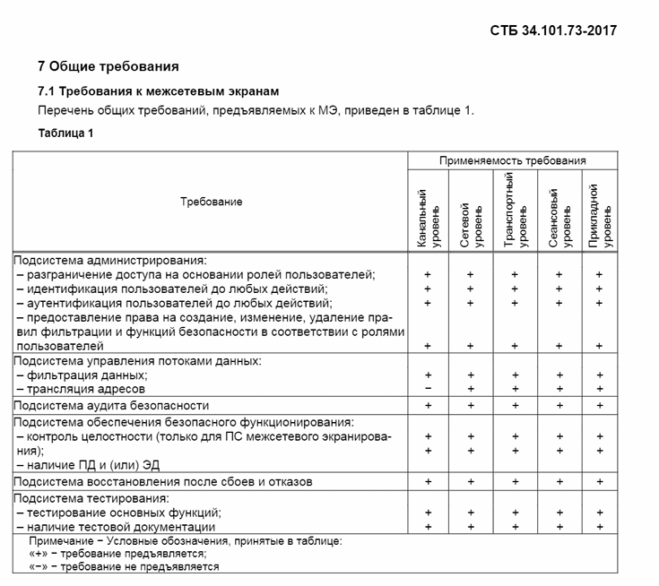
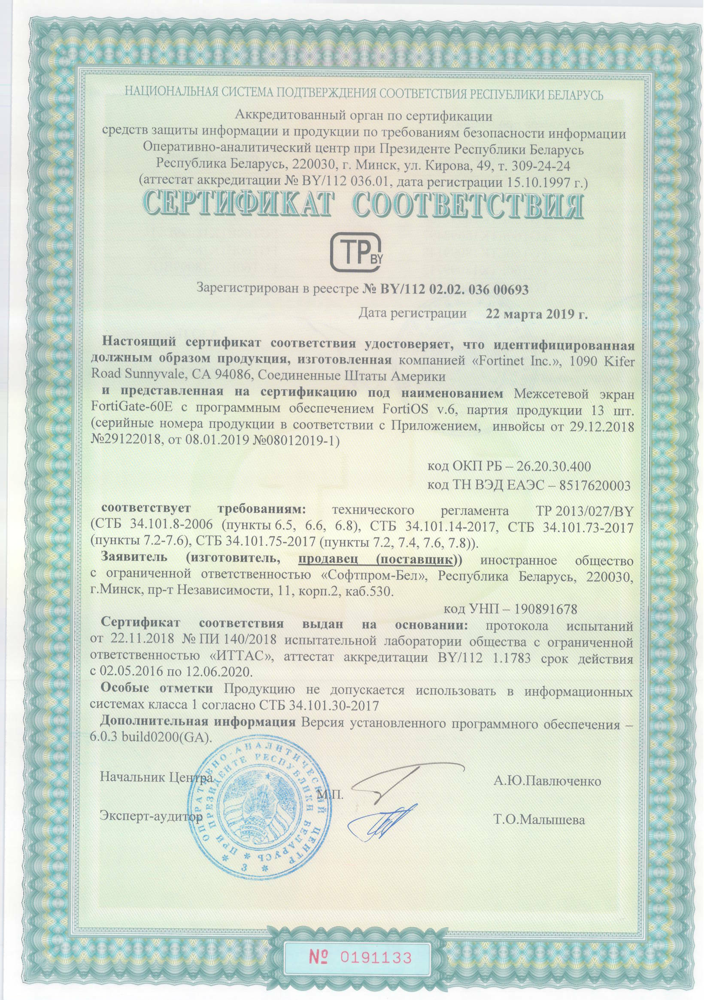

# Применение нормативно-правовых актов {#sec-theory-standards-risk-requirements-decisions}

В сфере информационной безопасности одновременно действуют документы разного назначения.

**Закон** может закреплять общую обязанность защищать информацию (какого вида и как) и содержит высокоуровневое описание данного процесса,

**указ** – устанавливает особый режим или распределяет полномочия между организациями и регулирующими органами (вспоминаем 40 указ, где описано взаимодействие: НЦКБ внутри ОАЦ – аттестованные ЦКБ – гос.органы и другие организации, то есть охватывается общая структура), приказ уполномоченного органа (**[а в нашем случае какого?]{.underline}**) – конкретизировать порядок выполнения требований (опять вспоминаем: 40 указ говорит нам о существовании национальной системы кибербезопасности, а 130 приказ ОАЦ – как именно она работает; 196 указ определяет правовые и организационные основы технической и криптографической защиты информации, а приказ ОАЦ № 66 предъявляет конкретные требования к системам соответствующих классов).

Технический регламент задаёт обязательные требования в пределах своей области применения (существуют технические регламенты на все что угодно, например Единицы величин, допущенные к применению на территории Республики Беларусь, Минеральные удобрения, О безопасности упакованной питьевой воды, включая природную минеральную воду) – этот документ на уровне закона. Он говорит о том, как и кто проверяет это на соответствие, а конкретизируют требования техрегламентов **Стандарты и ГОСТы**.

Не стоит путать их с международными стандартами в области ИБ, в частности, **СТБ ISO/IEC 27001** (полное название в актуальной редакции – *«Информационные технологии. Методы обеспечения безопасности. Системы менеджмента информационной безопасности. Требования»*) – это **главный мировой и национальный стандарт по управлению кибербезопасностью организации**. Этот стандарт заставляет организацию выстроить **СМИБ – Систему менеджмента информационной безопасности**.

## Когда [международный]{.underline} стандарт становится обязательным?

Международный стандарт не становится обязательным для всех белорусских организаций только потому, что он известен или широко применяется.

В частности, обязательность может возникать для финтех-сектора и банков (Национальный банк Республики Беларусь и отраслевые регуляторы требуют обязательного внедрения и периодического аудита СМИБ), при работе с зарубежными организациями.

Организация также может принять на себя обязательство соответствовать стандарту, например заявив об этом в документации, договоре или коммерческом предложении (те, кто будут приобретать услуги явно оценят наличие соответствия международному стандарту).

Ниже представлена краткая сводка документов РБ в сфере защиты информации с практическими вопросами, которые они регулируют.

| Документ | Практический вопрос, с которым он связан |
| --- | --- |
| Закон Республики Беларусь № 455-З «Об информации, информатизации и защите информации» | Какие общие требования установлены к защите информации и когда требуется аттестованная СЗИ? |
| Закон Республики Беларусь № 99-З «О защите персональных данных» | На каком основании обрабатываются персональные данные, какие права есть у субъекта и какие обязанности возникают у оператора? |
| Указ Президента № 40 «О кибербезопасности» | Как организована национальная система обеспечения кибербезопасности и как распределены её основные функции? |
| Указ Президента № 196 «О некоторых мерах по совершенствованию защиты информации» | Какие специальные требования связаны с технической и криптографической защитой информации и КВОИ? |
| Приказ ОАЦ № 66 от 20.02.2020 в действующей редакции | Какие требования и процедуры применяются к технической и криптографической защите и аттестации СЗИ соответствующих информационных систем, создании СИБ для КВОИ? |
| Приказ ОАЦ № 130 от 25.07.2023 в редакции приказа № 98 от 27.05.2026 | Какие конкретные требования по кибербезопасности установлены для объектов информационной инфраструктуры, как организуется работа ЦКБ и взаимодействие при киберинцидентах? |
| ТР 2013/027/BY «Информационные технологии. Средства защиты информации. Информационная безопасность» | Какие требования и процедуры подтверждения соответствия могут применяться к средствам защиты информации? |
| СТБ ISO/IEC 27001 | Как строится система менеджмента информационной безопасности и как организация управляет рисками и улучшением системы? |

## Создание системы защиты информации {#sec-theory-standards-risk-protection-system}

Система защиты информации (СЗИ) – совокупность мер, реализованных в информационной системе для защиты обрабатываемой информации. В частности, статья 28 Закона № 455-З устанавливает, что информация, распространение и (или) предоставление которой ограничено и которая не относится к государственным секретам, должна обрабатываться в информационных системах с применением СЗИ, аттестованной в установленном порядке, с учётом предусмотренных законодательством условий и исключений.

Для критически важных объектов информатизации (КВОИ) действуют иные требования к обеспечению защиты, для них создается **Система информационной безопасности,** она включает организационные и технические меры, распределение ответственности, управление рисками, оценку защищённости, аудит, мониторинг и реагирование в пределах применимых требований.

***Иными словами – СЗИ создается для ИС классов 3-4, а СИБ для КВОИ.***

Практическое правило: сначала определяют объект защиты и применимые требования, затем выбирают меры и средства, после чего устанавливают, каким способом требуется подтвердить соответствие.

А какие бывают меры? (назовите) Теперь стоит разобраться со средствами:

*Средства защиты информации – технические, программные, программно-аппаратные средства, предназначенные для защиты информации, а также средства контроля эффективности ее защищенности.*

К ним относятся те устройства и программы, основная цель которых – защита информации, а также те, на которые есть стандарт в соответствии с Техническим регламентом ТР 2013/027/BY Информационные технологии. Средства защиты информации. Информационная безопасность – его основная задача заключается в **обязательной проверке надежности всех средств защиты информации (СрЗИ)** перед тем, как они попадут на рынок Республики Беларусь.

Предположим, что завод Интеграл начал выпускать белорусские межсетевые экраны «Брама», но чтобы мы могли его себе прикупить и использовать в своей системе, они должны быть сертифицированы в соответствии с этим Техрегламентом. Конкретные критерии и методики оценки СрЗИ представлены в **стандартах (СТБ 34.101.ХХ)**. Выполнение требований государственных стандартов, взаимосвязанных с техрегламентом, автоматически означает, средство защиты информации (СЗИ) соответствует и самому техрегламенту.

Завод разрабатывает и собирает все необходимые документы по эксплуатации этого МЭ и вместе с самим продуктом передает в аккредитованную лабораторию для проведения испытаний.

::: {#fig-standards-risk-protection-product-requirements}

{fig-alt="Таблица требований к средству защиты информации"}

:::

Аудитор проверяет соответствие этого продукта согласно таблице выше, а также в соответствии с иными требованиями, приведенными в стандарте, если все реализовано, то данному средству защиты выдается сертификат соответствия:

Аналогичная ситуация происходит при ввозе в РБ средств защиты информации и необходимости их использования.

Закупка, установка и настройка сертифицированных СрЗИ не является достаточным для создания системы защиты информации, не стоит забывать о внедрении иных организационных и технических мер в соответствии с требованиями приказа ОАЦ № 66. В основе всего лежит *комплексный* подход.

::: {#fig-standards-risk-protection-product-certificate}

{fig-alt="Сертификат соответствия средства защиты информации"}

:::

## Риск – способ обосновать решение

В простейшей количественной модели риск оценивают через вероятность неблагоприятного события и размер ущерба, который возникнет при реализации сценария:

**R = p × L**

Здесь p – вероятность события за выбранный период, а L – ущерб при одном таком событии.

Если p – вероятность за год, а L выражен в деньгах, результат можно интерпретировать как ожидаемый годовой ущерб в рамках принятой модели. Это предупреждение, а не обещание, что организация потеряет именно такую сумму в конкретном году.

До и после введения меры можно сравнить ожидаемый ущерб, затем прибавить стоимость самой меры. Вероятность должна быть обоснована; ущерб может включать не только прямые расходы, но и простой, восстановление, расследование и другие последствия. А если требование прямо установлено законодательством, экономическая невыгодность меры сама по себе не даёт права его игнорировать.
